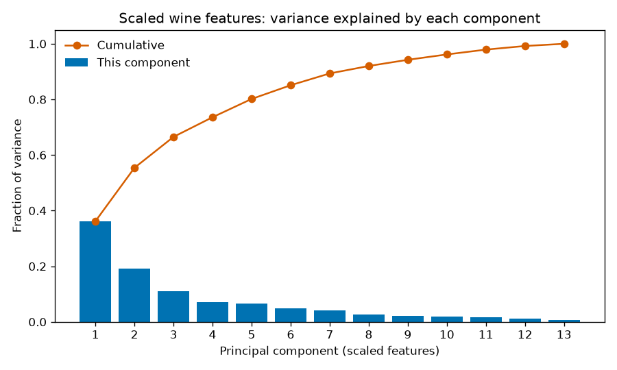
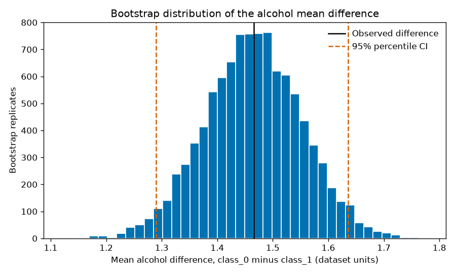
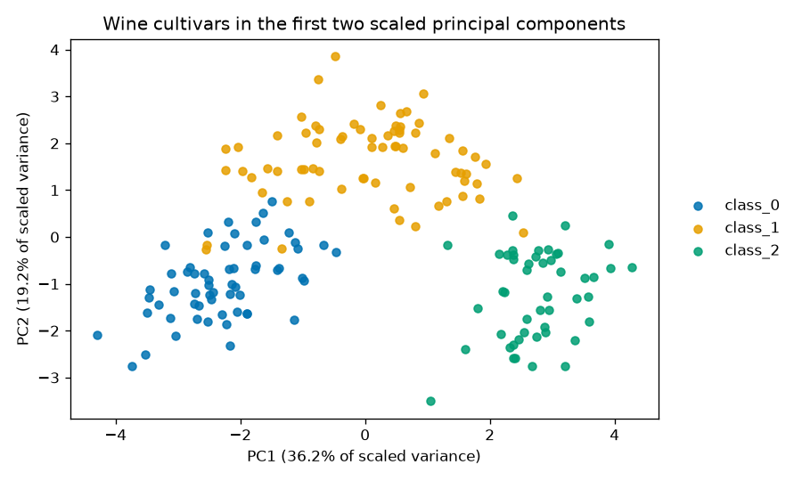

# Linear algebra, probability, and a gap that might be noise

A chemical table can look decisive before anyone has asked whether the pattern is a unit, a real difference, or the winner of thirteen looks. This project checks those three claims on the UCI wine measurements with NumPy, before any classifier is trained.

## Problem

A lab has 178 wines from three cultivars and 13 chemical measurements on each. Two sentences show up in the same meeting. The first: one direction explains almost all of the variation, so the measurements are redundant. The second: cultivar `class_0` has higher alcohol than `class_1`, and a scan of the other columns will say which differences matter. Both sentences skip the uncertainty. Shipping either one as a fact is how a later model gets a story that the data did not earn.

## Concepts taught

- A data matrix, column means, sample covariance, and an eigendecomposition.
- Why mixed units make unscaled PCA read the widest column.
- Cosine similarity on scaled rows, and what it does not say.
- A Welch t-test, a permutation check, and a percentile bootstrap interval.
- Why testing every column at 0.05 does not keep the family error at 0.05.

## Theory in brief

Each wine is a row vector in 13 dimensions. The sample covariance is the average outer product of the centered rows, with the usual `n - 1` divisor:

```
x_i_centered = x_i - mean
S = 1 / (n - 1) * sum_i  x_i_centered * x_i_centered^T
```

`S` is symmetric. Its eigendecomposition `S = Q Lambda Q^T` uses real eigenvalues and orthonormal eigenvectors. The k-th eigenvalue is the variance of the data along the corresponding unit eigenvector. The fraction of variance in that component is `lambda_k / sum(lambda)`. The same fractions come from the singular values of the centered matrix, because `lambda_k = s_k^2 / (n - 1)`. This project computes both and treats a large gap between them as a bug, not as a finding.

Variance is in squared units. If one column has a standard deviation of hundreds and another has a standard deviation below 1, the first column owns the covariance. Scaling each column by its sample standard deviation (`ddof=1`, the same divisor as `S`) asks a different question: which directions share variation after each measurement is in its own units?

A mean difference needs a different question. For two groups, the Welch statistic is

```
t = (mean_a - mean_b) / sqrt(s_a^2 / n_a + s_b^2 / n_b)
```

with degrees of freedom estimated from the two sample variances, not fixed at `n_a + n_b - 2`. The p-value is the probability of a statistic at least this extreme if the two populations have the same mean and the Welch assumptions hold. It is not the probability that the null is true.

The permutation test shuffles group membership and asks how often the absolute mean gap is at least as large as the one observed. The p-value uses the `+1` correction, `(hits + 1) / (n_perm + 1)`, so it cannot be reported as zero. The percentile bootstrap resamples each group with replacement and takes the 2.5 and 97.5 percentiles of the resampled gaps. That interval describes resampling variability of these rows. It does not create a random sample of all wine.

If `m` independent tests are each run at level `alpha`, the chance of at least one false positive is `1 - (1 - alpha)^m`. Correlated columns make the tests dependent, so the formula is a benchmark, not the truth. The simulation in this project is the check.

## Data

Source: [Wine](https://archive.ics.uci.edu/dataset/109/wine), UCI Machine Learning Repository. DOI: [10.24432/C5PC7J](https://doi.org/10.24432/C5PC7J). License: [CC BY 4.0](https://creativecommons.org/licenses/by/4.0/). Creators listed by UCI: Stefan Aeberhard and M. Forina. Donated 30 June 1991. The `wine.names` file dates the source note to July 1991 and credits the chemical analysis to M. Forina and colleagues at the Institute of Pharmaceutical and Food Analysis and Technologies, Genoa. Attribute names were donated by Riccardo Leardi.

The script does not download a separate file. `sklearn.datasets.load_wine` in scikit-learn 1.9.1 returns the same 178 by 13 table. Class counts in this run are 59, 71, and 48, matching UCI classes 1, 2, and 3. scikit-learn names them `class_0`, `class_1`, and `class_2`. There are no missing values.

The UCI variables table leaves units blank. This README does not invent percent alcohol, milligrams, or any other unit. Differences below are in the dataset's own numbers.

| Column | What the UCI file says it is |
| --- | --- |
| alcohol | Alcohol |
| malic_acid | Malic acid |
| ash | Ash |
| alcalinity_of_ash | Alcalinity of ash |
| magnesium | Magnesium |
| total_phenols | Total phenols |
| flavanoids | Flavanoids |
| nonflavanoid_phenols | Nonflavanoid phenols |
| proanthocyanins | Proanthocyanins |
| color_intensity | Color intensity |
| hue | Hue |
| od280/od315_of_diluted_wines | OD280/OD315 of diluted wines |
| proline | Proline |
| target | Cultivar class identifier, 1-3 in the UCI file |

`wine.names` says to standardise variables before methods that are not scale invariant. That note is the reason the unscaled PCA is the baseline, not an oversight.

Historical leave-one-out classifier rates in `wine.names` are not results of this project. They are not reproduced here.

## Approach

This is a descriptive analysis. There is no train/test split and no predictive score. A split would be required if these principal-component scores were later used as features for a classifier. Fitting that transformation on the full sample and then classifying would leak. Nothing here is scored that way.

Baseline, first claim: PCA on the centered but unscaled matrix. This is what you get if you treat every column as already comparable.

Baseline, second claim: declare a feature different whenever the two class means are not equal. That rule does not use a standard error.

Improvement for the geometry: z-score each column with the sample standard deviation, recompute PCA, and check the variance fractions against the SVD path.

Improvement for the mean: work the alcohol contrast explicitly, because it is the first constituent and the claim is easy to state. Report the Welch test, a 10,000-shuffle permutation p-value, and a 10,000-draw percentile bootstrap interval. Alcohol was not a pre-registered endpoint of a trial. The full 13-feature scan is in `results/feature_tests.csv` so that choice can be judged.

The failed procedure: shuffle all cultivar labels, then run a Welch test of `class_0` against `class_1` on every column, and count how often at least one p-value falls below 0.05. One thousand simulations. Seed 42 for the bootstrap, 43 for the permutation test, 44 for the label shuffles.

## Experiments

Every value is copied from `results/metrics.json` for seed 42. Rounded forms used in the summary are labeled.

| Experiment | What changed | Result | Notes |
| --- | --- | --- | --- |
| Unscaled PCA | Center only | PC1 fraction `0.998091230491897`. Dominant feature proline, absolute loading `0.9998229365233259`. Alcohol column SD `0.8118265380058575`. Proline column SD `314.9074742768491`. Alcohol R^2 on one-component reconstruction `0.41440441785105253`. | Failed description. The component is the wide unit. |
| Scaled PCA | Z-score columns, `ddof=1` | PC1 `0.36198848099926323`. Top two `0.5540633835693526`. Top three `0.6652996889318523`. PC2 fraction `0.19207490257008938`. Alcohol R^2 on one-component reconstruction `0.0980274460479944`. Eigen versus SVD max absolute difference `2.498001805406602e-16`. | The geometry after equalizing units. |
| Naive mean rule | Count unequal class_0 and class_1 means | `13` of 13 features | Not a test. Every column differs by some amount. |
| Alcohol contrast | Welch, permutation, bootstrap | Means `13.744745762711865` and `12.278732394366195`. Difference `1.4660133683456706`. Welch t `16.71133933365354`, df `127.84705824080136`, p-value `5.926412330452181e-34`. Permutation p-value `9.999000099990002e-05`. Bootstrap 95% interval `1.2897397947004077` to `1.6353668536643602`, excludes 0. | The gap is large in these rows. The permutation p-value is the `1/10001` floor: none of 10,000 shuffles matched the observed absolute gap. |
| Thirteen Welch tests | Same two classes, every column, alpha 0.05 | 11 of 13 below 0.05. Not below 0.05: malic_acid `0.6044843798557243`, hue `0.840188714904708`. | The scan is not the same claim as the alcohol test. |
| Bonferroni | Alpha `0.05/13 = 0.0038461538461538464` | Still 11 of 13 | Did not change the calls on the real labels. |
| Null family-wise error | Shuffle labels, test all 13 columns, 1,000 times | Rate `0.387`. Binomial SE `0.015402305022301045`. Independence formula `0.4866579167204952`. | Failed procedure. A 0.05 test does not give a 0.05 family error. |
| Scaled row cosine | First two `class_0` rows after z-scoring | `0.5622599141955993` | Moderate alignment, not a duplicate. |

Rounded summary, four decimals except the p-value, which is six digits in scientific notation: unscaled PC1 fraction 0.9981, scaled top-two fraction 0.5541, alcohol mean difference 1.4660, Welch p-value 5.926412e-34, null family-wise error rate 0.387.

The unscaled analysis is the underperforming description. It reports a fraction near 1 and still leaves alcohol only partly reconstructed (`0.41440441785105253`). After scaling, one component reconstructs even less of alcohol (`0.0980274460479944`), which is the honest cost of not letting proline dominate.

## Plots



The bars are the stored scaled variance fractions. The line is their cumulative sum. The first bar is `0.36198848099926323`. The line reaches `0.5540633835693526` at component 2 and `0.6652996889318523` at component 3. A reader who expected one component to finish the job will not see that here.



Ten thousand resampled differences of means. The solid line is the observed difference `1.4660133683456706`. The dashed lines are the 95% percentile interval, `1.2897397947004077` to `1.6353668536643602`. Zero is outside the plot's mass, not just outside the interval.



The axis labels round the stored fractions: PC1 is `0.36198848099926323` (36.2%), PC2 is `0.19207490257008938` (19.2%). The colors are the cultivar labels. This is a picture of the scaled measurements, not a classifier, and this README reports no accuracy for it.

## Key takeaways

Unscaled PCA put 0.9981 of the variance in one component because proline's standard deviation is `314.9074742768491` and alcohol's is `0.8118265380058575`. After scaling, the first two components explain 0.5541 of the variance, and the eigen and SVD fractions agree to `2.498001805406602e-16`.

The alcohol gap between `class_0` and `class_1` is 1.4660 in the dataset's units. The Welch p-value is 5.926412e-34, the permutation test never matched the gap in 10,000 shuffles, and the bootstrap interval excludes 0. Hue does not separate those two cultivars (`0.840188714904708`).

A rule that tests all 13 columns at 0.05 raised a false alarm in 0.387 of 1,000 label shuffles. Bonferroni did not change the 11 calls on the real labels, which is not evidence that a correction is free when the effects are absent.

## Common mistakes

- Running PCA on mixed units and reading the first component as chemistry. Here it was proline.
- Using `n` in one place and `n - 1` in another, then treating the gap as structure. The covariance and the scaling in this project both use `ddof=1`.
- Calling a p-value the probability that the null is true, or the probability that the result will replicate.
- Reporting the smallest of 13 p-values as if it had been the only test.
- Treating a bootstrap interval as a survey of all Italian wine. These 178 rows are a published table.
- Translating the alcohol gap into a percent when the source file does not state a unit.
- Saying Bonferroni "did nothing" because the real-label calls stayed at 11. The null simulation is the experiment that shows the cost.

## Interview questions

1. What does an eigenvalue of a covariance matrix mean? It is the variance of the centered data along that unit eigenvector. The fractions sum to 1 when every eigenvalue is non-negative, which they are for a sample covariance.

2. Why center before PCA? The covariance is defined on deviations from the mean. Without centering, the first direction chases the mean vector.

3. Why did unscaled PCA report 0.9981? Proline's sample standard deviation is about 315 and alcohol's is about 0.81. Variance is squared units, so the wide column owns `S`. The absolute loading on proline was `0.9998229365233259`.

4. Why `eigh` rather than `eig`, and why check SVD? The sample covariance is symmetric. `eigh` uses that and returns real eigenvalues. The SVD check on the scaled matrix differed by at most `2.498001805406602e-16`. A larger gap would mean a bug in the sort or the divisor.

5. What is a p-value? The probability of a statistic at least this extreme if the null model and the test's assumptions are true. It is not the probability that the null is true.

6. Why Welch, and what is the df `127.84705824080136`? The two cultivars were not assumed to share a variance. Welch estimates a variance per group and a matching degrees of freedom. Equal-variance df would have been `59 + 71 - 2 = 128`. The fractional df is the Welch adjustment, not a sample size.

7. What does this bootstrap interval assume? That resampling each group with replacement mimics how these rows were drawn. It does not assume normal alcohol values. It also does not make the UCI file a random sample of Italian wine, and it does not fill in a unit the file never stated.

8. Why was the null family-wise error 0.387 rather than 0.05? Thirteen tests at 0.05. Under a true null, one of them is small by chance. The independence formula gives `0.4866579167204952`. The simulation gave 0.387 because the chemical columns are correlated, so the tests are not independent. Both are far above 0.05.

9. When is "Bonferroni changed nothing" a bad sentence? When the effects are large, a correction can leave the calls unchanged, as it did here (still 11 of 13). That does not mean the uncorrected scan has a 0.05 family error. The shuffled-label rate is the evidence.

10. How is cosine similarity different from Euclidean distance on these rows? Cosine ignores magnitude. Two wines with the same profile at different concentrations can have cosine near 1 and a large Euclidean distance. After scaling, the first two `class_0` rows had cosine `0.5622599141955993`: related direction, not a copy.

## How this shows up at work

A stakeholder asks which segment won. The useful reply is the pre-stated metric, the estimate, and an interval. For alcohol, the estimate is `1.4660133683456706` and the 95% resampling interval is `1.2897397947004077` to `1.6353668536643602`. Hue would be the wrong slide (`0.840188714904708`).

A dashboard that runs PCA on revenue, rates, and counts will point at the column with the largest unit, the way unscaled PCA pointed at proline. Standardise, or do not talk about "the main direction."

An analyst who tests every slice and pastes the smallest p-value into a deck is running the procedure that false-alarmed at 0.387 under shuffled labels. In production, a monitor that pages on any feature with p < 0.05 will page on noise. A feature store that skips scaling before a PCA embedding will be dominated by the wide column.

What can go wrong later: these principal-component scores are not a model. If a teammate freezes this full-sample transformation and uses the scores to predict cultivar, the transformation has seen the labels' rows. Refit scaling and PCA on training rows only.

## Run it

From the repository root, after installing the shared requirements:

```powershell
python -m pip install -r requirements.txt
python 00-foundations/01-linalg-probability-stats/main.py
pytest 00-foundations/01-linalg-probability-stats/tests/test_smoke.py
```

From this folder, `python main.py` is the portable command. If GNU make is installed, `make run` calls the same script. The run uses seed 42, reads wine through scikit-learn, and writes `results/`. It does not need a GPU. On this laptop it finished in well under a minute.

Pinned stack for the committed numbers: numpy 2.5.4, scipy 1.18.1, scikit-learn 1.9.1, matplotlib 3.11.2. A p-value this small can move in the last digits across BLAS builds. The file `results/metrics.json` is the recorded run. The summary form 5.926412e-34 is that recorded p-value printed to six digits.

## Further reading

- UCI Machine Learning Repository, Wine. DOI [10.24432/C5PC7J](https://doi.org/10.24432/C5PC7J). License CC BY 4.0. The `wine.names` file is the source of the standardise-for-non-scale-invariant-methods note.
- S. Aeberhard, D. Coomans, and O. de Vel, "Comparative analysis of statistical pattern recognition methods in high dimensional settings," *Pattern Recognition*, 1994. DOI [10.1016/0031-3203(94)90145-7](https://doi.org/10.1016/0031-3203(94)90145-7). UCI lists this as the introductory paper. This project does not reproduce that comparison.
- B. L. Welch, "The generalization of 'Student's' problem when several different population variances are involved," *Biometrika* 34, 28-35, 1947.
- Bradley Efron and Robert J. Tibshirani, *An Introduction to the Bootstrap*, Chapman and Hall/CRC, 1993.
- Gilbert Strang, *Introduction to Linear Algebra*, Wellesley-Cambridge Press. The chapters on eigenvalues of symmetric matrices.
- Gareth James, Daniela Witten, Trevor Hastie, and Robert Tibshirani, *An Introduction to Statistical Learning*, Springer. The PCA and resampling chapters.
- scikit-learn, "Principal component analysis," [user guide](https://scikit-learn.org/stable/modules/decomposition.html#pca).
- SciPy, [`scipy.stats.ttest_ind`](https://docs.scipy.org/doc/scipy/reference/generated/scipy.stats.ttest_ind.html).
