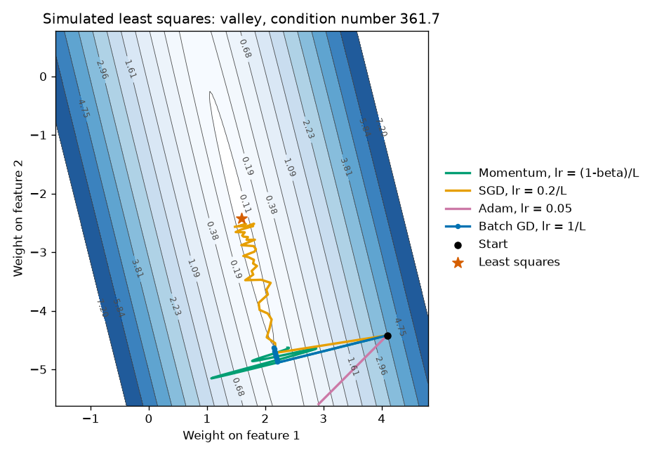
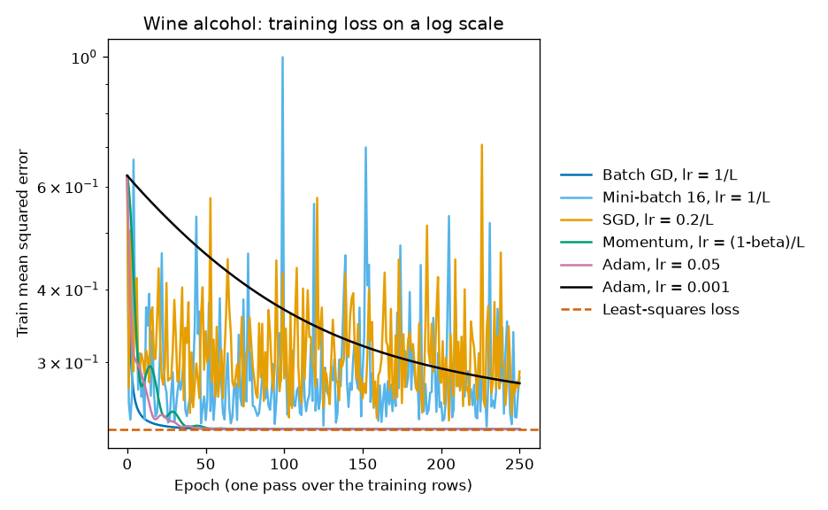
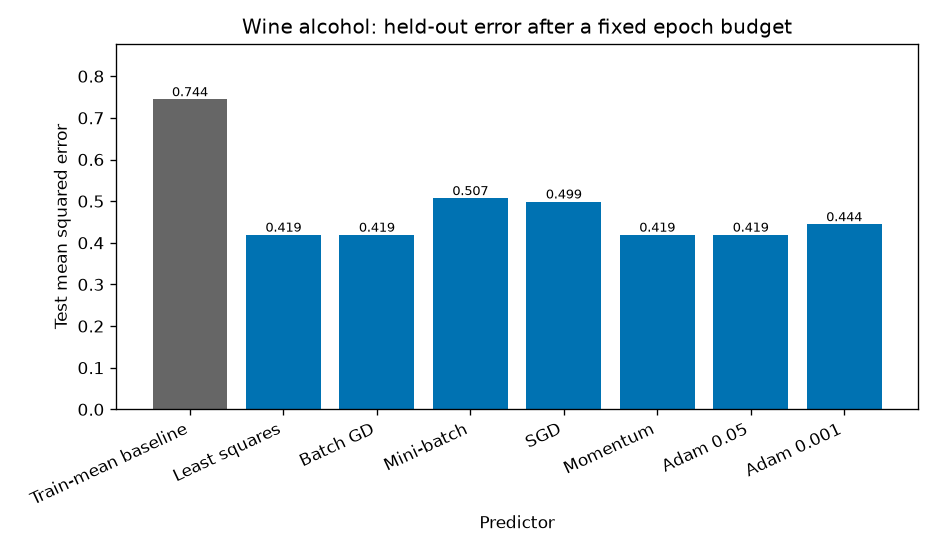

# Gradient descent, and the step that blew up

A training loss can stall, chatter, or leave the page. The cause is often the step size, not the name of the optimizer. This project runs batch gradient descent, mini-batch, SGD, momentum, and Adam on a valley you can see, then on a real regression where the least-squares answer is known.

## Problem

A lab is missing the alcohol measurement for some wines and has the other 12 chemical assays. Before anyone argues about Adam versus SGD, two questions matter. How far is a constant prediction from a linear fit? And which update rules actually reach that linear fit, instead of merely moving the loss for a while?

The same questions show up when a training job stalls or diverges. The useful artifact is the path and the distance to a known minimum, not a screenshot of one lucky curve.

## Concepts taught

- The gradient of mean squared error, and a finite-difference check.
- The Lipschitz constant of that gradient, and why `1/L` is a safe full-batch step.
- Batch, mini-batch, and SGD as different averages of the same per-row gradient.
- Heavy-ball momentum, and why a constant-gradient picture can mis-predict it.
- Adam's moment estimates, and a case where loss falls while the weights move away from the answer.

## Theory in brief

The training loss is the mean squared error on the rows you are allowed to fit:

```
L(w) = (1/n) * sum_i (x_i · w - y_i)^2
grad L(w) = (2/n) * X^T (X w - y)
```

The Hessian is `(2/n) X^T X`. It does not depend on `w`. Call its largest eigenvalue `L`. For this quadratic, full-batch gradient descent converges when the step is below `2/L`. The run uses `1/L` as the safe step and `2.5/L` as the step that should expand the steepest direction by a factor of 1.5 each epoch. That second claim is about the steepest eigenvector, not a promise about every other direction.

A mini-batch gradient is the same formula on a subset of rows. It is not the full gradient plus a polite amount of noise. Its size changes with the batch, so a step that was safe for all `n` rows need not be safe for 16.

SGD uses one row. The gradient of that row's squared error is `2 * residual * x_i`. Averaged over a random row, it is the full gradient. A single draw is not the average.

Heavy-ball momentum, as implemented here, is

```
v = beta * v + g
w = w - lr * v
```

with `beta = 0.9` and `v` starting at 0. If the gradient were constant, `v` would settle at `g / (1 - beta)`, and the step would be `lr / (1 - beta)` times `g`. With `beta = 0.9` that is ten times the plain step. That constant-gradient picture is why a naive copy of the safe GD step can look illegal. It is not a theorem about a shrinking gradient. This project measures both the naive copy and the scaled step `lr = (1 - beta) / L`.

Adam keeps a moving average of the gradient and of its square, then corrects the bias from starting those averages at zero:

```
m = beta1 * m + (1 - beta1) * g
v = beta2 * v + (1 - beta2) * g^2
m_hat = m / (1 - beta1^t)
v_hat = v / (1 - beta2^t)
w = w - lr * m_hat / (sqrt(v_hat) + eps)
```

`beta1 = 0.9`, `beta2 = 0.999`, `eps = 1e-8`, as in Kingma and Ba. The paper's default step is `0.001`. A second Adam run uses `0.05`, chosen as a larger fixed step, not tuned on the test set.

On a long thin valley, loss and distance to the minimizer can disagree. Moving along the steep wall lowers the loss a lot. Drifting along the flat floor changes the weights a lot and the loss only a little. A method can do the first and still walk away from the minimizer.

## Data

Wine measurements: [UCI Wine](https://archive.ics.uci.edu/dataset/109/wine), DOI [10.24432/C5PC7J](https://doi.org/10.24432/C5PC7J), license [CC BY 4.0](https://creativecommons.org/licenses/by/4.0/). Creators listed by UCI: Stefan Aeberhard and M. Forina. The script loads the table with `sklearn.datasets.load_wine` from scikit-learn 1.9.1. There are 178 rows and no missing values. The UCI variables table does not state units. Errors below are in squared dataset units, not in a percent I invented.

The target is `alcohol`. The features are the other 12 constituents. This is imputation of one assay from the assays taken with it, not a forecast of a later event. A random split is the right split for that claim. It is not evidence about next year's vintage.

Split, seed 42: `n_test = int(178 * 0.25) = 44`, so `n_train = 134`. Feature means and sample standard deviations (`ddof=1`) are fit on the training rows and applied to the test rows. The training mean of alcohol is added back at prediction time. It is not a free weight, and it is not computed from the test rows. The optimizer never sees the test loss. The budget is 250 epochs, chosen in advance, not by watching the test curve.

The contour plot is a different problem. It is simulated least squares with 120 rows, two correlated features, and noise, from seed 49 (`SEED + 7`). It exists so the valley can be drawn. It is not a public dataset, and its test column in the JSON is a copy of the training loss. Do not read it as a holdout score. The condition number of that Hessian is `361.73129929391274`. The plot title rounds it to 361.7.

## Approach

Baseline for the wine task: predict the training mean of alcohol for every row. No gradient is involved. If an optimizer cannot beat this on the test rows, it has not earned a more complicated story.

Optimization target: the least-squares weights from `numpy.linalg.lstsq` on the standardized training features. scikit-learn's `LinearRegression(fit_intercept=False)` is a check, not a second model. The max absolute coefficient gap is in `results/metrics.json`.

Every optimizer starts at the zero vector, which is the training-mean predictor in centered alcohol. One epoch is one pass over the 134 training rows. Batch, momentum, and Adam use the full gradient once per epoch. Mini-batch uses batches of 16. SGD uses one row at a time. Stochastic runs have their own seeds, recorded per run.

Steps, fixed before comparing curves:

| Run | Step |
| --- | --- |
| Batch GD, safe | `1/L` |
| Batch GD, too large | `2.5/L` |
| Mini-batch of 16 | the safe full-batch step, on purpose |
| SGD | `0.2/L` |
| Momentum, naive | `1/L`, `beta = 0.9` |
| Momentum, scaled | `(1 - beta) / L`, `beta = 0.9` |
| Adam | `0.05`, and the paper default `0.001` |

A run stops if a weight becomes non-finite or the training MSE exceeds `1000000.0`. The last completed epoch is still recorded. The test set is not used to stop.

The simulated valley uses the same rules for 40 epochs. The start is `3.2015621187164243` away from that problem's least-squares weights.

## Experiments

Values are copied from `results/metrics.json`. The wine Lipschitz constant is `9.225777503173262`, so the safe step is `0.10839194850038861`. The wine condition number is `49.104747420579436`.

| Experiment | What changed | Result | Notes |
| --- | --- | --- | --- |
| Train-mean baseline | Predict the training mean of alcohol | Train MSE `0.6261448206727558`. Test MSE `0.744355077563337`. | No fit. The bar chart rounds the test MSE to 0.744. |
| Least squares | Normal equation on the training rows | Train MSE `0.23032082664440326`. Test MSE `0.4189996214923983`. sklearn coefficient gap `3.7470027081099033e-16`. | The optimization target. Test gap versus the mean baseline is `0.744355077563337 - 0.4189996214923983 = 0.3253554560709387`. |
| Batch GD, `1/L` | 250 full-batch epochs | Train MSE `0.23032086916696826`. Test MSE `0.41888988687427114`. Weight L2 to least squares `0.0006723567151557094`. First entered the 1% band at epoch 27. | Reaches the target. The bar chart rounds the test MSE to 0.419. |
| Batch GD, `2.5/L` | Same budget, step `0.2709798712509715` | Exploded. After 22 completed epochs the train MSE was `967634.146272341`. The next step crossed `1000000.0`. | Failed run. Omitted from the bar chart because it has no finite test MSE. |
| Mini-batch 16 | Safe full-batch step on batches of 16, seed 43 | Train MSE `0.2827803601699109`. Test MSE `0.5067774914316279`. Weight L2 `0.13845806640769107`. Never entered the 1% band. | Underperformed. The full-batch step does not transfer. Bar label 0.507. |
| SGD | Step `0.02167838970007772`, seed 44 | Train MSE `0.28931410577639965`. Test MSE `0.4986375679707434`. Weight L2 `0.17879760234135675`. Never entered the 1% band. | Noisier and short of the target. Bar label 0.499. |
| Momentum, naive `1/L` | `beta = 0.9`, the GD step, not the scaled one | Did not explode. Train MSE `0.23032082664557105`. Test MSE `0.4189997126796659`. Weight L2 `1.0425968806969185e-06`. First entered the 1% band at epoch 38. | The constant-gradient explosion did not happen. The gradient shrank. |
| Momentum, scaled step | `lr = 0.010839194850038859` | Train MSE `0.2303208296058261`. Test MSE `0.41897139310756726`. Weight L2 `0.00017754130770682546`. First entered the 1% band at epoch 39. | Also reaches the target. Slower than plain GD to the 1% band. |
| Adam, `0.05` | Full batch, seed 45 | Train MSE `0.23032082664505296`. Test MSE `0.4189996184252807`. Weight L2 `1.0598446814048102e-06`. First entered the 1% band at epoch 35. | Matches least squares on this budget. |
| Adam, `0.001` | Paper default, seed 46 | Train MSE `0.2760827493344447`. Test MSE `0.444225338734525`. Weight L2 `0.3603274253121576`. Did not enter the 1% band. | Underperformed the safe GD step. Bar label 0.444. |

Rounded to 4 decimals for the summary line: mean-baseline test MSE 0.7444, least-squares test MSE 0.4190, least-squares train MSE 0.2303, Adam default test MSE 0.4442.

The simulated valley, 40 epochs, is the picture rather than the product metric.

| Surface run | Train MSE at the stop | Weight L2 to least squares | What happened |
| --- | --- | --- | --- |
| Start | `3.7755353532361142` | `3.2015621187164243` | Before any step. |
| Least squares | `0.09496170510755829` | 0 | Also `0.4307075031682599` away from the weights that generated the data. |
| Batch GD, `1/L` | `0.10901208984407194` | `2.281815159676281` | Still far after 40 epochs. Did not enter the 1% band. |
| Batch GD, `2.5/L` | last completed `702391.9331290444` after 15 epochs | stopped | Exploded. Next step crossed `1000000.0`. |
| Momentum, naive | `0.15508314921848665` | `0.9212297197306849` | Closer in weight space than GD, worse loss. Did not explode. |
| Momentum, scaled | `0.15898479033601406` | `2.346404452369887` | Short budget, small step, little progress. |
| SGD, `0.2/L` | `0.11554471959041762` | `0.1853382905124456` | First entered the 1% band at epoch 26, then left it. Final loss is not within 1%. |
| Adam, `0.05` | `0.13473949956598494` | `3.656094537704655` | Loss fell. Distance to the minimizer rose, from `3.2015621187164243` to `3.656094537704655`. |

The finite-difference check on the wine gradient, at a fixed probe, had max absolute error `3.8160163917666523e-10`.

The training-mean of alcohol used only to rebuild predictions is not a separate headline. The baseline MSE is the number to compare.

## Plots



The filled bands are training loss. The condition number on the title, 361.7, is `361.73129929391274` rounded to one decimal. The orange SGD path reaches the star and then zigzags. The blue batch path is the short marked segment leaving the start: after 40 epochs it is still `2.281815159676281` from the least-squares weights. The pink Adam path moves off that line. Its loss fell from `3.7755353532361142` to `0.13473949956598494`, and its distance to the star grew.



Log scale. The dashed line is the least-squares train MSE, `0.23032082664440326`. Batch GD, scaled momentum, and Adam at 0.05 sit on it. Adam at 0.001 is the slow black curve. Mini-batch and SGD spike because the step that suits the full gradient does not suit a subset. The exploded `2.5/L` run is omitted; its loss leaves this axis.



Bar labels are the test MSEs rounded to 3 decimals: 0.744, 0.419, 0.507, 0.499, and 0.444. The full values are in the table. Least squares, batch GD, scaled momentum, and Adam at 0.05 are the same height at this rounding. Mini-batch and SGD are worse than the linear fit they were trying to reach. The diverged step is not a bar.

## Key takeaways

Predicting the training mean of alcohol has test MSE 0.7444. Least squares has test MSE 0.4190 and train MSE 0.2303. That gap is the model, not the optimizer. Batch GD with step `1/L` first entered 1% of the least-squares train loss at epoch 27.

The step `2.5/L` is a failed run: after 22 epochs the wine train MSE was `967634.146272341`, and the next step crossed one million. Mini-batch gradient descent with the safe full-batch step never reached the least-squares loss and had test MSE `0.5067774914316279`.

Adam's paper default, 0.001, was still short after 250 epochs, with test MSE 0.4442 and weight L2 `0.3603274253121576`. On the simulated valley, Adam at 0.05 lowered the loss and ended farther from the minimizer than it started. SGD first touched the 1% band there at epoch 26 and did not stay.

## Common mistakes

- Copying a full-batch learning rate onto a mini-batch job. That is the wine mini-batch row.
- Treating `2/L` as a comfortable step. The boundary is not the same as a safe step. `2.5/L` diverged.
- Assuming heavy-ball momentum with the GD step must explode because the constant-gradient gain is `1/(1-beta)`. On the wine fit, that run did not explode.
- Reading a lower loss as a shorter distance to the answer. The pink path on the valley is the counterexample.
- Treating the first epoch inside a tolerance as the final result. Surface SGD entered the band at epoch 26 and finished outside it.
- Stopping on the test curve, then reporting that curve as confirmation. This run uses a fixed budget.
- Matching least squares and thinking you recovered the weights that generated the data. On the simulated problem those two vectors are `0.4307075031682599` apart.

## Interview questions

1. What does gradient descent update? The weights, by subtracting a step times the gradient of the training loss. It does not update the targets, and it does not look at the test loss unless you wrongly put that loss in the objective.

2. Why is `1/L` a safe full-batch step here? `L` is the largest eigenvalue of the MSE Hessian `(2/n) X^T X`. For this quadratic, steps below `2/L` contract the steepest direction. `1/L` is inside that region. On the wine fit, `L` was `9.225777503173262`.

3. Why did `2.5/L` fail? The steepest direction is multiplied by `1 - 2.5 = -1.5` each full step, so its component grows. After 22 wine epochs the train MSE was `967634.146272341`. The run then crossed the stop at `1000000.0`.

4. Why is a mini-batch gradient not just a slower full gradient? It is the full formula on fewer rows. Its variance depends on the batch size. Reusing `1/L` on batches of 16 never entered 1% of the least-squares train loss. Test MSE was `0.5067774914316279` against `0.4189996214923983`.

5. What is the difference between SGD and mini-batch? SGD is the one-row case. Mini-batch is a subset. Both are unbiased for the full gradient if the subset is drawn at random. Unbiased does not mean low variance, and it does not mean the full-batch step still works.

6. Write the heavy-ball update used here. `v = 0.9 v + g`, then `w = w - lr v`. If `g` never changed, the step would be ten times a plain GD step. On this wine problem the gradient shrank, and the naive run finished `1.0425968806969185e-06` from the least-squares weights.

7. What does Adam average? The gradient, and the elementwise square of the gradient, with bias correction because those averages start at zero. It does not know the Hessian. On the valley, loss fell and distance to the minimizer rose, from `3.2015621187164243` to `3.656094537704655`.

8. Why can the paper's default Adam step lose to plain GD? `0.001` is a default, not a Lipschitz calculation. After 250 wine epochs that run was still `0.3603274253121576` from the least-squares weights. Test MSE 0.4442 versus 0.4190.

9. What is a condition number doing in an optimization question? It is the ratio of the largest Hessian eigenvalue to the smallest. The wine ratio was `49.104747420579436`. The simulated valley was `361.73129929391274`. A large ratio means the safe step, set by the steep wall, barely moves you along the floor.

10. How would you debug a loss that became 1e6? Cut the step, confirm the gradient against a finite difference, and check that the batch size still matches the step you tuned. The finite-difference gap on this gradient was `3.8160163917666523e-10`, so the formula was not the bug. The step was.

## How this shows up at work

Someone says the new optimizer is better because the training curve dropped faster on one plot. Ask for the baseline and the target. Here the baseline test MSE is `0.744355077563337` and the least-squares test MSE is `0.4189996214923983`. Batch GD, scaled momentum, and Adam at 0.05 all reached that target. Mini-batch with a borrowed step did not. The optimizer name was not the result.

A job that was stable on a full batch starts spiking after a batch-size change. That is the mini-batch row. The step has to be retuned, or the batch has to go back.

A run that diverges is not a mystery if the step is above `2/L` and the loss is quadratic. The `2.5/L` wine run is the example to keep. In production, log the step, the batch size, and an automatic stop when the loss exceeds a threshold, as this script stops at `1000000.0`. Do not keep the exploded weights and score them.

What stakeholders will ask: can we fill in the missing alcohol number? The honest answer is a test MSE of `0.4189996214923983` against `0.744355077563337` for guessing the training mean, on 44 held-out rows, in units the source file does not name. It is not a deployed instrument.

## Run it

From the repository root, after installing the shared requirements:

```powershell
python -m pip install -r requirements.txt
python 00-foundations/02-gradient-descent/main.py
pytest 00-foundations/02-gradient-descent/tests/test_smoke.py
```

From this folder, `python main.py` is the portable command. If GNU make is installed, `make run` calls the same script. Seed 42. No GPU. The wine table comes from scikit-learn. The contour data are simulated in the script. Nothing is written under `data/`. On this laptop the run finished in well under a minute.

Pinned stack for the committed numbers: numpy 2.5.4, scipy is not required for this script, scikit-learn 1.9.1, matplotlib 3.11.2.

## Further reading

- UCI Machine Learning Repository, Wine. DOI [10.24432/C5PC7J](https://doi.org/10.24432/C5PC7J). License CC BY 4.0.
- Diederik P. Kingma and Jimmy Ba, "Adam: A Method for Stochastic Optimization," ICLR 2015. [arXiv:1412.6980](https://arxiv.org/abs/1412.6980).
- Boris T. Polyak, "Some methods of speeding up the convergence of iteration methods," USSR Computational Mathematics and Mathematical Physics 4(5), 1-17, 1964. The heavy-ball update.
- Stephen Boyd and Lieven Vandenberghe, *Convex Optimization*, Cambridge University Press, 2004. The gradient-method chapters. [The book is free from the authors](https://web.stanford.edu/~boyd/cvxbook/).
- scikit-learn, [`LinearRegression`](https://scikit-learn.org/stable/modules/generated/sklearn.linear_model.LinearRegression.html). Used here only as a check on `lstsq`.
