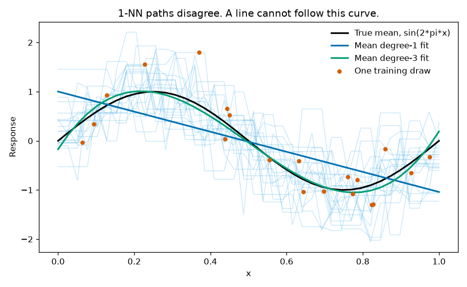
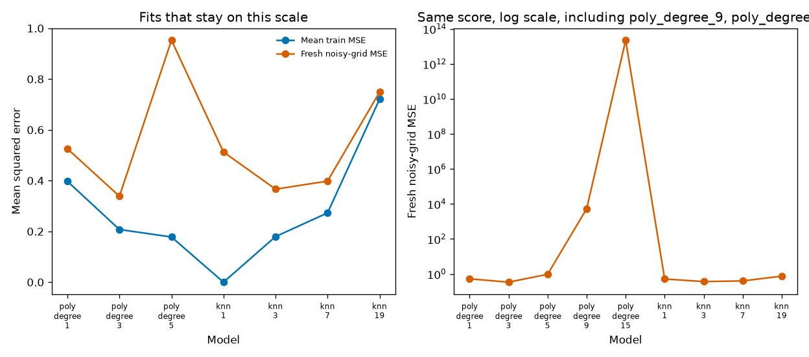
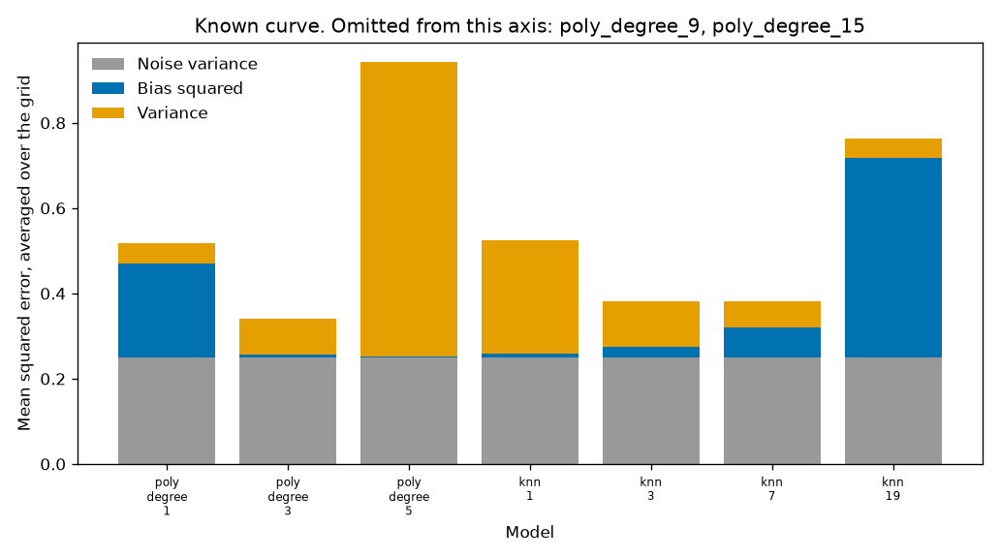
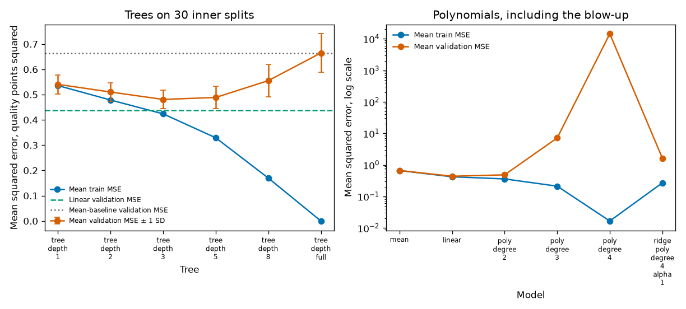
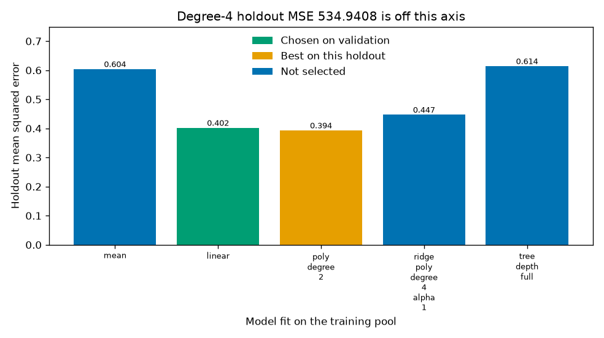

# Bias, variance, and the model that memorized

A lower training error is not a better model. This project separates bias, variance, and noise where the true curve is known, then shows the same tradeoff on red-wine quality, where that separation is not available and a mean prediction is the baseline.

## Problem

A tasting panel scores wines. The lab has the chemical tests and wants a model of the score. Someone will propose a deeper tree or a higher-degree polynomial because the training error fell. The useful question is whether that flexibility helps the next bottle, or only the bottles already in the fit.

The same question shows up whenever a team adds capacity and watches the training metric. The decision needs a baseline, a complexity sweep, and a score that was not used to pick the winner.

## Concepts taught

- The squared-error split into noise, bias squared, and variance, and when that split is available.
- A complexity sweep: polynomial degree, neighbor count, and tree depth.
- Why training error can fall while fresh-data error rises.
- Choosing a model on validation data, then scoring it once on a holdout.
- A peek at the holdout that changes the winner by less than the validation noise.

## Theory in brief

For squared error, at a fixed input `x`, write the response as `y = f(x) + ε` with `E[ε] = 0` and `Var(ε) = σ²`, independent of the training set. The fitted function `f̂` is random because the training set is random. Then

```
E[(y - f̂(x))²] = σ² + (E[f̂(x)] - f(x))² + Var(f̂(x))
```

The first term is noise. It does not depend on the model. The second is bias squared: how far the average fit sits from the true mean. The third is variance: how much the fit moves when the training set changes.

Averaging those terms over a grid of `x` gives the numbers in the simulation table. This script estimates the average fit and the variance from 100 independent training draws. The variance uses the sample variance across draws (`ddof=1`), then the mean over the 40 grid points. The noise term is `σ²`, which is known only because the curve was simulated.

The Monte Carlo column is a second estimate. It draws a fresh noisy response on the same grid, from seed 49, and averages the squared error. It is not an algebraic identity on a finite sample. For the stable fits the two estimates sit close together. Once a polynomial leaves the page, the absolute gap is large because both estimates are huge.

On the wine table, `f(x)` is not known. A validation error is an estimate of noise plus bias squared plus variance, lumped together. The bootstrap column later in the metrics is the variance of predictions across bootstrap refits. It is not a license to subtract it from the holdout error and call the remainder noise.

## Data

Two problems are in this run.

The curve is simulated. `x` is uniform on `[0, 1]`. The mean is `sin(2πx)`. The noise is normal with standard deviation `0.5`, so the noise variance is `0.25`. Each training draw has 20 points. The grid is 40 evenly spaced points from 0 to 1, including the endpoints. It is not a public dataset. Do not cite it as one.

The table is red wine quality: [UCI Wine Quality](https://archive.ics.uci.edu/dataset/186/wine+quality), DOI [10.24432/C56S3T](https://doi.org/10.24432/C56S3T), license [CC BY 4.0](https://creativecommons.org/licenses/by/4.0/). Creators: Paulo Cortez, A. Cerdeira, F. Almeida, T. Matos, and J. Reis. The script downloads `winequality-red.csv` only. The white-wine file is not used. UCI lists 1599 red rows; this file has `1599` rows and `11` features, and `1359` distinct feature rows. There are no missing values. The UCI variables table does not state units. The names file says each expert graded quality from 0 (very bad) to 10 (very excellent), and the published target is a sensory score. In this file the observed quality runs from `3.0` to `8.0`, with mean `5.6360225140712945`. Errors below are in score points squared.

The feature columns, in file order, are fixed acidity, volatile acidity, citric acid, residual sugar, chlorides, free sulfur dioxide, total sulfur dioxide, density, pH, sulphates, and alcohol. The target is `quality`.

Split, from a generator seeded with 42: `n_holdout = int(1599 * 0.20) = 319`, so the training pool has `1280` rows. The holdout is not used to fit, to scale, or to choose the model. Inside the pool, 30 splits from seed 43 take `int(1280 * 0.25) = 320` validation rows and 960 fit rows. Scaler, polynomial expansion, and the model are fit on those 960 rows only. A bootstrap variance check, seed 44, resamples the training pool 40 times and predicts the fixed holdout features. That check is not used to choose the model.

## Approach

Simulation models, all starting from the same 100 training draws:

| Model | What it is |
| --- | --- |
| Polynomial degree 1, 3, 5, 9, 15 | Ordinary least squares in the monomial basis, `numpy.polynomial.polynomial.polyfit` |
| k-NN with 1, 3, 7, 19 neighbors | Uniform weights, one input |

Degree 15 has 16 coefficients and 20 training points. It is in the run because a flexible fit can look good on the training points and fail on the grid. k = 19, with 20 training points, is the high-bias end: almost a constant.

Wine models, fit inside each training fold:

| Model | What it is |
| --- | --- |
| Mean | Predict the training-fold mean of quality |
| Linear | Standardize the 11 features, then ordinary least squares |
| Polynomial degree 2, 3, 4 | Expand, standardize, then ordinary least squares |
| Ridge, degree 4, `alpha = 1.0` | Same expansion, with a penalty chosen before the run, not by a search |
| Tree depth 1, 2, 3, 5, 8, and full | `DecisionTreeRegressor`, `min_samples_leaf` left at 1, `random_state = 0` |

Degree 2 expands to `77` columns, degree 3 to `363`, and degree 4 to `1364`. A degree-1 expansion is the linear model, so it is not a separate candidate.

The selection rule was fixed first: choose the model with the lowest mean validation MSE across the 30 inner splits. Refit that model on all 1280 pool rows. Score the 319 holdout rows once. A second, illegal rule picks the model with the lowest holdout MSE. That number is reported as a peek, not as the result.

## Experiments

Values are copied from `results/metrics.json`.

### Known curve

Noise variance is `0.25` on every row. The decomposition sum is bias squared plus variance plus that noise. The gap is the Monte Carlo fresh-grid MSE minus the sum.

| Model | Train MSE | Bias squared | Variance | Decomposition sum | Fresh-grid MSE | Gap |
| --- | --- | --- | --- | --- | --- | --- |
| Degree 1 | `0.3971394415250742` | `0.22080492473428953` | `0.04715798675801679` | `0.5179629114923063` | `0.5255441348064606` | `0.0075812233141542285` |
| Degree 3 | `0.20742544840506646` | `0.006496382473898046` | `0.08497542021292771` | `0.34147180268682575` | `0.3383645762902302` | `-0.0031072263965955527` |
| Degree 5 | `0.17795123143319677` | `0.0023880636356187336` | `0.6895199850904579` | `0.9419080487260766` | `0.9527403945775432` | `0.01083234585146664` |
| Degree 9 | `0.12466029016156979` | `59.46335037958827` | `5268.914359118794` | `5328.6277094983825` | `5275.380671843372` | `-53.2470376550109` |
| Degree 15 | `0.05448212431547345` | `213696926024.97076` | `22262217054642.473` | `22475913980667.695` | `22253291766963.31` | `-222622213704.38672` |
| 1-NN | `0.0` | `0.008738357564230017` | `0.2666226290033505` | `0.5253609865675806` | `0.5127618129105457` | `-0.01259917365703489` |
| 3-NN | `0.17949935350772325` | `0.023741759347552936` | `0.1077774625344888` | `0.38151922188204174` | `0.3663432126743345` | `-0.01517600920770723` |
| 7-NN | `0.2727107638873538` | `0.06915322044499517` | `0.06197771200920488` | `0.38113093245420004` | `0.3980389988030229` | `0.01690806634882286` |
| 19-NN | `0.7206592328719842` | `0.46887327184046096` | `0.043614345246674735` | `0.7624876170871357` | `0.7485973168182171` | `-0.013890300268918687` |

Degree 3 has the lowest fresh-grid MSE in this list, `0.3383645762902302`. Degree 1 is mostly bias: `0.22080492473428953` against a variance of `0.04715798675801679`. Degree 5 lowers the training error again and loses on fresh data because the variance is `0.6895199850904579`. That is the underperforming step, before the numerical blow-up.

Degree 15 is the failed run. Training MSE falls to `0.05448212431547345`. The fresh-grid MSE is `22253291766963.31`. The largest absolute prediction on the grid, across draws, is `286182476.2228075`. Four of the 100 degree-15 fits emitted a `RankWarning`. The other 96 did not need that warning to leave the page. Degree 9 is the same failure at a smaller scale: training MSE `0.12466029016156979`, fresh-grid MSE `5275.380671843372`, max absolute prediction `2372.3602625689737`.

1-NN has training MSE `0.0` and fresh-grid MSE `0.5127618129105457`, worse than degree 3. 19-NN has bias squared `0.46887327184046096` and fresh-grid MSE `0.7485973168182171`. Averaging almost the whole sample does not recover a sine wave.

Rounded to 4 decimals for the summary line: degree-3 fresh-grid MSE 0.3384, degree-1 fresh-grid MSE 0.5255, 1-NN fresh-grid MSE 0.5128.

### Red wine quality

| Model | Mean train MSE | Mean validation MSE | Validation SD | Holdout MSE |
| --- | --- | --- | --- | --- |
| Mean | `0.6644264322916666` | `0.6638917100694445` | `0.04738150410601989` | `0.6043963603913598` |
| Linear | `0.4197065629370807` | `0.4369568441509924` | `0.03077950090358439` | `0.40240742614403907` |
| Degree 2 | `0.3592507391774411` | `0.4835497080148516` | `0.05227970726406346` | `0.39353768047266385` |
| Degree 3 | `0.2115034636451063` | `7.158611340695202` | `10.444039649939883` | `1.111026260331588` |
| Degree 4 | `0.016597631911689694` | `14463.492598751998` | `27949.724932826863` | `534.9407857506061` |
| Ridge, degree 4, alpha 1 | `0.26903583086074356` | `1.6310143215549622` | `1.8478211809879705` | `0.4474164125389743` |
| Tree depth 1 | `0.5356343898289191` | `0.540376494790079` | `0.03803082943796004` | `0.5409617271397186` |
| Tree depth 2 | `0.47852611236933457` | `0.5101449714760947` | `0.03623900427401563` | `0.4945315318649876` |
| Tree depth 3 | `0.42376497458784357` | `0.4808793298788292` | `0.035759084173770196` | `0.4590815378025228` |
| Tree depth 5 | `0.32914169784080044` | `0.4886177967523429` | `0.04512227609903146` | `0.4681585844281628` |
| Tree depth 8 | `0.1697816312802517` | `0.5553061026205028` | `0.06493071954076088` | `0.5027752381242662` |
| Tree, full | `0.0` | `0.6646875` | `0.07586227560463628` | `0.6144200626959248` |

The validation rule selects `linear`. Its holdout MSE is `0.40240742614403907`. The mean baseline's holdout MSE is `0.6043963603913598`. The difference is `0.6043963603913598 - 0.40240742614403907 = 0.20198893424732073`.

The best tree on validation is depth 3, at `0.4808793298788292`, still above the linear validation MSE. The full tree's training MSE is `0.0` and its holdout MSE is `0.6144200626959248`, which is worse than the mean. The difference is `0.6144200626959248 - 0.6043963603913598 = 0.010023702304564952`. Memorizing the pool lost to a constant.

Degree 4 is the other failed run. Validation MSE `14463.492598751998`, and the validation SD `27949.724932826863` is larger than that mean, so a symmetric error bar would cross zero and hide the plot. Holdout MSE `534.9407857506061`. The precommitted ridge penalty, alpha `1.0`, brings the holdout MSE to `0.4474164125389743`. That is a real improvement over the unpenalized degree-4 fit, and it still loses to the linear model. The alpha was not tuned.

Peeking at the holdout selects `poly_degree_2`, with holdout MSE `0.39353768047266385`. The validation rule had rejected it: validation MSE `0.4835497080148516` against the linear model's `0.4369568441509924`. The peek changes the quoted holdout number by `0.40240742614403907 - 0.39353768047266385 = 0.008869745671375218`, which is smaller than degree 2's validation SD of `0.05227970726406346`. The procedure is still wrong. The score moved less than the split noise.

On the linear model fit to the training pool, the largest absolute coefficient after scaling is alcohol, `0.2891333557721234`. That is an association in one fit. It is not an effect of changing the alcohol in the glass.

Bootstrap prediction variance on the holdout features, 40 resamples of the pool, is `0.00038613304725059963` for the mean, `0.0057209784592672595` for the linear model, `0.020973270555992025` for a depth-1 tree, `0.3941222570532915` for the full tree, and `7216.9750738853345` for degree 4. The full tree's predictions move around. The mean barely does. This is not a decomposition of the holdout MSE.

Rounded to 4 decimals for the summary line: mean holdout MSE 0.6044, linear holdout MSE 0.4024, degree-2 holdout MSE 0.3935, full-tree holdout MSE 0.6144.

The run that wrote these numbers took `63.0596357000004` seconds on this laptop, including the polynomial fits. No GPU.

## Plots



The faint paths are 20 of the 1-NN fits. They disagree with each other. The blue line is the average degree-1 fit. The green curve is the average degree-3 fit, close to `sin(2πx)`. The orange points are one training draw, not the grid.



The left panel omits any model whose fresh-grid MSE is at least 10, which in this run is degree 9 and degree 15. Training error falls from degree 1 to degree 5 and is `0.0` for 1-NN. Fresh-grid error does not follow it. The right panel is the same fresh-grid MSE on a log scale, so the degree-15 spike is visible without flattening the other models.



Gray is the known noise, `0.25`. Blue is bias squared. Orange is variance. Degree 9 and degree 15 are omitted because their variance is off this axis; the values are in the table. Degree 3 is the short bar. Degree 5 is mostly variance. 19-NN is mostly bias.



Left: trees. The bars on the orange curve are the standard deviation across the 30 validation splits, not a confidence interval. The dashed line is the linear validation MSE, `0.4369568441509924`. The dotted line is the mean baseline. No tree's mean validation error gets under the dashed line, and the full tree's training error sits on zero. Right: log scale, so degree 4's validation error can share an axis with the mean. Degree 4's validation SD is larger than its mean and is not drawn as an error bar.



Bar labels are holdout MSE rounded to 3 decimals: 0.604, 0.402, 0.394, 0.447, and 0.614. The degree-2 label 0.394 is `0.39353768047266385` rounded to 3 decimals, not a stored 0.394. Green is the validation choice. Orange wins only on this holdout. The title's 534.9408 is `534.9407857506061` rounded to 4 decimals. That degree-4 bar is omitted so the other bars remain readable.

## Key takeaways

On the known curve, degree 3 has fresh-grid MSE 0.3384. Degree 15 cuts training MSE to `0.05448212431547345` and has fresh-grid MSE `22253291766963.31`. 1-NN fits the training points with error `0.0` and is still worse than the cubic on fresh data.

On red wine, the mean baseline's holdout MSE is 0.6044. The linear model, chosen without the holdout, has holdout MSE 0.4024. A full tree has training MSE `0.0` and holdout MSE 0.6144, worse than the mean. Degree 4's holdout MSE is `534.9407857506061`. Ridge with a precommitted alpha of 1 brings that to `0.4474164125389743` and still loses to the linear model.

Peeking at the holdout would have reported degree 2 and 0.3935. Validation had already scored that model worse than linear, and the peek moved the holdout number by less than the validation SD.

## Common mistakes

- Treating the training error as the number to beat. Degree 15 and the full tree are the examples.
- Reporting a bias-variance split on a real table. The wine noise term is not identified. The bootstrap variances are a different measurement.
- Picking the winner on the same holdout you quote. Degree 2 wins that illegal comparison and loses the validation comparison.
- Reading one deeper tree as progress. Depth 8 has a lower training error than depth 3 and a higher validation error.
- Drawing a symmetric error bar when the SD exceeds the mean. Degree 4's validation SD is `27949.724932826863`.
- Tuning nothing and still calling a penalty "the regularized solution." Alpha `1.0` was a precommitted comparison. It helped against unpenalized degree 4. It was not selected by a search, and it did not beat linear.
- Reading the alcohol coefficient as the effect of adding alcohol. It is the largest absolute coefficient in one scaled linear fit, `0.2891333557721234`.

## Interview questions

1. Write the squared-error decomposition. At a fixed `x`, expected squared error equals noise plus bias squared plus variance of the fit. The noise does not shrink when you add parameters. In this simulation it is `0.25`.

2. Why can training error fall while test error rises? A more flexible fit can match the training sample, including its noise. Degree 5's training MSE is `0.17795123143319677` and its fresh-grid MSE is `0.9527403945775432`. Degree 3 is worse on the training points and better on the fresh grid.

3. What did 1-NN do here? Training MSE `0.0`, variance `0.2666226290033505`, fresh-grid MSE `0.5127618129105457`. A training error of zero was the warning, not the result.

4. Why is 19-NN biased on this curve? With 20 training points, 19 neighbors average almost the whole sample. The sine wave is not a constant. Bias squared is `0.46887327184046096`.

5. Why can't you subtract "variance" from a wine test MSE and call the rest noise? You do not know `f(x)`. A bootstrap variance of predictions is also not the variance of the estimator under repeated samples from the population. The full tree's bootstrap prediction variance is `0.3941222570532915`. That number is not a noise estimate.

6. How do you choose tree depth without lying to yourself? Score depths on splits that are not the final holdout, then touch the holdout once. Here that rule picks the linear model, not a tree. The best tree validation MSE is `0.4808793298788292`, against the linear model's `0.4369568441509924`.

7. What is wrong with the degree-2 holdout win? It was the best of the models on the holdout, at `0.39353768047266385`, so choosing it there uses the test set twice. Validation had it at `0.4835497080148516`, worse than linear. The holdout gap versus linear is `0.40240742614403907 - 0.39353768047266385 = 0.008869745671375218`, smaller than degree 2's validation SD.

8. A stakeholder says the full tree fit perfectly. What do you show? Training MSE `0.0`, holdout MSE `0.6144200626959248`, mean baseline `0.6043963603913598`. The perfect fit lost to a constant on the next 319 rows.

9. Did regularization fix the degree-4 model? Relative to unpenalized degree 4, yes: holdout MSE fell from `534.9407857506061` to `0.4474164125389743`. Relative to the linear model, no. The penalty was alpha `1.0`, chosen in advance, not by a search on the holdout.

10. What would you log in production? The training error, the validation error, the baseline, the chosen complexity, and the fact that the final slice was not used to choose. A training curve alone would have shipped the full tree or the degree-4 expansion.

## How this shows up at work

Someone adds features or depth because last month's training metric improved. Ask for the comparison against a constant and against the current model, on rows the new model did not choose itself. Here the constant scores `0.6043963603913598` on the holdout and the selected linear model scores `0.40240742614403907`. The full tree scores `0.6144200626959248`. That is a model not to ship, even though its training error is zero.

A review will also ask whether the reported winner was picked on the reported test. Degree 2 is the example of that mistake. The score looks a little better. The selection is no longer a test.

What can go wrong in production is the degree-4 pattern: a wide expansion fits the extract you trained on and then produces wild scores on a new extract. The validation SD being larger than the mean was the alarm. A single lucky holdout would not have been.

Stakeholders will ask if the model can replace the tasting panel. The honest answer is a holdout MSE of `0.40240742614403907` against `0.6043963603913598` for the training-pool mean, on 319 red wines, in score points squared. It is not a claim about white wine, and it is not a claim that alcohol causes the score.

## Run it

From the repository root, after installing the shared requirements:

```powershell
python -m pip install -r requirements.txt
python 00-foundations/03-bias-variance/main.py
pytest 00-foundations/03-bias-variance/tests/test_smoke.py
```

From this folder, `python main.py` is the portable command. If GNU make is installed, `make run` calls the same script. The wine file is downloaded to `data/winequality-red.csv`, which is gitignored. The curve is simulated in the script. Seed 42 for the simulation draws and the holdout split, 43 for the inner splits, 44 for the bootstrap, 49 for the fresh-grid noise. No GPU.

Pinned stack for the committed numbers: numpy 2.5.4, pandas 3.0.6, scikit-learn 1.9.1, matplotlib 3.11.2.

## Further reading

- UCI Machine Learning Repository, Wine Quality. DOI [10.24432/C56S3T](https://doi.org/10.24432/C56S3T). License CC BY 4.0.
- P. Cortez, A. Cerdeira, F. Almeida, T. Matos, and J. Reis, "Modeling wine preferences by data mining from physicochemical properties," Decision Support Systems 47(4):547-553, 2009. [doi:10.1016/j.dss.2009.05.016](https://doi.org/10.1016/j.dss.2009.05.016).
- Trevor Hastie, Robert Tibshirani, and Jerome Friedman, *The Elements of Statistical Learning*, 2nd edition, Springer, 2009. Chapter 7, Model Assessment and Selection. [Free from the authors](https://hastie.su.domains/ElemStatLearn/).
- Stuart Geman, Elie Bienenstock, and René Doursat, "Neural Networks and the Bias/Variance Dilemma," Neural Computation 4(1):1-58, 1992.
- Pedro Domingos, "A Unified Bias-Variance Decomposition and its Applications," Proceedings of the Seventeenth International Conference on Machine Learning, 2000. [PDF](https://homes.cs.washington.edu/~pedrod/papers/mlc00a.pdf).
- scikit-learn, [`DecisionTreeRegressor`](https://scikit-learn.org/stable/modules/generated/sklearn.tree.DecisionTreeRegressor.html) and [`PolynomialFeatures`](https://scikit-learn.org/stable/modules/generated/sklearn.preprocessing.PolynomialFeatures.html).
