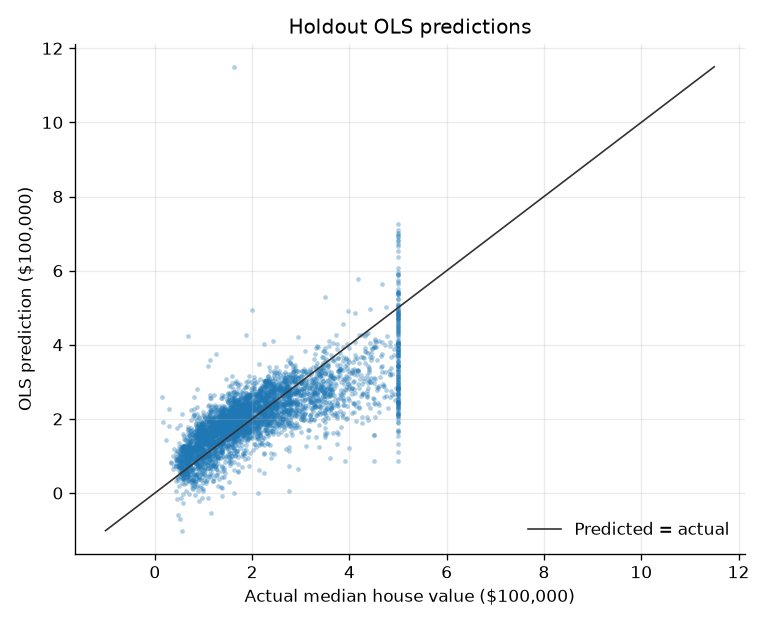
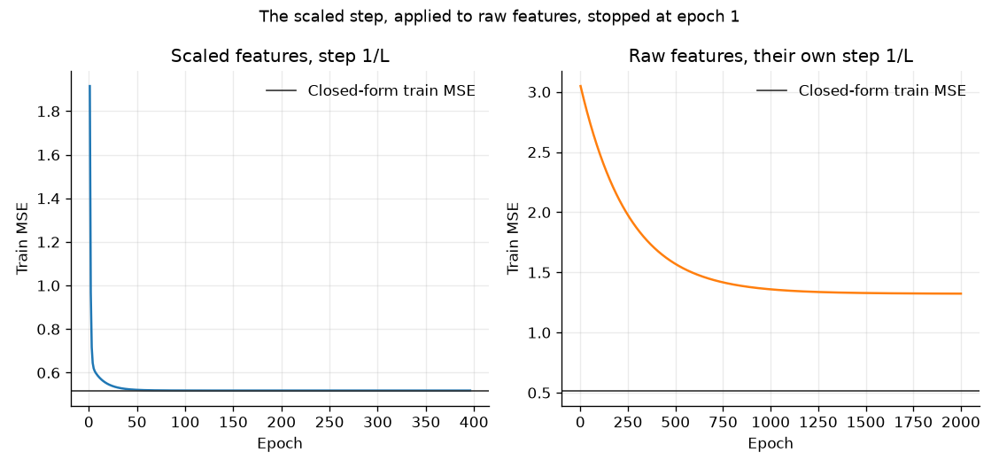
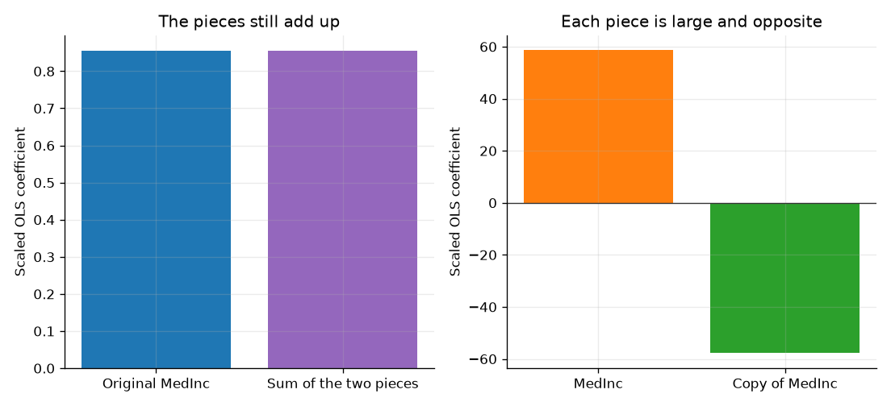
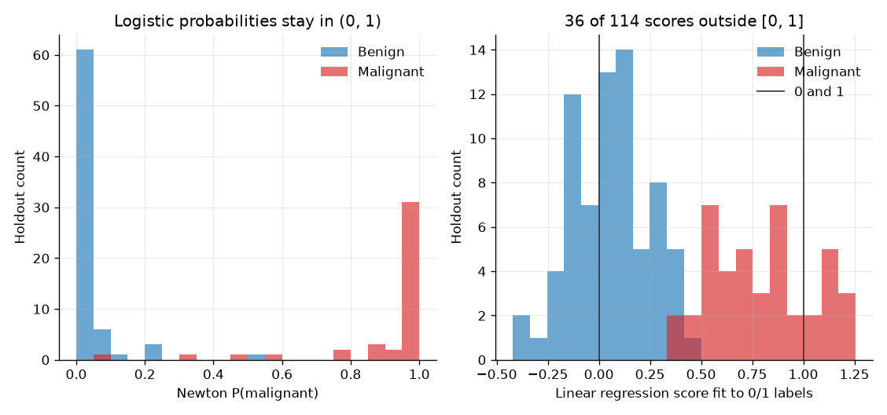
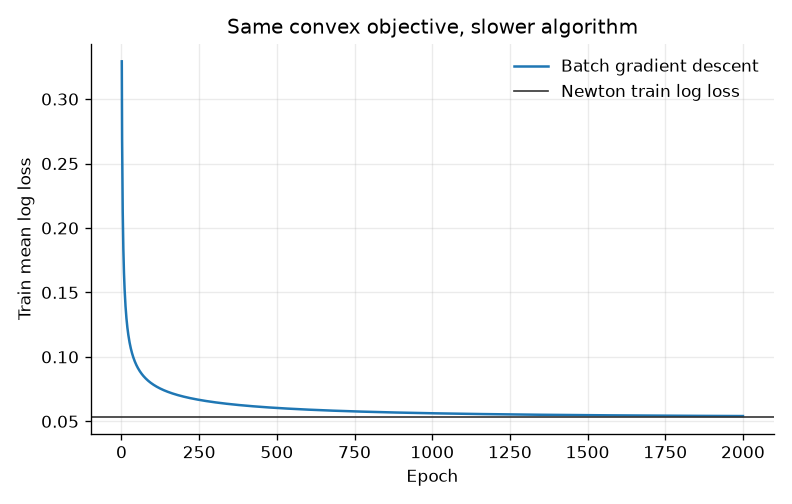

# Linear and logistic regression, then the library check

A closed form and a few lines of Newton are enough to reproduce scikit-learn on these two problems. The same code also shows the versions that should not be shipped: a step size copied from scaled data, a line fit to yes/no labels, and an unregularized logistic model that separates the training rows.

## Problem

A lender wants a first model of district house value from census block-group measurements. The score has to be a weighted sum, because someone will ask which measurement moved the number. Before any tree or neural net, the question is whether ordinary least squares beats predicting the training mean, and whether a hand-written fit is the same object scikit-learn returns.

A pathology lab has a different score. From measurements of cell nuclei, it wants a probability that a fine-needle sample is malignant. Accuracy is a poor summary: most samples in this file are benign. The model has to be checked against a library, and it has to fail in a way you can explain when the penalty is removed.

Neither fit is a production system. The cancer model is not a diagnostic device. It is a 569-row public file used to see the math.

## Concepts taught

- Ordinary least squares and ridge, including an intercept that is not penalized.
- Batch gradient descent with the safe step `1/L`, and why that step is not portable across feature scales.
- Logistic regression as Bernoulli negative log likelihood, with the penalty scikit-learn actually minimizes.
- Newton on that objective, and a gradient-descent run that has not reached it.
- What changes when the same labels are fit with squared error, or with no penalty, on data the unregularized model can separate.

## Theory in brief

A linear score is `z = b + x·w`. For housing, the prediction is `z` itself. Ordinary least squares chooses `b` and `w` to minimize the residual sum of squares. The same coefficients minimize the mean squared error. With the intercept stored as a column of ones, the normal equations are `XᵀX w = Xᵀy`. This script solves that least-squares problem with a singular-value solver, not by inverting `XᵀX`.

The gradient of the mean squared error is `(2/n) Xᵀ(Xw - y)`. The Hessian is `(2/n) XᵀX`. Its largest eigenvalue `L` is a Lipschitz constant of the gradient. Batch gradient descent with step `1/L` cannot overshoot the quadratic bowl. A step that is safe after standardization is not safe on the raw columns, because `L` scales with the square of the column magnitudes.

Ridge adds `alpha ||w||²` to the residual sum of squares and does not add it to the intercept. That is the scikit-learn `Ridge` objective. `alpha` is `1.0` here. It was fixed before the holdout was scored. It was not chosen because it won.

For the cancer labels, `y` is 1 when the sample is malignant and 0 otherwise. The model probability is the logistic function of `z`:

```
p = 1 / (1 + exp(-z))
```

The training loss is the average Bernoulli negative log likelihood,

```
-(1/n) sum [y log p + (1 - y) log(1 - p)]
```

plus `(lambda/2) ||w||²`. The intercept is not inside the penalty. scikit-learn's lbfgs path minimizes that average loss with `lambda = 1/(C n)`. The comment in the installed solver says the user-facing objective is `C` times the sum of pointwise losses, plus a penalty; the implementation reaches it by scaling the penalty with `n`. This script uses that same `lambda`. `C` is `1.0`, also fixed in advance.

The gradient of the average log loss is `(1/n) Xᵀ(p - y)`, plus `lambda w` on the coefficients. The Hessian is `(1/n) Xᵀ diag(p(1-p)) X`, plus `lambda` on the coefficient diagonal. Because `p(1-p)` never exceeds one quarter, a global step-size bound is available without looking at the holdout. Newton uses the local Hessian and takes the full step when it decreases the objective. It does not use a line search as a hidden tuning loop on the test set.

Squared error on 0/1 labels has a different target. Its optimum can sit outside the unit interval. Clipping those scores so a log loss can be computed does not turn them into the logistic model.

If a direction classifies every training row correctly, the unregularized log likelihood has no finite maximizer: increasing the coefficients in that direction keeps raising the training likelihood. Two solvers then stop at different large vectors. A penalty is what makes the coefficient a quantity you can compare.

## Data

Two public files. Neither is committed. `data/` stays gitignored; these loaders do not write into it.

California housing is loaded with `sklearn.datasets.fetch_california_housing`. The installed scikit-learn description says the file has 20,640 rows and 8 numeric features, no missing values, one row per 1990 US Census block group, obtained from StatLib (`https://lib.stat.cmu.edu/datasets/houses.zip`). The loader downloads `cal_housing.tgz` from figshare file 5976036. This run has `20640` rows, `8` features, a training split of `16512`, and a holdout of `4128`. The target is median house value in units of $100,000. The description summarizes the range as 0.15 to 5. In this file the observed minimum is `0.14999` and the observed maximum is `5.00001`.

The feature names, and only the descriptions the file gives, are median income in the block group, median house age, average rooms per household, average bedrooms per household, block-group population, average number of household members, latitude, and longitude. The description does not state a unit for median income. Do not invent one. Average rooms and bedrooms can be large where a block group has few households and many empty houses. The loader source carries an SPDX BSD-3-Clause header. The description does not include a separate license file for the extract. The cited source is the 1990 census extract redistributed by StatLib, with Pace and Barry, Statistics and Probability Letters, 33:291-297, 1997, named in the scikit-learn description.

Breast Cancer Wisconsin (Diagnostic) is the copy shipped inside scikit-learn, which points at `https://archive.ics.uci.edu/dataset/17/breast+cancer+wisconsin+diagnostic`. The UCI API record used for this write-up has DOI `10.24432/C5DW2B`, creators William Wolberg, Olvi Mangasarian, Nick Street, and W. Street, and an introductory paper: Street, Wolberg, and Mangasarian, "Nuclear feature extraction for breast tumor diagnosis," 1993, DOI `10.1117/12.148698`. UCI's donation policy states that datasets in the repository are licensed CC BY 4.0: `https://archive.ics.uci.edu/contribute/donation`. The UCI variable table does not fill in units. The 30 features are the mean, standard error, and worst value of ten nucleus measurements from a digitized fine-needle image. This run has `569` rows, `212` malignant and `357` benign. scikit-learn stores malignant as target 0. This script sets the positive class to malignant.

The housing split is `train_test_split` with `test_size` `0.2` and seed `42`. The cancer split uses the same seed and size and is stratified on the recoded label, so the holdout has `42` malignant rows out of `114`, against `170` of `455` in the training split. Features are then standardized with the training mean and the training sample standard deviation (`ddof=1`). The holdout uses those training moments. scikit-learn is fit on that already scaled matrix, so the library check is not a second, hidden scaler.

## Approach

Housing starts with the training-mean prediction. The closed-form least-squares fit is next, then the same fit from scikit-learn. Ridge uses the precommitted `alpha` of `1.0`. Batch gradient descent starts at the zero vector. On scaled features its step is `1/L` and it stops when the training mean squared error is within the script's precommitted tolerance of the closed form, or at `2000` epochs. The raw-feature run gets its own `1/L` and the same epoch cap. A third run applies the scaled step to the raw design. That is the failure a copied learning rate produces. It is not a candidate.

A near-copy of median income is then added, with normal noise of standard deviation `0.0001` from seed `45`, drawn separately on the training and holdout rows after the split. The column is scaled with the other features. This is a demonstration of an ill-conditioned design, not a feature that was selected on the holdout.

The cancer baselines are the training malignant rate, as a constant probability, and the majority class, as a hard label. The reported model is Newton on the `C = 1.0` objective. scikit-learn's lbfgs solver is fit with the same `C`, `l1_ratio` 0, and tolerance `1e-12`. It reported `47` iterations, so the iteration cap did not bind. Batch gradient descent uses the global `1/L` step for at most `2000` epochs. The unregularized Newton run and a linear regression on the 0/1 labels are comparisons, not challengers that get to replace the penalized model after seeing the holdout. Classification metrics use a threshold of one half. That threshold was not tuned.

The script raises if the penalized housing or cancer coefficients miss scikit-learn by more than a fixed tolerance. That check is a correctness test on the training fit. It is not model selection. The unregularized cancer comparison is allowed to disagree, and it does.

## Experiments

| Experiment | What changed | Result | Notes |
| --- | --- | --- | --- |
| Housing mean | Predict the training mean | Holdout MSE `1.3106960720039365` | RMSE `114485.63543099792` dollars |
| Housing OLS | Closed form on scaled features | Holdout MSE `0.5558915986952442` | RMSE `74558.13830127764` dollars. Max absolute coefficient gap versus scikit-learn `2.609024107869118e-15` |
| Housing ridge | Precommitted `alpha` `1.0` | Holdout MSE `0.5558548567257238` | Change versus OLS `-3.6741969520415196e-05`. Not a search |
| Housing GD, scaled | Step `1/L`, stop near the closed form | `396` epochs, holdout MSE `0.5558928213149463` | Training gap to OLS `9.663481126409579e-11` |
| Housing GD, raw, own step | Same budget, step `1.498110595486275e-07` | Holdout MSE `1.2959326721958302` after `2000` epochs | Training MSE still `1.3232372018271241`, gap `0.8053040763024543` |
| Housing GD, copied step | Scaled step on raw features | Stopped at epoch `1`, training MSE `6994534363101.463` | The underperforming optimizer |
| Income copy | Noise standard deviation `0.0001` | Holdout MSE `0.5559444756947375` | Change versus OLS `5.2876999493300936e-05`. Coefficients `58.618929622138594` and `-57.76453986363866` |
| Cancer constant rate | Training malignant rate on every row | Holdout log loss `0.6581679861838116` | The probability baseline |
| Cancer majority class | Always benign | Holdout accuracy `0.631578947368421` | Not a log-loss baseline |
| Cancer Newton, `C` `1.0` | The reported classifier | Holdout log loss `0.07716713894283675` | Accuracy `0.9649122807017544`. Coefficient gap versus lbfgs `1.6631946718748125e-06` |
| Cancer GD, same penalty | At most `2000` epochs | Holdout log loss `0.0757607519088126` | Training gap to Newton `0.000864473683532832`. Not selected |
| Cancer, no penalty | Newton, `lambda` 0 | Holdout log loss `13.33741462393542` | Training log loss `7.303091096676565e-11`. Separated the training rows |
| Cancer, no penalty, lbfgs | Same split, `C` infinite | Holdout log loss `92.46130322338546` | Max absolute probability gap versus Newton `1.0` |
| Linear regression on labels | Squared error, scores clipped at `1e-12` for the log loss only | Holdout log loss `0.19417102466552807` | `36` of `114` scores outside 0 and 1. Accuracy `0.9649122807017544` |

The ridge change is smaller than a story about regularization. It is reported because the penalty was precommitted. The runs that lost are the copied step, the raw-feature gradient descent, the line fit to labels, and both unregularized logistic fits.

## Plots



The cloud follows the diagonal and then fails in two visible ways. `179` holdout rows sit on the observed maximum, `5.00001`, so the actual values form a vertical stripe. The predictions are not confined to the observed range: the lowest is `-1.0137928122566187`, the highest is `11.500331025900921`, `15` are negative, and `39` are above the observed maximum. An unconstrained line will invent prices outside the file.



The left panel meets the closed-form training loss. The right panel, with the safe step for the raw columns, is still far above its closed form after the epoch cap. The copied step is not drawn. It left the axis on the first epoch; the measured training loss is `6994534363101.463`.



The left panel is the original median-income coefficient, `0.8544089036812219`, next to the sum of the two pieces, `0.8543897584999343`. The right panel is why a stakeholder cannot read either piece: `58.618929622138594` and `-57.76453986363866`.



Newton probabilities stay in the unit interval. The linear scores do not. The title count, 36 of 114, is the stored outside count, not a rounded percentage.



The curve is still above the Newton training loss at epoch `2000`. The holdout log loss happened to be a little lower. That was not a reason to change the reported model.

## Key takeaways

On this housing split, closed-form least squares cut holdout mean squared error from `1.3106960720039365` to `0.5558915986952442`. The hand-written coefficients matched scikit-learn to `2.609024107869118e-15`. A step that was safe on the scaled design, `0.24691559850835107`, made the raw-feature update explode on epoch `1`.

The penalized cancer model matched lbfgs closely enough to compare probabilities: the largest holdout probability gap was `4.2760906249217356e-07`, and the holdout log loss was `0.07716713894283675` against a constant-rate baseline of `0.6581679861838116`. Removing the penalty separated the training rows, dropped training log loss to `7.303091096676565e-11`, and left two solvers with holdout log losses of `13.33741462393542` and `92.46130322338546`.

A line fit to the same labels tied the logistic accuracy at `0.9649122807017544` and lost on log loss, `0.19417102466552807`, with `36` scores outside the unit interval. Accuracy was the wrong place to look.

The largest scaled housing coefficient is latitude, `-0.8969560377826353`, with longitude at `-0.8698681161237012` and median income at `0.8544089036812219`. Those are associations at the training scale, holding the other scaled columns fixed. They are not an effect of moving a house north.

## Common mistakes

- Treating scikit-learn's target 0 as the positive cancer class. In this file, target 0 is malignant. The script flips it and says so.
- Comparing a from-scratch log loss with scikit-learn without using `lambda = 1/(C n)`. The averages match only after that scaling. The intercept stays out of the penalty.
- Copying a learning rate from a scaled experiment onto raw columns. Here that step was `0.24691559850835107` against a raw safe step of `1.498110595486275e-07`.
- Fitting squared error to 0/1 labels and clipping the scores into probabilities. Clipping made a log loss computable. It did not make the model logistic.
- Declaring a tie on accuracy. Both classifiers scored `0.9649122807017544`. The log losses did not tie.
- Reading a standardized coefficient as a causal effect. Latitude and longitude are a location pattern in a cross-section, not a treatment. Duplicating income left the holdout error almost unchanged and made each income coefficient unreadable.
- Tuning `C`, `alpha`, or the epoch cap on the holdout, then quoting that holdout as confirmation. Nothing in the reported choice was picked there. The gradient-descent holdout that looks slightly better was not used.

## Interview questions

1. Write the normal equations. For an intercept column included in `X`, minimize `||Xw - y||²`. Differentiate to get `XᵀX w = Xᵀy`. A singular-value solver is the stable way to compute that solution. Inverting `XᵀX` is the version that fails when a column is duplicated.

2. Why is the intercept left out of the ridge penalty? Penalizing it shrinks the prediction at the origin of the features, which is an artifact of how you centered them. scikit-learn's `Ridge` does not penalize `intercept_`. This fit matches that objective; the max absolute gap on the housing coefficients was `2.1760371282653068e-14`.

3. Why did gradient descent need scaling? The safe step is `1/L`, and `L` is the largest eigenvalue of `(2/n) XᵀX`. Raw population and coordinates make `L` large, so the safe step was `1.498110595486275e-07` and `2000` epochs did not reach the closed form. The scaled step `0.24691559850835107` exploded on those raw columns at epoch `1`. See `00-foundations/02-gradient-descent` for the same Lipschitz step on a smaller problem.

4. What is the gradient of logistic loss? For labels in `{0, 1}` and `p = sigmoid(z)`, the average negative log likelihood has gradient `(1/n) Xᵀ(p - y)`. Add `lambda w` if the penalty is `(lambda/2) ||w||²`. The intercept gradient is the mean residual, with no penalty term.

5. Why can a linear regression of 0/1 labels predict 2, or -1? Squared error does not know that the target is a probability. On this holdout the scores ran from `-0.42195287973108264` to `1.2563458144795296`, and `36` of `114` fell outside the unit interval.

6. What breaks in unregularized logistic regression when the training rows are separable? The likelihood has no finite maximizer. This training fit reached accuracy `1.0`, a minimum margin of `19.316237205505182`, and a training log loss of `7.303091096676565e-11`. Newton and lbfgs then stopped at different large vectors. Their holdout probabilities differed by `1.0`.

7. Accuracy rose, so why look at log loss? The majority accuracy is already `0.631578947368421`. Both the logistic model and the clipped linear scores reached `0.9649122807017544`. The constant-rate log loss was `0.6581679861838116`, the logistic log loss `0.07716713894283675`, and the clipped linear log loss `0.19417102466552807`. The threshold was not tuned; a later project covers cost-sensitive thresholds.

8. The income coefficient became 58 after you duplicated the column. Did the model change? The two pieces were `58.618929622138594` and `-57.76453986363866`. Their sum was `0.8543897584999343`, next to the original coefficient `0.8544089036812219`. Holdout mean squared error moved by `5.2876999493300936e-05`. The prediction was stable. The story about income was not.

9. How do you check a from-scratch model against a library without using the test set twice? Fit both on the training matrix, compare coefficients and training predictions, and treat a large gap as a bug in the objective. Then score the holdout once. The penalized cancer coefficient gap was `1.6631946718748125e-06`. The unregularized gap was a result, not a pass.

10. Which coefficient is the effect of moving north? None of them. The largest scaled coefficient is latitude, `-0.8969560377826353`, and longitude is `-0.8698681161237012`. Mean radius and mean perimeter in the cancer training rows have correlation `0.9978146993019572`. A large coefficient on one of a collinear pair is not a lever you can pull.

## How this shows up at work

A pricing or risk team often asks for a linear score first, because a stakeholder wants the weights. The useful delivery is the baseline gap, the unit of the target, and a statement of what the weight is not. Here the target unit is $100,000, the holdout RMSE fell from `114485.63543099792` dollars to `74558.13830127764`, and the latitude weight is an association. The same score predicted negative values and values above every observed price. A production constraint, or a different model, has to be an explicit decision. Leaving the line unconstrained will not invent that constraint for you.

On a rare-event or diagnosis score, the stakeholder will quote accuracy. The constant-rate log loss and the confusion counts are the correction. At one half, the penalized model had 39 true positives, 3 false negatives, 1 false positive, and 71 true negatives on 114 holdout rows. That is not a clinical claim. It is the count this split produced.

Two library fits that disagree after training error has vanished are a separation or objective bug, not a reason to pick the one with the friendlier holdout. Match `C`, the intercept penalty, and the scaling. If they still disagree, the unregularized problem does not have a unique answer. Duplicate columns from a join look like the income copy: the score barely moves, and the weight a stakeholder reads becomes nonsense.

## Run it

From this directory, with the repo environment installed from the root `requirements.txt`:

```bash
python main.py
pytest tests/test_smoke.py
```

`python main.py` downloads the housing file into the scikit-learn data cache if it is not already there, loads the cancer file from the installed package, and writes `results/metrics.json` and the plots. The smoke test uses synthetic arrays and does not repeat that download. This run finished in `1.127445300000545` seconds.

## Further reading

- scikit-learn, "1.1. Linear Models," including the ordinary-least-squares, ridge, and logistic sections: `https://scikit-learn.org/stable/modules/linear_model.html`. The ridge penalty in this script is the residual-sum-of-squares penalty stated there. The logistic `lambda` is the one in the installed lbfgs path, which scales the penalty by `1/(C n)`.
- scikit-learn's California housing description, loaded with the dataset in this environment. It is the source for the column list, the $100,000 target unit, the StatLib URL, and the Pace and Barry citation.
- UCI Machine Learning Repository, Breast Cancer Wisconsin (Diagnostic), dataset 17, DOI `10.24432/C5DW2B`: `https://archive.ics.uci.edu/dataset/17/breast+cancer+wisconsin+diagnostic`.
- UCI donation policy, which states that datasets in the repository are licensed CC BY 4.0: `https://archive.ics.uci.edu/contribute/donation`.
- Street, Wolberg, and Mangasarian, "Nuclear feature extraction for breast tumor diagnosis," 1993, DOI `10.1117/12.148698`, as named by the UCI API record for this dataset.
- The installed `HalfBinomialLoss` docstring points to Hastie, Tibshirani, and Friedman, *The Elements of Statistical Learning*, section 4.4.1, for the logistic loss used above. I am citing the pointer in the docstring, not a page I opened for this run.
