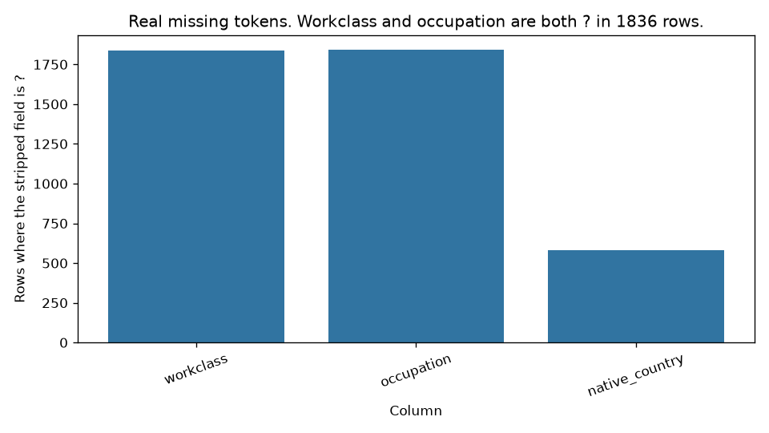
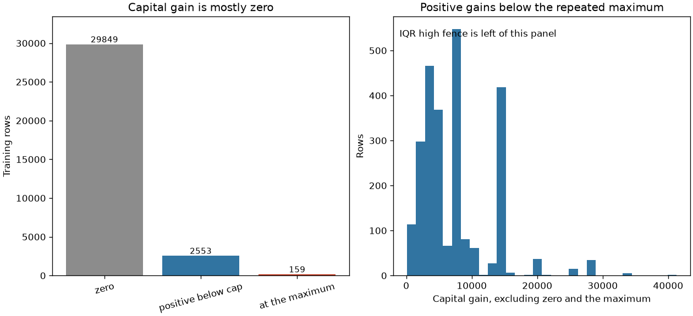
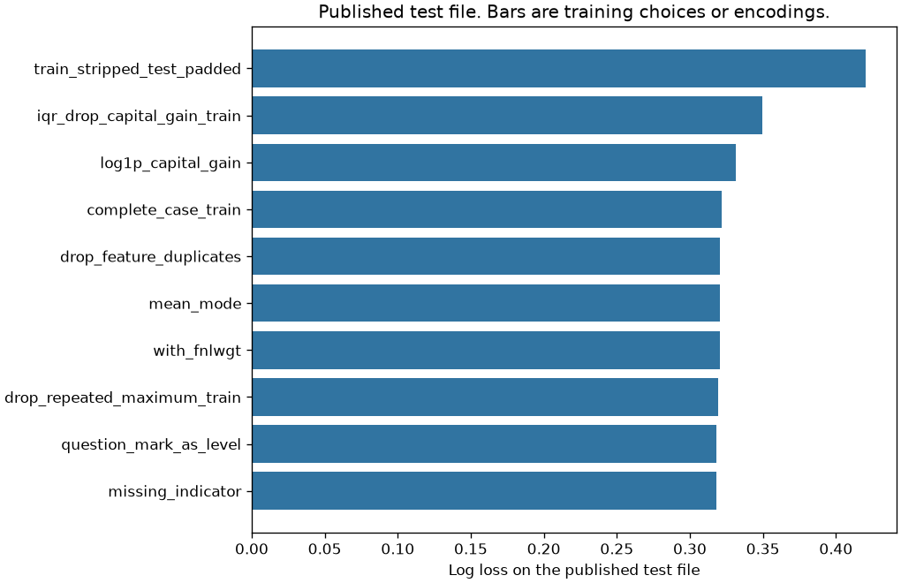
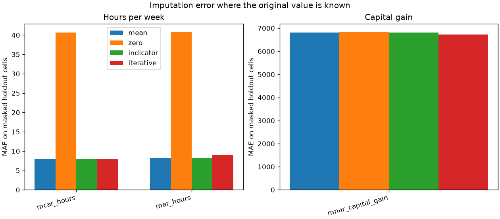
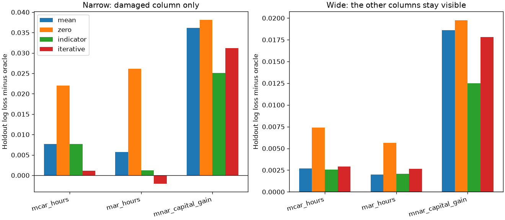
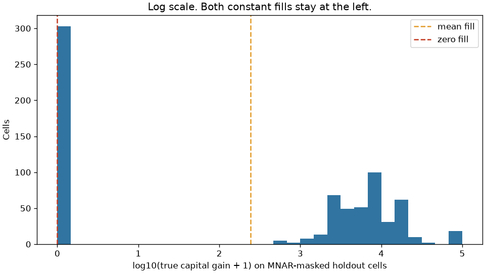

# Messy census cleanup, then the score

The published training file and the published test file did not share an income label. Stripping spaces on one side and not the other made every categorical test cell unknown. A rule that looked like outlier removal deleted every positive capital gain.

## Problem

An operations team receives two extracts of the same census file: one used to fit a score, one used to score new rows. The columns have the same names. The strings do not. Someone has already proposed three cleanups: drop incomplete rows, drop outliers, and fill the blanks with the average. Each of those changes who is in the training file, or what the model is allowed to see.

The score is not a lending or hiring decision. The file is a 1994 Census extract donated for a prediction exercise: does the recorded income class exceed the donor's threshold. Race is in the file. This project does not use it, and it does not audit fairness. A later project does. Copying this feature list into a decision about a person would be a different, and worse, use of the extract.

## Concepts taught

- What is actually in a public file before any imputer runs: padding, a label period, a missing token, duplicates, and a category that exists on one side only.
- MCAR, MAR, and MNAR, with the original value kept so the fill can be checked.
- Why a missingness indicator can beat a better-looking fill, and why a multivariate fill can improve a one-column model without reconstructing the column.
- Why an interquartile fence collapses on a zero-inflated column.
- Why the imputer, the scaler, and the encoder are fit on training rows only.

## Theory in brief

Call the missingness indicator `R`. It is 1 when the value was not recorded. `X_obs` is what you still see. `X_mis` is the value you would have seen.

MCAR says the mask ignores the row: `P(R | X_obs, X_mis) = P(R)`. The hours mask in the injection study is a coin flip. The values are not an argument of that function.

MAR says the mask can depend on what remains observed, but not on the hidden value itself: `P(R | X_obs, X_mis) = P(R | X_obs)`. The second hours mask depends on age. Age stays in the row.

MNAR says that equality fails. The capital-gain mask depends on whether the hidden gain is positive. A procedure that only looks at the observed columns cannot see the rule that deleted the value.

Mean imputation replaces a hole with the mean of the observed training values. That uses `E[X | R = 0]` as a stand-in for `E[X | R = 1]`. Under MCAR those two expectations match, up to sampling noise. Under this MNAR rule they do not. The masked capital-gain cells had mean `6846.322714681441`. The training mean written into those cells was `242.96299411269973`.

A missingness indicator does not repair that number. It adds a column that says the value was missing. If missingness itself is associated with the label, the indicator can move the score while the filled number stays wrong. On the capital-gain mask, the indicator and the mean fill have the same reconstruction error. The classifier does not.

Log loss is the average Bernoulli negative log likelihood,

```
-(1/n) sum [y log p + (1 - y) log(1 - p)]
```

with `p` clipped at `1e-12`. The constant baseline sets `p` to the training positive rate for every scored row. Accuracy uses the threshold `0.5`. That threshold was not tuned.

The interquartile fence is `Q1 - 1.5 (Q3 - Q1)` and `Q3 + 1.5 (Q3 - Q1)`, with the multiplier `1.5`. If both quartiles are `0.0`, both fences are `0.0`. Every positive value is then outside the fence.

A one-hot encoder fit on stripped training levels turns an unseen string into a row of zeros when unknown levels are ignored. A leading space is enough to make a known category unseen.

## Data

Adult, UCI dataset 2, DOI 10.24432/C5XW20. Creators Barry Becker and Ronny Kohavi. The script downloads `adult.data` and `adult.test` from the UCI machine-learning database into `data/`, which is gitignored. The repository page is https://archive.ics.uci.edu/dataset/2/adult. The UCI donation policy says datasets in the repository are licensed CC BY 4.0: https://archive.ics.uci.edu/contribute/donation. Credit the creators if you reuse the extract.

The donor note, `adult.names`, says the extract comes from the 1994 Census database, under the conditions age over 16, adjusted gross income over 100, final weight over 1, and hours over 0. The prediction task is whether the person makes over 50K a year. The note also says unknown values were converted to `?`, and that the files were split with MLC++ into the `32561` training rows and `16281` test rows. After stripping, this script has those two counts. The complete-case training count in the note is `30162`. This script's complete-case training count is the same.

The note says "Duplicate or conflicting instances : 6". After stripping and concatenating the two files, this script counts `52` extra exact rows, `57` extra feature rows, and `5` feature keys whose income labels disagree. The note does not define the count. I am not going to edit the measured count until it equals 6.

The test file starts with `|1x3 Cross validator`. That line is not a row. The script skips it and raises if the preamble does not contain that marker.

Columns used in the official model: age, education number, capital gain, capital loss, hours per week, workclass, marital status, occupation, relationship, sex, and native country. Income is the label. `>50K` is the positive class. Education as a string is one-to-one with education number in the training file: both directions have maximum `1`, so the string is dropped. `fnlwgt` is the Census final weight. The donor note says similar weights apply within a state, not across states. It is not an attribute of the person, and it is excluded except in one comparison. Race is a protected attribute. It is excluded. This is not a fairness audit.

Sex remains in the official feature list because it is part of the published extract and the comparison is about cleanup, not about a new feature set. The injection matrix also codes Male as 1 and Female as 0, so age can drive a MAR mask while sex stays observed. Neither choice is a recommendation to use sex in an income screen.

## Approach

The official comparison uses the donor split. Nothing in that comparison was refit on the test file. The logistic model is scikit-learn `LogisticRegression` with `C` of `1.0`, an L2 penalty, lbfgs, and at most `2000` iterations. The script raises if a fit hits that cap. The decision threshold stays at `0.5`.

The baseline predicts the training positive rate for every test row, and, separately, predicts the majority class. The majority class is the class whose training rate is at least one half. On this file that class is `0`.

Then, on the same split:

- Keep `?` as its own category. The donor note says that token was written in place of Unknown.
- Replace numeric holes with the training mean and categorical holes with the training mode, then one-hot encode. The encoder ignores unknown levels.
- Do that same fill, and add a missingness indicator wherever a column was actually missing.
- Drop training rows with any missing workclass, occupation, or native country, then still score the full test file. The test file still has holes, so the mode imputer remains.
- Drop extra training rows that repeat the same features. Keep the first income label.
- Drop training rows whose capital gain equals the training maximum. Leave the test file alone.
- Drop training rows outside the capital-gain interquartile fence.
- Apply `log1p` to capital gain on both files, then use the mean-and-mode pipeline.
- Add `fnlwgt` to that same pipeline.
- Strip the training categories and leave the raw test categories padded. This is the failed encoding, kept so the cost is measured.

The injection study is a different population. It keeps the `30162` complete training rows, where the original values are known, and makes a stratified `0.2` split with seed `42`: `24129` fit rows and `6033` holdout rows. Three masks are then applied. The rates were fixed before the holdout was scored.

- MCAR: hide hours with probability `0.25`. The mask does not see the value.
- MAR: hide hours with probability `0.6` when age is at least `50.0`, and `0.05` otherwise.
- MNAR: hide capital gain with probability `0.8` when the gain is positive, and `0.05` when it is zero.

Each mask is filled by the training mean, by zero, by the training mean plus an indicator, and by `IterativeImputer`. The imputer is fit on the masked training rows and only then applied to the holdout. For the MCAR hours column, the script checks that the mean imputer matches the training observed mean, and that fitting on the training rows plus the holdout would have produced a different mean. The holdout was not used to choose a method.

A narrow model sees only the damaged column, plus the indicator column when that method adds one. A wide model sees age, education number, hours, capital gain, and the sex indicator, after the same fill. The oracle sees the column before the mask. Its score is not comparable to the published test file. The features, the rows, and the split are different.

Uncertainty, where it was precommitted, is a percentile interval from `1000` resamples of the paired row-wise log-loss difference. A positive difference means the second method has the lower loss. No comparison was added after seeing the result.

## Experiments

Published test file. The constant-rate baseline has log loss `0.5467485574653357`. Majority-class accuracy is `0.7637737239727289`. The test positive rate is `0.23622627602727106`. The training positive rate is `0.2408095574460244`.

| Experiment | What changed | Log loss | What else was measured |
| --- | --- | --- | --- |
| Constant rate | Training positive rate on every row | `0.5467485574653357` | Majority accuracy `0.7637737239727289` |
| Question mark kept | `?` stays a category | `0.31833658576426743` | AUC `0.9048541861256276`, accuracy `0.8529574350469873`, `32561` training rows |
| Mean and mode | Holes filled, then one-hot | `0.3207506692781671` | AUC `0.9031967060749178`, accuracy `0.85148332412014` |
| Missing indicator | Same fill, plus indicators | `0.31832050972644726` | AUC `0.9048751165969438`, accuracy `0.8524046434494196` |
| Complete-case train | Drop incomplete training rows | `0.32159967061942873` | `30162` training rows, full test file still scored |
| Drop duplicate features | Keep the first copy | `0.3207786436484106` | `32536` training rows |
| Drop the repeated maximum | Training rows at `99999.0` removed | `0.31913995990134847` | `32402` training rows. Test file unchanged |
| IQR drop | Fence collapsed to `0.0` | `0.34962426376625366` | AUC `0.886352789053259`, accuracy `0.8382163257785148`, `29849` training rows |
| log1p capital gain | Compress the gain, same pipeline | `0.3314562538085302` | Worse than mean and mode. No precommitted interval |
| Add fnlwgt | Sampling weight as a feature | `0.32039194503641827` | A small move. Not a reason to use the weight |
| Strip train, pad test | Leading spaces left on the test file | `0.42049919201950064` | AUC `0.8209704713077949`, accuracy `0.8103310607456544` |

The two informative treatments of the real token beat mode fill by a small, precommitted margin. Mean-and-mode minus the indicator is `0.0024301595517198173`, interval `0.0014071667941598007` to `0.0033952430041773976`. Mean-and-mode minus the question-mark level is `0.002414083513899587`, interval `0.0013925046360891847` to `0.0034188618173069305`. Both intervals exclude zero. The comparison between the indicator and the question-mark level was not precommitted. Their point estimates are close. I am not calling one of them the winner.

The padded file is the failed encoding. All `97686` categorical test cells were unknown to the stripped training levels, and all `97686` of those cells were the padded strings. Log loss rose by `0.09974852274133353`, interval `0.09292333642955133` to `0.10629986584680146`. The numeric columns were still aligned. A comparison against the constant baseline would have hidden this: `0.42049919201950064` is still below `0.5467485574653357`.

The IQR drop is the failed cleanup. It removed `2712` training rows, which is every positive capital gain, and left `29849` zeros. Log loss rose by `0.028873594488086598` relative to mean and mode, interval `0.02477381517166422` to `0.032978806595786586`. It still beat the constant baseline. That is not evidence that the rule helped.

`log1p` also lost. The same mean-and-mode pipeline went from `0.3207506692781671` to `0.3314562538085302`. No interval was precommitted, so this is a point estimate. The transform is tempting because `29849` training gains are zero and `159` sit at `99999.0`. Compressing that tail is a good guess at why a linear score got worse. I did not measure the coefficient change, and I am not adding that comparison now.

Adding `fnlwgt` moved the point estimate from `0.3207506692781671` to `0.32039194503641827`. That comparison was not precommitted. The column is a sampling weight. It stays out of the reported feature list.

Injection holdout, complete rows only. The constant-rate log loss is `0.561194159143231`. Majority accuracy is `0.7510359688380573`. The complete-row positive rate is `0.24892248524633645`, against `0.2408095574460244` on the full training file. Do not compare these log losses with the published-test numbers above.

| Mask | Fill | Masked cells | MAE | True mean | Filled mean |
| --- | --- | --- | --- | --- | --- |
| MCAR hours | Mean | `1559` | `7.904791739307751` | `40.679923027581786` | `40.96745447500968` |
| MCAR hours | Zero | `1559` | `40.679923027581786` | `40.679923027581786` | `0.0` |
| MCAR hours | Iterative | `1559` | `7.962122898697427` | `40.679923027581786` | `40.92048078089385` |
| MAR hours | Mean | `1042` | `8.283526279153323` | `40.85700575815739` | `41.03988927882951` |
| MAR hours | Iterative | `1042` | `8.925413060755305` | `40.85700575815739` | `43.2753105452797` |
| MNAR capital gain | Mean | `722` | `6807.287108979123` | `6846.322714681441` | `242.96299411269973` |
| MNAR capital gain | Zero | `722` | `6846.322714681441` | `6846.322714681441` | `0.0` |
| MNAR capital gain | Iterative | `722` | `6732.152135722986` | `6846.322714681441` | `317.9155712114246` |

The indicator rows are omitted from that table because the indicator uses the same mean fill. Its MAE equals the mean-fill MAE. The realized MCAR training rate was `0.2512329561937917`, near the requested `0.25`. The MAR training rate was `0.16154834431596835`, because the rule depends on age rather than a fixed fraction. The MNAR training rate was `0.11301753077209996`.

On the narrow hours model, mean fill is worse than the oracle. The MCAR gap is `0.00770119605863741`, interval `0.004663229275854385` to `0.01050635327986962`. The MAR gap is `0.0056836726327069015`, interval `0.0027626694931616427` to `0.008898869159403001`. Zero fill is worse still: the narrow MCAR log loss is `0.5568395762112013`, and its accuracy is `0.7510359688380573`, the same as the majority class. Zero is also below the observed hours minimum of `1.0`.

The failed interpretation is the narrow MAR iterative fit. Its log loss is `0.5327674994403983`, below the oracle's `0.5348075280596708`, while its MAE is `8.925413060755305` against the mean fill's `8.283526279153323`. The iterative fill is allowed to see age, education, capital gain, and sex. The narrow oracle is allowed to see only the true hours. The imputed column can carry those other columns into a model that was supposed to see one column. That is not a better reconstruction. The wide model already sees those columns, and there the iterative fill does not beat the oracle: `0.4126523175751417` against `0.40999920340971946`. No interval was precommitted for the iterative contrast. I am not computing one after the fact.

On MNAR capital gain, the narrow mean fill has log loss `0.5491415925287269` against the oracle's `0.5130200252082852`. The gap is `0.036121567320441646`, interval `0.027188129723620155` to `0.04406418598934944`. The indicator, with the same filled numbers, reaches `0.5381403857849608`. Mean minus indicator is `0.011001206743765946`, interval `0.006390241011383274` to `0.015523174114993583`. The wide versions are `0.42859060978745617` for the mean and `0.4225056864314909` for the indicator, a gap of `0.006084923355965322`, interval `0.002918827734442648` to `0.009226624146970303`. The indicator is useful here because the mask itself is associated with a positive gain. It does not mean the fill was good.

Zero versus mean on that narrow MNAR model is detectable and small: `0.0020239021574461873`, interval `0.0014637055544777283` to `0.0025856368086355857`. The reconstruction gap is the one that matters. The zero fill writes `0.0` where the hidden mean is `6846.322714681441`.

The other injection grid cells are in `results/metrics.json`. They are not a second leaderboard.

## Plots



Workclass and occupation are both missing in `1836` training rows. Occupation is missing while workclass is present in `7` rows. The other direction is `0`.



The left panel is the stored counts: `29849` zeros, `2712` positive rows, and `159` rows at `99999.0`. The right panel is the positive rows below that maximum. The interquartile fence is `0.0`, so it sits to the left of that panel rather than through the positive values. The donor note does not call `99999.0` a Census top-code. This write-up does not either.



The axis starts at zero, so the padded file and the IQR drop separate from the cluster of fills. The constant-rate baseline is not a bar. It is worse than every bar, which is why it is the wrong comparison for a cleanup.



Hours and capital gain are separate panels. One axis would hide the hours comparison under the capital-gain errors.



A bar below zero is a fill that beat the oracle. The narrow MAR iterative bar does that. The wide panel does not. Read it with the MAE plot, not instead of it.



The axis is `log10(value + 1)`. The mean fill and the zero fill both stay at the left. The histogram does not.

## Key takeaways

The published files needed a label rule before they needed a model. After stripping, `16281` of `16281` test labels still ended in a period, and the raw label sets had `0` values in common.

Leaving the test categories padded made `97686` of `97686` categorical cells unknown and moved published-test log loss from `0.3207506692781671` to `0.42049919201950064`. That run still beat the constant baseline.

Keeping the question mark, or adding a missingness indicator, beat mode fill by a small precommitted margin. Dropping rows outside the capital-gain fence deleted all `2712` positive gains and raised log loss to `0.34962426376625366`.

On the injected MNAR mask, the mean fill wrote `242.96299411269973` where the hidden mean was `6846.322714681441`. The indicator improved the score without changing that fill. A lower log loss is not a reconstruction.

The narrow iterative fill that beat its oracle had a worse MAE than the mean. The other columns leaked through the imputed hours. I did not select that fill.

## Common mistakes

- Stripping one extract and not the other. Here that made every categorical test cell unknown while the numeric columns still matched.
- Joining on the raw income string. The test labels carry a period. The training labels do not.
- Fitting the imputer, the scaler, or the encoder on the full file, then splitting. The script fits them on the training side and checks that the holdout mean would have changed the MCAR fill.
- Treating complete-case training as a complete solution. The test file still has holes, and the complete rows have a different positive rate: `0.24892248524633645` against `0.2408095574460244`.
- Applying an interquartile fence to a column whose quartiles are zero. The fence becomes `0.0`, and the rare rows are the ones you delete.
- Calling a repeated maximum a top-code because it looks like one. The donor note does not say that.
- Celebrating a multivariate imputer because the downstream loss improved. Check the MAE, and check whether the model was allowed to see the other columns directly.
- Filling with zero because zero is already a common value. On hours, zero is below the observed minimum of `1.0`.
- Using `fnlwgt` as a feature because a point estimate moved. It is a sampling weight.
- Rewriting Holand-Netherlands. The donor category list uses that spelling. It appears in `1` training row and `0` test rows. Changing one side creates a new unseen level.
- Quoting accuracy `0.85148332412014` without the majority accuracy `0.7637737239727289`.

## Interview questions

1. What is the difference between MCAR, MAR, and MNAR? MCAR does not depend on the row. MAR may depend on observed columns, not on the hidden value. MNAR depends on the hidden value or on something you still have not observed. This project implements one of each: a coin flip for hours, an age rule for hours, and a positive-gain rule for capital gain.

2. Why can the training mean be a bad fill even when it is the right training statistic? Mean imputation estimates the hidden mean by the observed mean. On the MNAR holdout cells those two numbers were `6846.322714681441` and `242.96299411269973`. The statistic was computed correctly. The assumption was false.

3. The indicator had the same MAE as the mean fill. Why did the score improve? The indicator does not change the filled number. It tells the model the value was missing. Under the MNAR rule, missingness is more common when the gain is positive. The narrow gap was `0.011001206743765946`, and the interval excluded zero.

4. Why did the interquartile rule delete every positive capital gain? The training quartiles were both `0.0`, so both fences were `0.0`. The rule removed `2712` rows and left `29849`. Published-test log loss rose to `0.34962426376625366`.

5. Why fit the imputer on the training rows only? The holdout, or the production request, is the thing you are scoring. Fitting on it uses values you would not have at training time. This script checks that the MCAR mean matches the training observed mean and that adding the holdout would change it.

6. The test labels would not join to the training labels. What do you check before you touch the model? The raw strings. Here every test label still had a period after stripping, and the raw label overlap was `0`. A leading space on every non-age field is the same class of bug.

7. Iterative imputation beat the oracle. Is it the better fill? Not on this run. The narrow MAR iterative log loss was `0.5327674994403983` against an oracle of `0.5348075280596708`, but the MAE was worse than the mean fill. The fill could see columns the oracle model could not. The wide comparison did not show the same win. No interval was precommitted.

8. When should `?` stay a category? When it is a recorded token, not a random hole. The donor note says Unknown was converted to that token. Mode fill throws away the label shift: occupation-missing rows had positive rate `0.10363537710255019`, against `0.24903965101894654` when occupation was present.

9. Accuracy is 0.85. Is the model doing a lot? The majority class already scores `0.7637737239727289`. Mean-and-mode accuracy is `0.85148332412014`. Log loss moves from `0.5467485574653357` to `0.3207506692781671`. Accuracy is the weaker summary, and the threshold was not chosen from a cost matrix. That choice is a later project.

10. A sampling weight improved the point estimate. Should it ship? No. `fnlwgt` is a Census weight, and the donor note limits the similarity claim to within a state. The point estimate moved to `0.32039194503641827`. That comparison was not precommitted, and a weight is still not an attribute of the person.

## How this shows up at work

The usual incident is two jobs writing the same extract. One strips strings. One does not. The model trains, the score collapses, and the numeric fields look fine. The check is a category-level overlap, not a row count. Here the overlap failure was total: `97686` of `97686` categorical cells.

The second incident is a data-quality rule that deletes outliers before anyone looks at the label. On this column the rule deleted every positive capital gain. The score got worse and still beat a constant prediction, so a dashboard that only shows "better than baseline" would have accepted it.

A stakeholder will ask why missing occupation predicts a lower positive rate. The measured rates are `0.10363537710255019` and `0.24903965101894654`. That can be a form design, a non-response pattern, or a proxy for employment. It is not a causal effect, and it is not an eligibility feature. Race was left out on purpose. This project did not measure disparate impact.

Duplicate rows are a different size of problem in a small labeled set than they are here. The training file had `24` extra exact rows in `32561`. Dropping repeated feature keys barely moved the published-test log loss. I would still count them. I would not expect that count to save a model of this size.

## Run it

From this directory, with the repo environment installed from the root `requirements.txt`:

```bash
python main.py
pytest tests/test_smoke.py
```

`python main.py` downloads the two Adult files into `data/` if they are not already there, writes `results/metrics.json`, and writes the six plots. The smoke test uses synthetic arrays and does not download the extract. This run finished in `5.013879799998904` seconds.

## Further reading

- UCI Machine Learning Repository, Adult, dataset 2, DOI 10.24432/C5XW20: https://archive.ics.uci.edu/dataset/2/adult. Barry Becker and Ronny Kohavi are the creators named there.
- The donor note `adult.names`, fetched with the classic files. It is the source for the extraction conditions, the `?` conversion, the train and test counts, the complete-case training count, the duplicate figure of 6, the `fnlwgt` description, and the Kohavi citation. I am citing that note, not a PDF of the paper.
- The citation as the donor note prints it: Ron Kohavi, "Scaling Up the Accuracy of Naive-Bayes Classifiers: a Decision-Tree Hybrid," Proceedings of the Second International Conference on Knowledge Discovery and Data Mining, 1996, pages "to appear." I did not open the paper, and I am not adding page numbers.
- UCI donation policy, which states that datasets approved for the repository are licensed CC BY 4.0: https://archive.ics.uci.edu/contribute/donation.
- scikit-learn, "Imputation of missing values": https://scikit-learn.org/stable/modules/impute.html. The mean fill is the univariate strategy. `IterativeImputer` is the multivariate strategy. Both were fit on the training side only.
