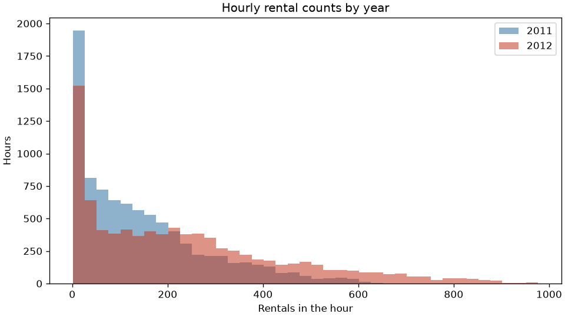
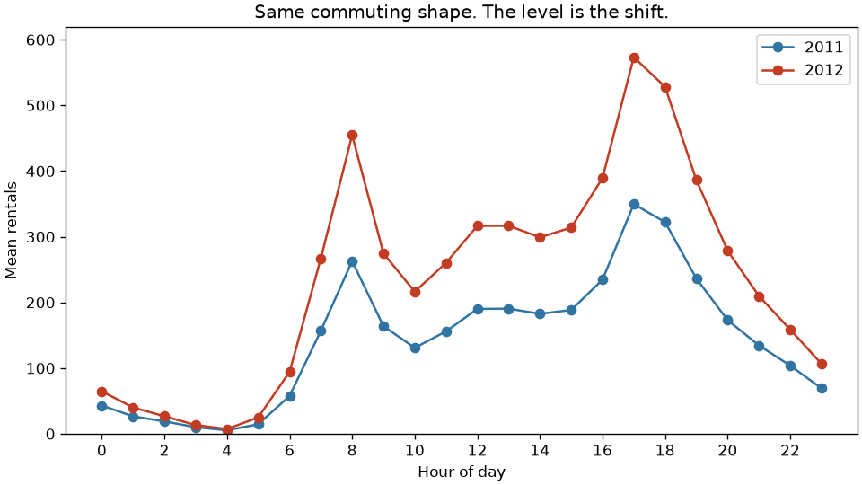
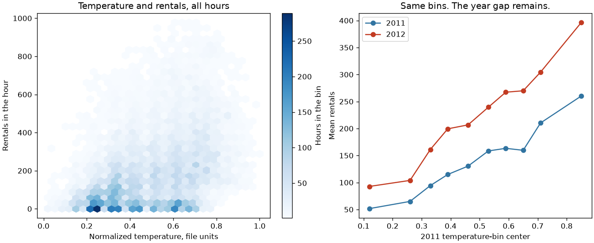
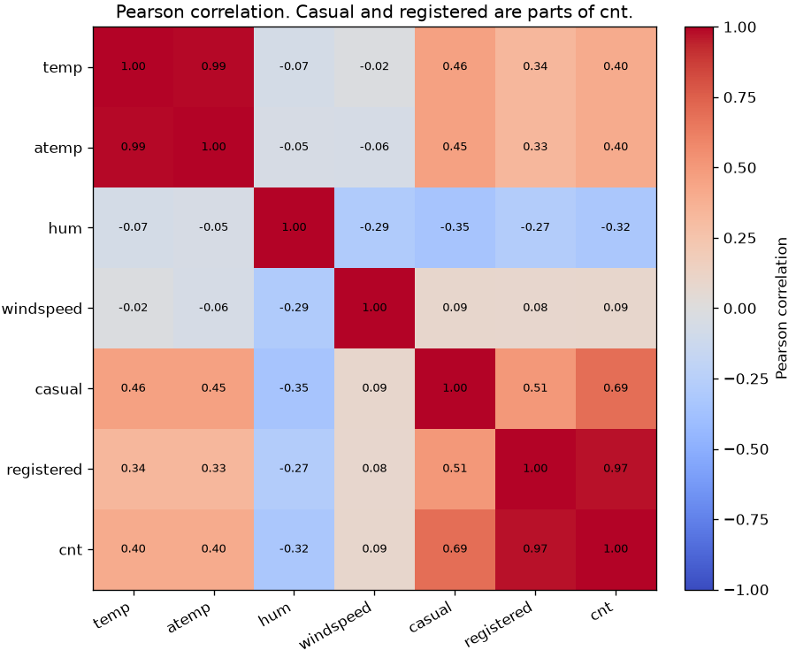
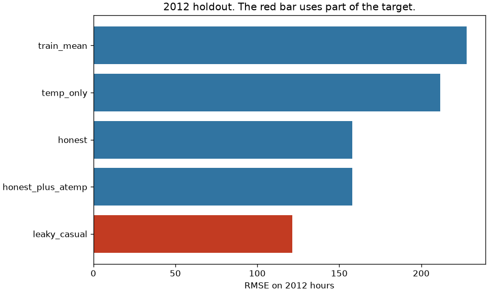
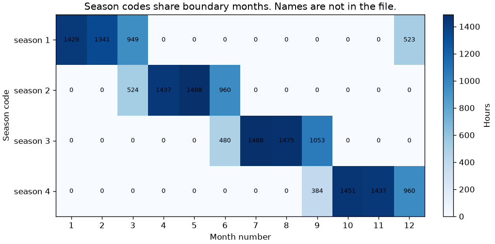

# What the next year does to a familiar chart

The hour-of-day shape barely changes. The level does. A random split hides that, and a column that is part of the target makes the score look better than a description of demand.

## Problem

A city operations team has two years of Capital Bikeshare hourly rentals and a stakeholder who wants to know whether last year is a safe picture of next year. The same person will point at a correlation and ask what drives rentals. Temperature is the usual answer. Casual riders are the usual second answer, because that column moves with the total.

Neither answer is a cause you can act on until the file has been read. The next year can sit higher at the same hour and the same temperature. A column can be correlated with the target because it is part of the target. Two documents can name the same season code differently. This project measures those three failures before anyone treats a chart as a decision.

The rows are public hourly totals for Washington, D.C. They are not rider-level records. This is not a staffing plan and not a causal estimate of weather.

## Concepts taught

- Univariate and bivariate views, and which view hides a shift.
- A time split against a random split of the same size.
- Correlation against an accounting identity, and a coefficient that changes when other columns are added.
- Why a tiny p-value on a large file is not the size of the shift.
- What to do when the data dictionary and the repository page disagree.

## Theory in brief

A Pearson correlation is the standardized linear association between two columns. It is not an effect. If `casual + registered = cnt` in every row, casual is part of the label. Its correlation with `cnt` can be high without being a cause you can change. The identity is the residual, which is zero. The correlation is a weaker fact.

A training-mean baseline predicts one number, the mean of the training period, for every later hour. Root mean squared error is the square root of the mean squared error. The `R²` in this script is

```
1 - (mean squared error) / (mean squared deviation from the scored-period mean)
```

That denominator uses the period being scored, not the training mean. A model can beat the training mean and still have a negative `R²`, because the later period has a different mean. Beating last year's average is not the same as explaining this year's variation.

The Kolmogorov-Smirnov statistic is the largest gap between two empirical cumulative distributions. With thousands of hours, a small gap can produce a tiny p-value. The statistic, the difference in means, and a binned stability index are the size. The p-value is not.

The population stability index compares bin shares. Training quantile edges define the count and temperature bins. Hour and weather use their own levels. Empty shares are clipped at `1e-06` and both sides are renormalized. This script reports the number. It does not apply a cutoff I did not take from a source I opened.

Ridge here minimizes squared error plus `1.0` times the squared coefficient vector, with the intercept unpenalized. Numeric columns are standardized on the training period only. Categorical columns are one-hot encoded on the training period only. Unknown test levels become zeros. `alpha` was fixed before the 2012 scores were computed. It was not chosen because it won.

## Data

Bike Sharing, UCI dataset 275, DOI 10.24432/C5W894. Creator Hadi Fanaee-T. The dataset page I opened licenses it CC BY 4.0. The script downloads the UCI zip into `data/`, which is gitignored, and reads `hour.csv`. Credit the creator if you reuse the extract.

The zip readme says the rows are Capital Bikeshare rentals in Washington, D.C., for 2011 and 2012, aggregated to hours, with weather added from an external weather site and a holiday flag from a District of Columbia schedule. The prediction task named there is hourly or daily rental count from environmental and seasonal settings. The same readme requires a citation to Fanaee-T and Gama, Progress in Artificial Intelligence (2013), DOI 10.1007/s13748-013-0040-3. I opened the readme, not the paper.

The file has `17379` hours, from `2011-01-01` through `2012-12-31`, and `0` missing cells. The repository page says the dataset has `17389` instances. I am not going to edit the file count until it equals that claim. The calendar span is `731` days, which would be `17544` hours. `165` of those hours are absent, across `76` days. There are `0` duplicate date-hour keys. A file with no nulls is not a complete hourly panel.

`cnt` is the total rentals in the hour. `casual` and `registered` are the two parts of that total. Their sum matches `cnt` in every row: the maximum absolute residual is `0.0`, and the nonzero count is `0`. `temp`, `atemp`, `hum`, and `windspeed` are stored already scaled. The zip readme says temperature is divided by 41 and feeling temperature by 50. The repository page gives a different min-max formula. I did not convert the columns. The plots use file units.

The zip readme names season code 1 as "springer," then summer, fall, and winter. The repository page names code 1 as winter, then spring, summer, and fall. The file contains neither name. Code 1 contains months 12, 1, 2, and 3, with `523`, `1429`, `1341`, and `949` hours. Codes share boundary months: month 3 is in codes 1 and 2, month 6 in codes 2 and 3, month 9 in codes 3 and 4, and month 12 in codes 1 and 4. I did not rename the codes.

Weekday `0` is Sunday in this file, measured from the date rather than assumed. The working-day flag matches the readme definition on every row: `0` disagreements with "not Saturday, not Sunday, and not a holiday." Weather code 4 occurs in `3` hours. That is a count, not a weather effect.

The time split is year code `0` against year code `1`: `8645` training hours and `8734` test hours. Year is not a feature in the reported model. It is the split.

## Approach

Look at the file before fitting. Count the missing hours, check the identity, record the season-month table, and compare the two source dictionaries. Then describe the shift: means, a Kolmogorov-Smirnov statistic, a stability index, and the mean rental by hour in each year.

The baseline predicts the 2011 mean for every 2012 hour.

The reported model is ridge regression on season, month, hour, holiday, weekday, working day, weather, temperature, humidity, and wind speed. It was specified before the 2012 scores were used. It excludes the row id, the date, the year code, feeling temperature, casual, and registered. Year is excluded because it does not vary inside the training period. Casual and registered are excluded because they are parts of the target. Feeling temperature is excluded from the reported model and put in a separate run, so a second temperature column is not mistaken for a second mechanism.

The failed or non-selected runs, all scored on the same 2012 hours, are a temperature-only ridge, the reported model plus feeling temperature, the reported model plus the year code, and the reported model plus casual. A random split of the same size, seed `42`, is scored on its own holdout and is not compared as if it were the 2012 file.

Uncertainty was precommitted for three squared-error gaps on the 2012 rows: training mean minus the reported model, reported model minus the casual model, and temperature-only minus the reported model. Each interval uses `1000` resamples. No comparison was added after the scores were seen.

## Experiments

2012 hours. The training-mean baseline has RMSE `227.80800899708046` and `R²` `-0.18922856895347007` against the 2012 mean. The negative `R²` is the level shift: the 2011 mean is `143.79444765760556`, and the 2012 mean is `234.6663613464621`.

| Experiment | What changed | 2012 RMSE | What else was measured |
| --- | --- | --- | --- |
| Training mean | 2011 mean on every 2012 hour | `227.80800899708046` | MAE `168.2519267819546`. `R²` `-0.18922856895347007` |
| Temperature only | Scaled temperature | `211.61468824966946` | `R²` `-0.02616919871808765`. Beats the training mean, loses to the 2012 mean |
| Reported ridge | Calendar and weather, no identity columns | `158.0887211276591` | MAE `110.18908829760082`. `R²` `0.42729743350343097` |
| Add feeling temperature | A second temperature column | `158.05583125492214` | Point estimate only. No precommitted interval |
| Add year code | A column that is constant in 2011 | `158.0887211276591` | Year coefficient `0.0`. Same RMSE as the reported model |
| Add casual | Part of the target | `121.24036781428663` | `R²` `0.6631614048129209`. Not a demand model |

The reported model beats the training mean on squared error by `26904.445215435124`, interval `25767.343982544488` to `28015.73432382263`. The interval excludes zero. MAE remains `110.18908829760082` against a 2012 mean of `234.6663613464621`. The calendar model is a better description than the mean. It is not a finished forecast.

Temperature only is the failed mechanism story. It beats the training mean and still has a negative `R²` against the 2012 mean. The precommitted gap from temperature only to the reported model is `19788.732535226012`, interval `18909.93017280456` to `20641.425928064557`. The scaled temperature coefficient falls from `60.3634706079774` in the one-column model to `32.272748585359736` when the calendar and the other weather columns are included. That is a change in a linear association, holding those columns fixed in the score. It is not an effect of making the city warmer.

Adding feeling temperature barely moves the point estimate, from `158.0887211276591` to `158.05583125492214`. The two scaled coefficients are `20.62945294367281` and `11.387499113812952`, against a reported-model temperature coefficient of `32.272748585359736`. The overall correlation of the two temperature columns is `0.9876721390396491`. I did not precommit an interval, and I am not calling the small RMSE change a win. Two columns for one measurement are not two levers.

Adding the year code does nothing measurable on this split. The coefficient is `0.0`, and the RMSE matches the reported model. The training period has one year code. A column with no training variation cannot learn the level shift.

Adding casual is the failed feature. RMSE falls to `121.24036781428663`. The squared-error gap from the reported model is `10292.81696003526`, interval `9706.204586569078` to `10898.201140060622`. The identity residual is `0.0`, so casual is not an independent measurement. Its correlation with the total is `0.694564077974949`, which is high and still not the identity. The identity is the sum, not the correlation. This model cannot be used before the hour's casual count exists.

The random split is the failed validation. The same specification, scored on a seed-`42` holdout of `8734` rows, has RMSE `110.56838688362778` and `R²` `0.6190259195551173`. That holdout is not 2012. `4344` of the `8645` training rows are 2012 hours, a share of `0.502486986697513`. `4390` of the holdout rows are 2012 hours. The lower error is what happens when the training file contains the period you claim to be predicting. It is not comparable to `158.0887211276591`.

## Plots



Both years pile up at small counts. 2012 has the longer right tail: the maximum is `977.0`, against `651.0` in 2011. The overlap hides the level shift. The hour profile does not.



The correlation of the 24 hourly means is `0.9992071561496558`. 2012 is higher at every stored hour. Hour 8 moves from `262.9944903581267` to `454.7637362637363`. Hour 17 moves from `349.6767123287671` to `573.227397260274`. The shape is familiar. The level is not.



The left panel is the cloud: many hours, a rising association, and a lot of scatter. The right panel uses 2011 temperature bins for both years. The year gap remains inside those bins. Temperature did not move enough to explain the shift. The 2011 temperature mean is `0.48906882591093115`. The 2012 mean is `0.5048248225326311`.



The annotated values are rounded. The stored overall correlations are `0.4047722757786589` for temperature and rentals, `0.9876721390396491` for the two temperature columns, and `0.694564077974949` for casual and the total. Registered is the larger part of the total. That is composition, not a cause.



The casual bar is lower. It is marked as the run that sees part of the target. The feeling-temperature bar sits on top of the reported model. The year-code run is omitted because its RMSE is the same number as the reported model.



The codes overlap at months 3, 6, 9, and 12. The names from the readme and the repository page are not in the file, so they are not in the figure. Cells marked 0 are month-season pairs that do not occur. They are drawn so the grid is complete. They are not stored counts.

## Key takeaways

Mean hourly rentals moved from `143.79444765760556` in 2011 to `234.6663613464621` in 2012. The hour-of-day profile stayed almost the same, with correlation `0.9992071561496558`, and 2012 was higher at every hour.

A random split of the same size scored RMSE `110.56838688362778` because half of its training rows were 2012 hours. The reported model, trained only on 2011, scored `158.0887211276591` on 2012. Those are different questions.

Casual plus registered equals the target in every row. A model allowed to see casual reached RMSE `121.24036781428663`. That is leakage, not a better description of demand.

The temperature association is real and not the year shift. The same temperature bins sit higher in 2012, and the temperature-only `R²` against the 2012 mean is `-0.02616919871808765`.

The season name depends on which document you open. The month table is in the file. I used the table.

## Common mistakes

- Treating a random holdout as a next-year test. Here that holdout trained on `4344` hours from the year it was supposed to describe.
- Reading a correlation as a cause. Casual's correlation with the total is `0.694564077974949`. The residual of the sum is `0.0`.
- Quoting a p-value as the size of a shift. The rental-count statistic is `0.2164736099112342`. The hour statistic is `0.0050754627845970846`, with p-value `0.9998472497350213`. The hour distribution is stable. The demand at those hours is not.
- Calling a tiny temperature p-value an important weather change. The temperature statistic is `0.05462317081036424` and the stability index is `0.03550737978907738`. The count stability index is `0.24372056429642858`. I did not apply an external cutoff to either index.
- Converting temperature with whichever formula is convenient. The readme and the repository page disagree, so the plots stay in file units.
- Renaming season code 1 to winter or to spring. The documents disagree, and the code contains December and March.
- Celebrating a second temperature column. The RMSE change is a point estimate, and the coefficients are no longer one measurement.
- Fitting a year indicator on a one-year training period and expecting it to learn growth. The coefficient is `0.0`.
- Declaring the file complete because there are `0` nulls. `165` expected hours are absent.
- Comparing this project's random-split RMSE with the 2012 RMSE as if the winner were a better model.

## Interview questions

1. Why is correlation not causation here? Casual plus registered equals `cnt` in every row, so the residual is `0.0`. Casual's correlation with the total, `0.694564077974949`, is composition. Temperature is associated with rentals, and the same temperature bins are higher in 2012. The association does not explain the year gap.

2. The random split had a lower RMSE. Should you ship that number? No. It was `110.56838688362778` on a mixed holdout. The training fold contained `4344` hours from 2012. The next-year RMSE of the same specification was `158.0887211276591`. A split that contains the future is not a forecast.

3. A Kolmogorov-Smirnov test on temperature has a tiny p-value. Is the weather shift large? The statistic is `0.05462317081036424` and the stability index is `0.03550737978907738`. The count mean moved from `143.79444765760556` to `234.6663613464621`. Sample size made a small weather gap reject equality. The mean gap is the size that matters for staffing.

4. The hour column did not shift. Did demand? The hour statistic is `0.0050754627845970846` and the hour stability index is `0.00022658441631769787`. The profile correlation is `0.9992071561496558`, and 2012 is higher at every hour. Stable timing is not stable volume.

5. Two documents name season code 1 differently. What do you use? Neither name, until you measure the months. Code 1 contains December, January, February, and March in this file. The readme says "springer." The repository page says winter. The model uses the code.

6. Why can RMSE improve while `R²` is negative? `R²` here is against the scored-period mean. Temperature only has RMSE `211.61468824966946`, better than the training mean's `227.80800899708046`, and `R²` `-0.02616919871808765`. It beat last year's average and still lost to this year's average.

7. Feeling temperature improved the point estimate. Is it a new feature? The RMSE moved from `158.0887211276591` to `158.05583125492214`, with no precommitted interval. The two columns have correlation `0.9876721390396491`. The coefficients split. That is one measurement written twice.

8. Why did the year coefficient become zero? The training period is one year code. The fitted coefficient is `0.0`, and the 2012 RMSE matches the model without it. Growth is a shift you have to represent some other way, or accept that this model will not learn it from a constant.

9. What do you show a stakeholder who asks what drives rentals? The hour profile, the year means, the identity, and the baseline gap. Not a single correlation. The reported model cuts 2012 RMSE from `227.80800899708046` to `158.0887211276591`, and the remaining MAE is `110.18908829760082`.

10. The file has no nulls. What else do you check? Missing hours, duplicate keys, a label that is a sum of other columns, and a dictionary that disagrees with the page. This file has `165` absent hours, `0` duplicate date-hour keys, and an identity residual of `0.0`.

## How this shows up at work

The stakeholder chart is usually last year's hourly profile. Here that shape is a good picture of when rentals happen and a bad picture of how many. Mean demand rose from `143.79444765760556` to `234.6663613464621` while the profile correlation stayed at `0.9992071561496558`. A staffing plan copied forward would be short at the same peaks it got right.

Someone will add the casual column because the correlation is `0.694564077974949` and the RMSE falls to `121.24036781428663`. That feature does not exist before the hour is over. Shipping it is a leakage incident, not a feature win. The check is whether the column is a part of the label, not whether the score moved.

A notebook with a random split will report `110.56838688362778` and look more rigorous than the time split. Ask what share of the training rows come from the period being discussed. Here that share was `0.502486986697513`.

Two dictionaries for one code will reach a meeting. Do not vote on the name. Put the month table on the page. And do not let a significant weather test displace the level shift. The temperature p-value is tiny. The count mean is the number operations will feel.

## Run it

From this directory, with the repo environment installed from the root `requirements.txt`:

```bash
python main.py
pytest tests/test_smoke.py
```

`python main.py` downloads the UCI zip into `data/` if it is not already there, writes `results/metrics.json`, and writes the six plots. The smoke test uses synthetic arrays and does not download the zip. This run finished in `3.123639599998569` seconds.

## Further reading

- UCI Machine Learning Repository, Bike Sharing, dataset 275, DOI 10.24432/C5W894: https://archive.ics.uci.edu/dataset/275/bike+sharing+dataset. Hadi Fanaee-T is the creator named there. The page I opened states the CC BY 4.0 license and the season and temperature descriptions that disagree with the zip readme.
- The `Readme.txt` inside the UCI zip, which this script reads. It is the source for the field list, the "springer" season line, the divide-by-41 and divide-by-50 lines, the Capital Bikeshare description, and the required paper citation.
- The citation as that readme prints it: Hadi Fanaee-T and Joao Gama, "Event labeling combining ensemble detectors and background knowledge," Progress in Artificial Intelligence (2013), DOI 10.1007/s13748-013-0040-3, pages 1-15. I am citing the readme, not a PDF I opened.
