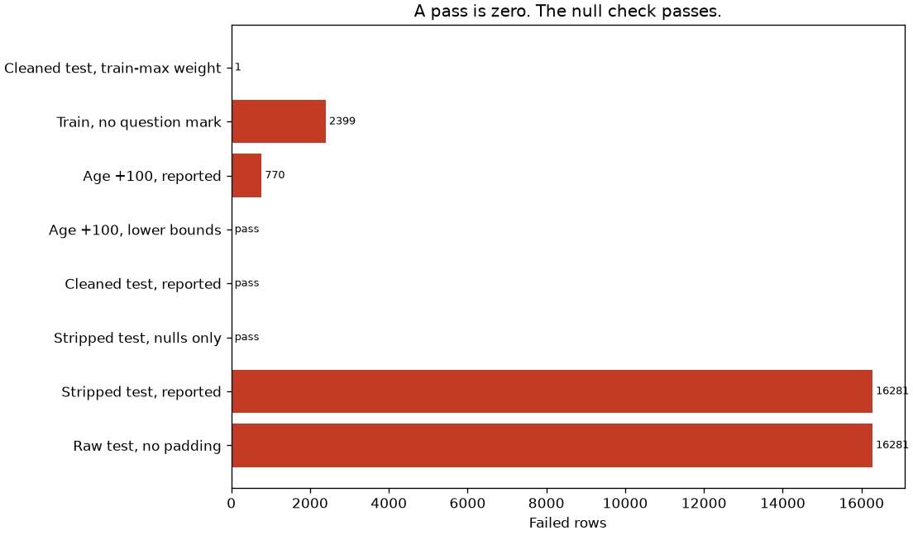
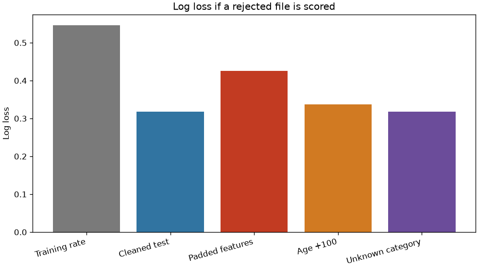

# A null check passed the bad file

The published test labels all end in a period. A schema that only looks for nulls accepts every row. Scoring the padded file anyway moves the log loss. A bad category can fail the schema and still leave the score almost unchanged.

## Problem

A scoring job receives a new census extract and is expected to return a number. The columns have the same names as the training file. The strings do not. If the job only checks that nothing is null, it will score the file. The number will look like a model result. It is a result about a file that did not meet the contract.

The person who owns the job will also hear two other arguments. One is that the score did not move, so the new token cannot matter. The other is that the training maximum is a safe upper bound, so one heavier row should fail the extract. Both arguments are checked here, on the published files, before anyone treats the score as a file review.

This is not a lending or hiring decision. The file is a 1994 Census extract donated for a prediction exercise. Race is in the file. The schema checks it. The model does not use it. This is not a fairness audit.

## Concepts taught

- A schema is a contract, not a null count.
- Why the contract has to say whether stripping is part of ingestion.
- A check copied from an extraction condition, and what that check cannot see.
- A token that is missing from the level list and still belongs in the file.
- A training maximum used as a hard cap.
- Why a score that does not move is not a passing grade for the file.

## Theory in brief

A schema accepts or rejects a table before a model is allowed to see it. Pandera `0.34.1` is the checker in this project. A column check fails when a value is outside a declared set or a declared bound. A failing file is not scored by the reported path. The comparisons that do score a failing file are labeled as silent scores. They measure the cost of skipping the gate. They are not used to edit the gate.

The reported bounds come from three places, and those places are not mixed.

The donor note states extraction conditions: age greater than `16`, final weight greater than `1`, and hours greater than `0`. Those are lower bounds. An age of 190 still satisfies age greater than `16`.

Two caps are mine, and the script records that they are not in the note. Age must be at most `120`. Hours must be at most `168`. They were not chosen by looking at the test file.

The category sets come from the donor note's level lists. The income set comes from the stripped training file, not from the test file and not from the note's class line. The note says unknown values were converted to `?`. The reported schema allows that token only in columns where the training file uses it. A schema that bans it is a comparison, not the gate.

Log loss is the average Bernoulli negative log likelihood,

```
-(1/n) sum [y log p + (1 - y) log(1 - p)]
```

with `p` clipped at `1e-12`. The constant baseline sets `p` to the training positive rate for every scored row. The decision threshold used for accuracy is one half. It was not tuned. Accuracy is stored. It is not the gate.

The paired gaps are mean differences of per-row log loss, rejected-file score minus cleaned-file score. Each interval is a percentile interval from `1000` resamples. I am not claiming a coverage proof. A gap whose interval includes zero is still reported.

## Data

Adult, UCI dataset 2, DOI 10.24432/C5XW20. Creators Barry Becker and Ronny Kohavi. The script downloads `adult.data`, `adult.test`, and `adult.names` into `data/`, which is gitignored. The repository page is https://archive.ics.uci.edu/dataset/2/adult. The UCI API I opened names that DOI and names the missing-value symbol as NaN. The donation policy I opened says datasets approved for the repository are licensed CC BY 4.0: https://archive.ics.uci.edu/contribute/donation. Credit the creators if you reuse the extract.

`adult.names` is the donor note. It says the extract comes from the 1994 Census database, under the conditions age over 16, adjusted gross income over 100, final weight over 1, and hours over 0. The prediction task is whether the person makes over 50K a year. It says unknown values were converted to `?`, and that U.S. was converted to US to avoid periods. It says the files were split into `32561` training rows and `16281` test rows, `48842` instances in total. This script's counts match those three claims: `32561`, `16281`, and `48842`.

The same note's class line is `>50K, <=50K.` I am not treating that period as punctuation or as part of the label. The stripped training labels are `<=50K` and `>50K`. The stripped test labels are `<=50K.` and `>50K.`. The reported income contract is the training set. The note and the test file are recorded, not reconciled.

The UCI API's missing symbol is NaN. The note and the extract use `?`. The raw test file has `0` null cells. A schema copied from the API symbol would be looking for a hole that is not in the file.

The test file starts with `|1x3 Cross validator`. That line is not a row. The script skips it and raises if the marker is absent.

The published files pad every field after the first comma. Age is the first field. It is not in the padding failures. Every other assigned column is. Every raw training row and every raw test row has at least one padded field: `32561` and `16281`.

After stripping, `?` appears in three training columns: workclass `1836`, occupation `1843`, and native country `583`. Education and education number are one-to-one in the training file. The reported schema checks the test file against that training map. It does not learn the map from the test file. Race is checked and then excluded from the model. `fnlwgt` is the Census final weight. The note says similar weights apply within a state, not across states. It is excluded from the model. Sex remains in the model because this comparison is about the gate, not a new feature list. That is not a recommendation to use sex in an income screen.

## Approach

The ingestion step is named. Stripping is not an invisible cleanup, and it is not applied on one side only. The reported gate then runs on the stripped table.

The reported schema requires the assigned columns, rejects an extra column, and checks:

- age greater than `16` and at most `120`
- final weight greater than `1`, with no training-maximum cap
- capital gain and capital loss at least `0`
- hours greater than `0` and at most `168`
- categories in the donor lists, plus `?` in the three training columns that use it
- income in the stripped training labels, with no period and no padding
- education number equal to the training education map

The model is fit only on the stripped training file. It is logistic regression with `C` of `1.0`, an L2 penalty, lbfgs, and at most `2000` iterations. The fit used `65` iterations. Numeric columns are scaled on training. Categorical columns are one-hot encoded on training, and an unknown level becomes zeros. The features are age, education number, capital gain, capital loss, hours, workclass, marital status, occupation, relationship, sex, and native country. `?` stays as its own category. It is not imputed.

The constant baseline predicts the training positive rate, `0.2408095574460244`, for every test row.

Four comparison gates were specified before the scores were used. A null-only schema. The donor lower bounds with no caps. The reported schema with `?` removed from the allowed sets. A final-weight cap at the training maximum. None of them is selected because of the log loss it would have produced.

Two corruptions use one draw of `814` cleaned test rows, rate `0.05`, seed `42`. One adds `100` to age. The other replaces workclass with `N/A`. The draw was not chosen after seeing which rows moved the score.

The silent scores repair the income period only so the label is defined. The features stay broken. That repair is not part of the reported gate. The gate sees the unrepaired file and rejects it.

## Experiments

The constant baseline has log loss `0.5467485574653357` on the published test rows. The model on the cleaned test file has log loss `0.31833658576426743`, accuracy `0.8529574350469873` at the untuned threshold, and ROC AUC `0.9048541861256276`. That is the scoreable file. The cleaned test file passes the reported schema. The stripped training file passes it too.

| Gate or score | What was checked | What happened |
| --- | --- | --- |
| Raw files, no padding | Leading or trailing space | Failed rows `32561` and `16281`. Age is not in the failing columns |
| Stripped test, reported schema | Training income labels | Failed rows `16281`. The examples are `<=50K.` and `>50K.` |
| Stripped test, nulls only | Nulls and column names | Passed. Null cells in the raw test file: `0` |
| Cleaned test, reported schema | Strip, then remove one income period | Passed. Failed rows `0` |
| Age plus `100`, donor lower bounds | Age greater than `16` only | Passed. Failed rows `0` |
| Age plus `100`, reported schema | Age cap `120` | Failed rows `770`. `44` corrupted rows stayed within the cap |
| Unknown workclass, reported schema | Donor levels plus `?` | Failed rows `814` |
| Training file, no question mark | Donor levels only | Failed rows `2399`. Failure cases `4262` |
| Cleaned test, training-max weight | Weight at most `1484705.0` | Failed rows `1`. The example value is `1490400` |

The null-only schema is the failed check. It passes the stripped test file. The reported schema fails all `16281` rows of that same file, on the income column. A file with no nulls is not a file that meets the label contract.

The padding score is the cost of skipping the gate. With features left as published, log loss is `0.425486700706032` and ROC AUC is `0.8223558134122712`. The paired gap against the cleaned score is `0.10715011494176453`, interval `0.09974343153574589` to `0.11467272472014542`. The interval excludes zero. The encoder was fit on stripped training levels, so a leading space makes a known category unknown. The label was repaired only to compute the metric. The reported gate would not have scored this file.

The age corruption is the extraction-condition failure. Adding `100` to `814` rows leaves every corrupted age above `16`, so the donor lower-bound schema passes the file. The reported cap fails `770` rows. `44` corrupted rows remain at or below `120`, so the cap is not a complete detector of this shift. The file still fails. Scoring it anyway raises log loss to `0.3373689376884842`. The paired gap is `0.019032351924216744`, interval `0.015824906773038657` to `0.022076784870518694`. The interval excludes zero. The lower-bound schema would have allowed that score.

The unknown category is the failed "watch the score" argument. The schema rejects all `814` altered rows. The silent log loss is `0.3185299015633552`. The paired gap is `0.0001933157990877257`, interval `-3.066274477825533e-05` to `0.0004156091257688888`. The interval includes zero. The encoder drops an unknown level, and only those `814` rows lose that column. A score that does not resolve a difference is not a clean file.

Banning `?` is the failed strict reading of the level list. The note lists the categories and, separately, says unknown was converted to `?`. The list does not contain the token. The ban fails `2399` training rows and `4262` cells: workclass `1836`, occupation `1843`, native country `583`. The training job cannot start. The reported schema allows the token in those three columns, and the stripped training file passes.

The training-maximum weight is the other failed strict rule. The training maximum is `1484705.0`. One cleaned test row has `1490400`. The cap rejects the published test file after the label has been repaired. Capital gain does not tell this story: both maxima are `99999.0`, so a training-maximum cap on that column would not have failed this file. The reported schema does not cap the weight at the training maximum. The cleaned test file passes.

## Plots



The two long bars are the published test file: padded on arrival, and still rejected after stripping because of the income period. The null-only bar is a pass. The donor lower bounds pass the age shift. The reported cap does not. The question-mark ban fails the training file. The training-maximum weight fails one cleaned test row.



The padded file is the expensive silent score. The age shift is smaller and still resolved by the precommitted interval. The unknown category sits on the cleaned bar. That is the score you would wave through if you used the metric as a schema.

## Key takeaways

A null check passed the stripped test file. The reported schema failed all `16281` rows because the income labels were `<=50K.` and `>50K.`. There were `0` null cells.

Scoring the padded features anyway moved log loss from `0.31833658576426743` to `0.425486700706032`. The gap was `0.10715011494176453`, and the interval excluded zero.

Replacing `814` workclass values with `N/A` failed the schema and did not produce a log-loss gap whose interval excluded zero. The score is not the review.

The donor condition age greater than `16` passed an age shift of `100`. A cap at the training maximum weight rejected one otherwise valid test row, `1490400` against `1484705.0`.

The cleaned file passes. The gate is not an excuse to reject the published test extract after the two declared repairs: strip, then remove one trailing period from income.

## Common mistakes

- Calling a null check a schema. This test file has `0` nulls and `16281` bad labels.
- Stripping the training file and not the arrival file. Every raw test row is padded. The silent log loss is `0.425486700706032`.
- Reading the note's class line, `>50K, <=50K.`, as the label contract. The training labels have no period. I did not vote on the punctuation.
- Copying the API's missing symbol. The API says NaN. The extract says `?`. The null count is `0`.
- Banning `?` because it is absent from the level list. That ban fails `2399` training rows. The note says unknown was converted to that token.
- Using the training maximum as a hard cap. One test weight, `1490400`, is above `1484705.0`. The row is not a broken label.
- Trusting an extraction lower bound to catch an impossible age. Age greater than `16` passed the shifted file.
- Waiting for log loss to move. The unknown-category interval included zero. The schema had already failed `814` rows.
- Learning the allowed labels from the file being validated. The income set here comes from training. A set learned from the test file would have accepted the period.
- Treating this model's accuracy, `0.8529574350469873`, as the validation result. The threshold was not tuned, and the gate is the schema.

## Interview questions

1. What is the difference between a null check and a schema? A null check asks whether a cell is empty. This raw test file has `0` null cells, and the null-only schema passes after stripping. The labels are still `<=50K.` and `>50K.`. The reported schema fails all `16281` rows. A schema states the values that are allowed.

2. The score got worse after a bad extract. Is that the validation? It is the cost of skipping validation. Padded features moved log loss from `0.31833658576426743` to `0.425486700706032`. The gate should have stopped the file before that number existed. The unknown-category run is the counterexample: the schema failed `814` rows, and the log-loss interval included zero.

3. Why not infer the schema from the file you are about to score? The test labels would then define the legal labels, and the period would pass. The contract has to come from the donor note and the training file. The cleaned test file is the thing being accepted or rejected.

4. The donor note says age greater than 16. Is that enough? No. The age-plus-`100` file passes that check, with `0` failed rows. The reported cap at `120` fails `770` rows. `44` shifted rows stay within the cap, so even the cap is not a complete detector. A lower bound is not an upper bound.

5. A new row has a larger final weight than any training row. Do you fail the extract? Not with a training maximum. That rule fails one cleaned test row, `1490400` against `1484705.0`, after the label is valid. The reported schema checks the donor lower bound, final weight greater than `1`, and lets the cleaned file pass.

6. The level list does not contain `?`. Should the schema reject it? Not if the same note says unknown was converted to `?` and the training file uses it. The ban fails `2399` training rows. The reported schema allows it in workclass, occupation, and native country. Those training counts are `1836`, `1843`, and `583`.

7. Two documents disagree about the missing token. What do you do? Keep both. The API I opened says NaN. The note and the file use `?`. A null check matches the API and misses the file. Do not edit the file until the documents agree.

8. Why did the padded score change when the unknown category barely did? A leading space hits every categorical cell, so the encoder treats the test categories as unknown. `N/A` hits `814` rows of one column, and unknown levels are ignored. The size of the score change is not the validity of the token.

9. Where do you fit the education map? On training. It is one-to-one there, and the cleaned test file passes the check. Fitting it on the file under review would make the check pass by construction.

10. What do you tell the person who wants the score anyway? The cleaned score is `0.31833658576426743` against a training-rate baseline of `0.5467485574653357`. The padded score is a different file. I will not put `0.425486700706032` in the model report as if the contract had passed.

## How this shows up at work

The job fails closed. A new extract that fails the reported schema does not get a score, a dashboard, or a stakeholder sentence. The published test file fails twice: once on padding, and again on the income period after stripping. The cleaned file passes, so the repair is specific. It is not "reject the vendor."

Someone will propose a null check because the API says the missing symbol is NaN and the null count is `0`. That check passes the bad labels. The review artifact is the failed income check, not a green null report.

Someone will also say the score barely moved, so the new workclass token is fine. Here the interval included zero and the schema had already failed `814` rows. The encoder was designed to ignore unknown levels. That design hides the token in the metric. It does not make the token legal.

The training-maximum cap is how a pipeline rejects a legitimate new row and then looks strict. One weight, `1490400`, is above the training maximum `1484705.0`. Operations will hear that the file failed validation. The failure is the cap, not the extract. Write the bound down as a donor rule or as your own rule. Do not let the training sample become the rule by accident.

## Run it

From this directory, with the repo environment installed from the root `requirements.txt`:

```bash
python main.py
pytest tests/test_smoke.py
```

`python main.py` downloads the three UCI files into `data/` if they are not already there, writes `results/metrics.json`, and writes the two plots. The smoke test uses a tiny frame and does not download the files. This run finished in `2.8029182000009314` seconds.

## Further reading

- UCI Machine Learning Repository, Adult, dataset 2, DOI 10.24432/C5XW20: https://archive.ics.uci.edu/dataset/2/adult. Barry Becker and Ronny Kohavi are the creators named by the API I opened. That API also names the missing-value symbol as NaN, which the extract does not use.
- UCI donation policy, which I opened: https://archive.ics.uci.edu/contribute/donation. It says datasets approved for the repository are licensed CC BY 4.0.
- `adult.names`, which this script reads. It is the source for the extraction conditions, the level lists, the conversion of Unknown to `?`, the class line `>50K, <=50K.`, and the required paper citation.
- The citation as that note prints it: Ron Kohavi, "Scaling Up the Accuracy of Naive-Bayes Classifiers: a Decision-Tree Hybrid," Proceedings of the Second International Conference on Knowledge Discovery and Data Mining, 1996, pages listed there as "to appear." I am citing the note, not a PDF I opened.
- Pandera 0.34.1, the checker this script imports: https://pandera.readthedocs.io/en/stable/. The version string is the one this run recorded.
