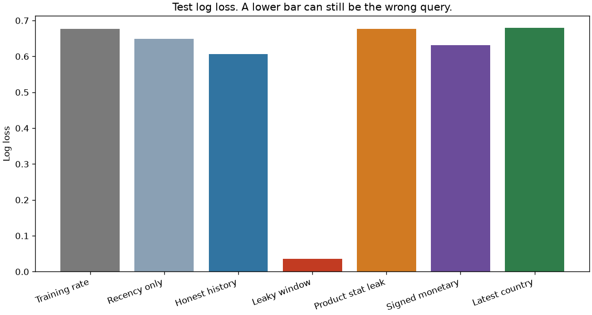
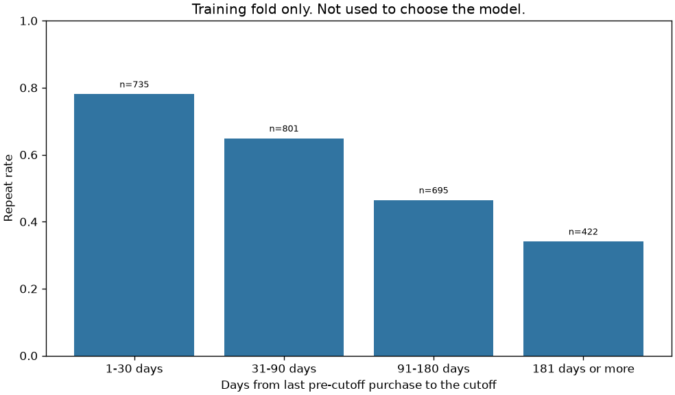

# The better score had already seen the order

A query that includes the label window scores a test log loss of `0.03506553353837828`. The same model, limited to lines before the cutoff, scores `0.6063879510172124`. The first number is not a forecast. It is the label leaking through the date filter.

## Problem

A retailer wants to know which existing customers will place another order after a date. The file is not a customer table. It is one row per invoice line. Someone will be asked to write a SQL query that joins customers, orders, and products and returns spend, recency, and an order count.

If that query is written against the whole extract, and the label is "bought again before the extract ended," the features contain the outcome. The backtest will look solved. The query could not have been run on the decision date.

This file is a UK online gift retailer, and the source note says many customers are wholesalers. A repeat here is another business order, not a consumer app session. The model is not a churn product and it is not a pricing tool.

## Concepts taught

- Turn one invoice extract into customers, products, orders, and lines.
- Define a cutoff, an eligible population, and a label that does not reuse the feature window.
- Put the date predicate on the line timestamp, not on a collapsed invoice key.
- See a leak that improves the score, and a leak that does not.
- See an invoice split put the same customer on both sides.
- Leave a missing customer id missing.

## Theory in brief

Pick a cutoff `T`. A purchase line has quantity greater than `0`, unit price greater than `0`, and an invoice number that does not start with `C` after uppercasing. That rule was fixed before the scores.

A customer is eligible when the customer id is present and at least one purchase line has timestamp `t < T`. The label is `1` when at least one purchase line has `t >= T`, and `0` otherwise. Customers with no purchase before `T` are not scored. They have no history the query could have used on the decision date.

An honest feature is an aggregate of purchase lines with `t < T`. Recency is the calendar-day difference between the date of the last of those lines and the cutoff date. DuckDB's `date_diff` returns that difference as an integer. The docs I opened describe it as an integer date-part function. The smoke test locks the calendar-day reading on a known pair of dates. That check is the definition used here, not a claim about every database.

The leaky query keeps the same eligible customers and moves the feature bound to one second after the last parsed timestamp. Its recency anchor is the date of that last timestamp, not the cutoff. A positive customer then has extra orders, extra spend, and a recency measured after the purchase that defines the label.

A second leak leaves the customer list historical and removes the date filter from a product statistic. Each stock code gets a mean purchase quantity over the whole file. Each customer gets the average of those means for products bought before the cutoff. The join looks historical. The number on the product row is not.

The reported model is logistic regression. Numeric features are scaled with the training customers' mean and scale, inside the pipeline, and then

```
p = 1 / (1 + exp(-(w · z + b)))
```

Log loss is the mean Bernoulli negative log likelihood,

```
-(1/n) sum [y log p + (1 - y) log(1 - p)]
```

with `p` clipped at `1e-12`. The constant baseline sets `p` to the training positive rate for every test customer. The decision threshold for accuracy is `0.5`. It was not tuned. Accuracy is stored. It is not the selection metric.

The paired gaps are mean differences of per-customer log loss on the `664` test customers. The name is the first model minus the second. A negative gap means the first model has lower loss. Each interval is a percentile interval from `1000` resamples, seed `7`. I am not claiming a coverage proof.

## Data

Online Retail, UCI dataset 352, DOI 10.24432/C5BW33. Creator Daqing Chen. The script downloads `https://archive.ics.uci.edu/static/public/352/data.csv` into `data/`, which is gitignored. The repository page is https://archive.ics.uci.edu/dataset/352/online+retail. The API record I opened has no license field. The donation policy I opened says datasets approved for the repository are licensed CC BY 4.0: https://archive.ics.uci.edu/contribute/donation. Credit Daqing Chen if you reuse the extract.

The API abstract says: "This is a transactional data set which contains all the transactions occurring between 01/12/2010 and 09/12/2011 for a UK-based and registered non-store online retail." The same record says the company mainly sells unique all-occasion gifts and that many customers are wholesalers. The API also names an introductory paper. I did not open that PDF, so none of its results are used here.

The API says `541909` instances. This file has `541909` rows. The API says `6` features. The file has `8` columns. I am not reconciling that. The API says the extract has no missing values, and it says CustomerID and Description have no missing values. The file has `135080` missing customer ids and `1454` missing descriptions.

The columns, as the API describes them, and what the file did:

- InvoiceNo is called a 6-digit number uniquely assigned to each transaction. A leading `c` means a cancellation. The file has `25900` invoice numbers. `43` of them have two timestamps, both spans are `1` minute, and `0` invoices have a line before the cutoff and a line at or after it. `9288` rows start with `C`. `0` start with `c`. The purchase rule uppercases the invoice number, so both forms would be excluded. Only the uppercase form is in the file.
- StockCode is called a 5-digit integer uniquely assigned to each product. `1124` codes, on `54873` rows, are not 5-digit integers. They stay in the product table as strings. `650` codes have more than one description, and one code has `8`. Description is not the product key. `4070` stock codes are in the file.
- Quantity and UnitPrice are the line amount. `10624` rows have a negative quantity. `1336` of those do not start with `C`. `0` cancellation-prefix rows have a positive quantity. `2515` rows have a zero price. `2` have a negative price. The purchase rule excludes all of those. `530104` rows pass it. `313059` of those are before the cutoff and `217045` are at or after it.
- InvoiceDate is text. The format that parsed all `541909` rows is `%m/%d/%Y %H:%M`. The parsed span is `2010-12-01 08:26:00` to `2011-12-09 12:50:00`. Sorting the text gives `1/10/2011 10:04` to `9/9/2011 9:52`. Those are not the first and last invoices. The API date text is `01/12/2010 and 09/12/2011`. That string is not the file's minimum or maximum, and it was not used as the parser format.
- CustomerID is called a 5-digit number uniquely assigned to each customer. `4372` non-null ids are present. The `135080` missing rows cover `3710` invoices, `9` countries, and `3810` products. Those rows are not given a sentinel id. One sentinel would glue that set into a single customer.
- Country is called the name of the country where the customer resides. `38` countries appear. `0` invoices contain more than one country. `0` country strings have padding. `8` of `4372` customers have more than one country on some line. `6` of `3317` eligible customers have more than one country on a purchase line before the cutoff. A latest-line rule is an extra assumption, not the data dictionary.

`5268` rows are exact duplicates of another row. The line grain is the file row. I counted the duplicates and kept them. I did not rerun the model after dropping them, so I am not claiming they are harmless.

`0` invoices have more than one customer id, so the order's customer id is that unique id. Invoices with only a missing id stay out of the customer table.

## Approach

The cutoff is `2011-09-01 00:00:00`. It sits inside the parsed span. The label window runs from that timestamp through the last parsed line, `2011-12-09 12:50:00`. The leaky feature bound is one second later, `2011-12-09 12:50:01`, and its recency anchor is `2011-12-09`.

DuckDB `1.4.4` builds four tables from the extract: customers, products, orders, and order_lines. The reported feature query starts from eligible customers, joins orders, joins order_lines, and joins products. The date predicate is `order_lines.invoice_ts < cutoff`. It is not `orders.ts_min`. The `43` multi-timestamp invoices do not cross this cutoff, so a minimum-timestamp bug would not have moved this file's features across the decision date. The query does not rely on that. A line can cross a cutoff even when this extract's invoices do not.

The reported features are order count, line count, product count, purchase monetary sum, recency in days, cancellation-invoice count, and mean unit price. Cancellations use a second join with the same feature bound. They are not subtracted from the purchase sum. Scaling is fit on the training customers only. The logistic regression uses `C` of `1.0`, an L2 penalty, lbfgs, and at most `2000` iterations. The reported fit used `20`.

The split is a stratified customer split, test size `0.2`, seed `42`. It is not an invoice split. `2653` customers are in train and `664` are in test.

The constant baseline predicts the training positive rate, `0.5883905013192612`, for every test customer. A recency-only logistic model is the simple feature baseline. Both were specified before the test scores were used.

Four comparisons are scored and not selected. The leaky window uses the same seven aggregates through the extract end. The product-stat leak uses the all-time mean quantity. Signed monetary sums every pre-cutoff line, including cancellations, zero prices, and negative quantities. Latest country is a one-hot of the latest pre-cutoff purchase country, with an unseen country becoming zeros. `1` test customer had a country absent from the training fold. None of these four is selected because of its log loss. The reported model name was fixed as the honest history query.

Class weights are not used. The positive rate is `0.5884835694905035`, not a rare-event problem. Threshold tuning belongs in a later project.

## Experiments

`3317` customers are eligible. `1952` are positive. The test positive rate is `0.588855421686747`.

| Experiment | What changed | Test log loss | Notes |
| --- | --- | --- | --- |
| Training rate | One probability for every test customer | `0.6772728728233448` | Accuracy `0.588855421686747`, the test rate, because the training rate is above `0.5` |
| Recency only | Days since the last pre-cutoff purchase | `0.6494876916888732` | AUC `0.6494664755534321`. Beats the constant. |
| Honest history | Seven aggregates before the cutoff | `0.6063879510172124` | Reported model. AUC `0.7186419718389028`. Accuracy `0.6656626506024096` at the untuned threshold. |
| Leaky window | Same aggregates through the extract end | `0.03506553353837828` | AUC `0.9999063170418669`. Better, and not a forecast. Not selected. |
| Product-stat leak | All-time mean quantity of products bought before the cutoff | `0.6773985009263662` | AUC `0.5132139812446718`. Worse than the constant. Still not a legal feature. |
| Signed monetary | Sum of every pre-cutoff line | `0.6308298095776333` | AUC `0.6877640688382376`. `1149` customers differ from the purchase sum. |
| Latest country | Latest pre-cutoff purchase country | `0.6790522959989986` | AUC `0.49045839071414526`. Worse than the constant. |

The honest model beats the constant by `0.07088492180613244` log loss. The percentile interval is `-0.1090016714913747` to `-0.030176592632029153`, and it excludes zero. It also beats recency only. That gap is `-0.04309974067166066`, interval `-0.0736253154532777` to `-0.006368137132793607`, and it excludes zero. The extra aggregates helped on this split. That is the reported improvement.

The leaky window beats the honest model by `0.5713224174788343` log loss. The interval is `-0.6115919502171333` to `-0.5353588281723854`. It excludes zero. The order count rose for `1952` customers, which is every positive customer. No invoice spans the cutoff, so each of those customers has at least one new invoice in the label window, and the leaky query counted it. The score is reading that fact. It was not selected.

The product statistic is the leak that does not announce itself. Its gap against the honest model is `0.07101054990915373`, interval `0.030296408118255028` to `0.10901785688689815`. It is worse, and the statistic still uses purchases after the cutoff. A score that fails to improve is not a cleanliness check.

Latest country is worse than the honest model by `0.07266434498178614`, interval `0.03163814459614468` to `0.11073493324936706`. `2989` of `3317` eligible customers have United Kingdom as the latest purchase country, a share of `0.9011154657823335`. The column is almost a constant, and the data dictionary's "one country" claim is false for `6` eligible customers.

Signed monetary is worse than the honest model on the point estimate, by `0.024441858560420825`. The interval is `-0.004563709605442553` to `0.05345779296215528`, and it includes zero. I am not calling that a resolved loss. It was not selected because the purchase rule was already fixed.

Two designs were not scored, because a score would have mixed the bug with a model.

| Failed design | What was measured | Result |
| --- | --- | --- |
| Text min and max of InvoiceDate | String sort | `1/10/2011 10:04` to `9/9/2011 9:52`, against a parsed span of `2010-12-01 08:26:00` to `2011-12-09 12:50:00` |
| Random split of history invoices | Seed `42`, test size `0.2`, `13842` invoices, `2768` held out | `1254` of `3317` eligible customers have invoices on both sides |
| Random split of every customer invoice | `22190` invoices, `4438` held out | `1676` of `3317` eligible customers are on both sides |
| One id for every missing customer | Count the rows that would be glued together | `3710` invoices, `9` countries, `3810` products |

The history-invoice split also puts `1255` of `3360` customers with a pre-cutoff invoice on both sides. Those `3360` customers are not the eligible set. An invoice before the cutoff is not the same thing as a purchase before the cutoff.

The maximum pre-cutoff purchase sum is `176355.93999999986`. The mean is `1579.511776303889`. That maximum is the raw float sum, not a rounded sterling amount. It is one reason not to read this as a consumer basket model.

The run took `1.3839195000000473` seconds on this machine, including the local file read and the plots. That is a measurement, not a budget.

## Plots



The red bar is the leaky window. It is the lowest log loss and the query that could not have been run on the cutoff. The blue bar is the reported model.



This chart uses the `2653` training customers only. The bin edges were fixed in the script. They were not chosen from the test score, and the chart was not used to pick the model.

| Days since last pre-cutoff purchase | Training customers | Repeat rate |
| --- | --- | --- |
| 1-30 | `735` | `0.780952380952381` |
| 31-90 | `801` | `0.6491885143570537` |
| 91-180 | `695` | `0.46474820143884893` |
| 181 or more | `422` | `0.3412322274881517` |

## Key takeaways

The honest history query beats the training-rate baseline, `0.6063879510172124` against `0.6772728728233448`, and it beats recency alone. That improvement is real on this customer split.

The leaky query's `0.03506553353837828` is a better number and a worse query. Every one of the `1952` positive customers gained an order when the date filter was removed.

A leak does not have to improve the score to be a leak. The all-time product average was worse than the constant model and still used rows from the label window.

An invoice split is not a customer split. `1254` eligible customers landed on both sides of a history-invoice holdout.

A missing customer id is a missing key. Filling it once would merge `3710` invoices into one person.

## Common mistakes

- Choosing the SQL with the lowest backtest score. Here that choice selects the leak.
- Treating a score that did not move as evidence the feature is historical. The product average did not help, and it still used future lines.
- Splitting the invoice table, or the line table, and then scoring customers.
- Computing a product attribute on the full extract and joining it to a historical customer list.
- Sorting date text. The text minimum of this file is not the first invoice.
- Collapsing an invoice to its minimum timestamp before applying the cutoff. It happens not to cross this cutoff. That is not the rule.
- Filling every missing customer id with one sentinel.
- Reading "country where the customer resides" as a promise that the column has one value per customer.
- Reporting accuracy when a constant rate above `0.5` already predicts the majority class for every row.

## Interview questions

1. Why is the split unit the customer, not the invoice? A random split of history invoices put `1254` of `3317` eligible customers on both sides. The holdout would not be a new customer. `05-model-evaluation/02-cross-validation` is the later project on group splits.

2. Why is a log loss of `0.03506553353837828` not a reason to ship the query? The feature window includes the label window. The order count rose for all `1952` positive customers. The query could not have been executed on the cutoff. `02-feature-engineering/03-data-leakage` continues this distinction.

3. When does a join to a product table leak? When the product attribute was computed with rows after the decision time, even if the customer's product list is historical. This project's all-time mean quantity is that join. It lost to the constant model. The loss does not make the attribute legal.

4. Why did country fail, if the dictionary says it is where the customer resides? `2989` of `3317` latest countries were United Kingdom. The model scored `0.6790522959989986`, worse than the training rate, with AUC `0.49045839071414526`. `6` eligible customers had more than one country before the cutoff, so the dictionary sentence is not a column constraint.

5. How should a missing customer id be handled? Not with one fill-in. These missing rows cover `3710` invoices, `9` countries, and `3810` products. They stay out of the customer model, and the count is reported.

6. Why is the minimum date string the wrong first invoice? Text order put the minimum at `1/10/2011 10:04`. The parser that accepted every row put the first timestamp at `2010-12-01 08:26:00`. The API's `01/12/2010 and 09/12/2011` is a third string. It was not used as the format.

7. Why is log loss the comparison, not accuracy at `0.5`? The training rate is `0.5883905013192612`, so the constant predicts every customer repeats. Its accuracy equals the test rate, `0.588855421686747`. That accuracy cannot rank the constant. The threshold was not tuned. `05-model-evaluation/01-metrics-deep-dive` and `05-model-evaluation/04-cost-sensitive-threshold` are the later projects.

8. The honest model beat recency. Does that mean the feature list was chosen by the test? No. The seven aggregates and the reported model name were fixed before the scores were read. The leaky query beat the honest model by more and was rejected for the date filter, not because of a second look at the leaderboard. `05-model-evaluation/05-statistical-comparison` is where paired comparisons get a longer treatment.

9. What should the date predicate attach to? The line timestamp. An invoice key with two timestamps is not one time. This file has `43` such invoices. None cross this cutoff. The predicate still belongs on the line, because the key check failed.

## How this shows up at work

The ticket sounds small: add customer spend and days since last order. The warehouse table is current. The backtest label is "ordered again before today." If the feature query and the label share that table, the offline result can look like the red bar. Production has to run the query on the decision date, so it will look like the blue bar. The stakeholder question is why the pilot missed the backtest. The answer is the predicate, not the estimator.

A second review comment is about grain. A notebook that splits invoices and then aggregates to customers will put the same customer in train and test. Here that happened to `1254` eligible customers even after limiting the split to history invoices. The fix is the split unit, not a different model class.

Missing customer ids become a data-quality count. They are not an imputation task unless someone can say which person the line belongs to. One default id creates a fake customer from `3710` invoices.

Country will be requested because it is in the data dictionary. The dictionary says where the customer resides. The file has `6` eligible customers with more than one country before the cutoff, and the latest-country model did not beat the training rate. Write the rule down, then measure it. Do not add it because the score might move.

The later folder `02-feature-engineering/07-aggregation-features` stays on this grain problem. `02-feature-engineering/10-sklearn-pipelines` is the version where the scaler is not a separate step someone can fit on the full frame.

## Run it

From this folder, with the repo requirements installed:

```bash
pip install -r requirements.txt
python main.py
pytest tests/test_smoke.py
```

`make run` and `make test` call the same two commands. The script downloads the CSV only if `data/online_retail.csv` is missing. Do not commit that file. DuckDB is pinned in the repo `requirements.txt` because the smoke test imports this project and CI installs that file.

## Further reading

- UCI Online Retail dataset record, including the abstract, the variable notes, and the API fields used above: https://archive.ics.uci.edu/dataset/352/online+retail
- UCI donation policy, which states the CC BY 4.0 license for datasets approved into the repository: https://archive.ics.uci.edu/contribute/donation
- DuckDB date-part functions, including `date_diff`: https://duckdb.org/docs/2.0/sql/functions/datepart.html

The introductory paper named by the UCI API was not opened. It is not listed here.
