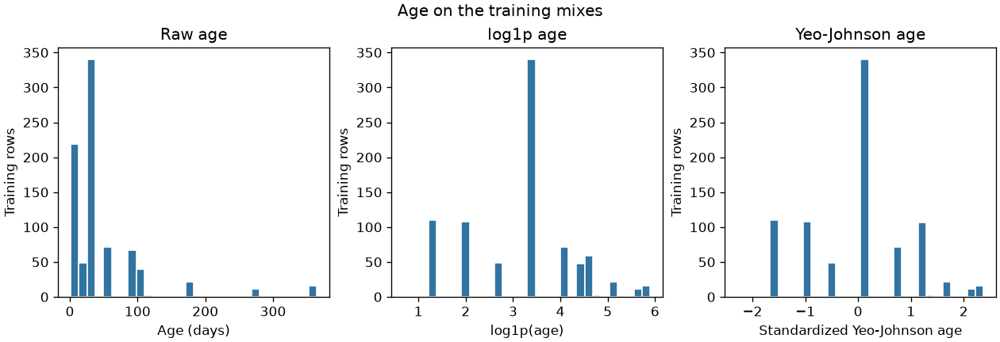
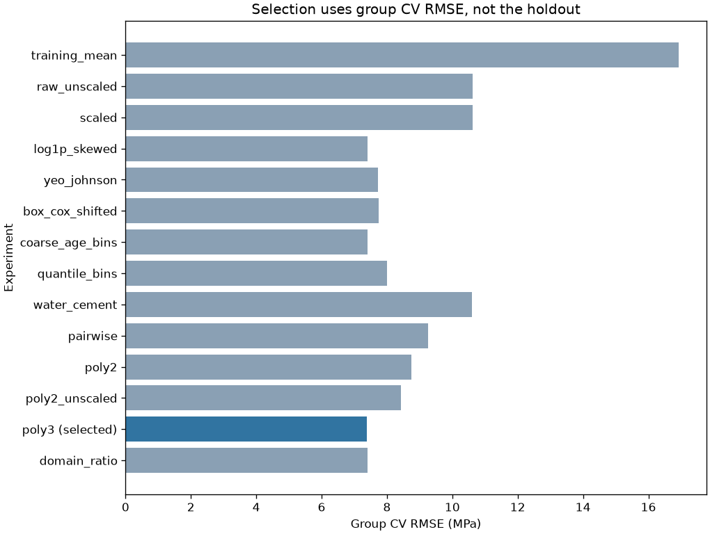
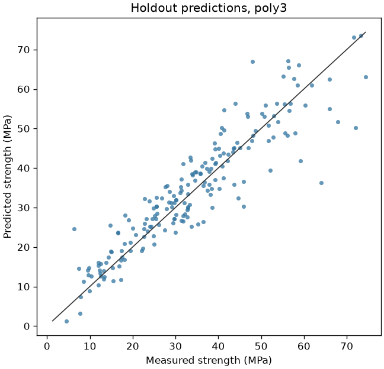

# Numeric transforms for concrete strength

A materials lab can screen a mix before it breaks the cylinder. This project asks which numeric transforms actually change a ridge regression of compressive strength, and which ones only look more general.

## Problem

A lab proposes a mix in kilograms per cubic meter and wants an estimate of compressive strength in MPa at a stated age. Waiting for the break test is the expensive part. A spreadsheet user starts with a linear model on the raw quantities. Age is piled up at a few curing days and has a long tail, several ingredients are often absent, and the same recipe is broken at more than one age. Those are transform and split problems, not a reason to jump to a larger model.

## Concepts taught

Scaling, `log1p`, Box-Cox, Yeo-Johnson, binning, a domain interaction, and polynomial features. Also the difference between a transform that wins a pre-registered rule and a transform you can explain.

## Theory in brief

A ridge fit minimizes the squared error plus `alpha` times the sum of squared feature weights. The intercept is not part of that penalty. Here `alpha` is `1.0` and it was not tuned. If one column has a much larger spread than another, the same penalty treats their weights differently, because a large-scale column needs a small weight to move the prediction. Standardization puts each training column on a common scale:

`z = (x - u) / s`

`u` and `s` come from the training rows only. On this split, scikit-learn's scale matched NumPy's population standard deviation and did not match the sample standard deviation. Scaling does not straighten a curve. It only changes the units the penalty sees.

`log1p(x)` is the natural log of `1 + x`. It is defined for every nonnegative column in this file. The screen that chooses columns is a fit: training skew, with the bias correction off, must exceed `1.0`, and the training minimum must be at least `0`. Each CV fold fits that screen itself. The columns stored in `results/metrics.json` are from the fit on all training rows.

Box-Cox is a power family for strictly positive numbers. The unshifted fit in this script raises `ValueError` on this training matrix. Yeo-Johnson is the related family that accepts zeros. Both choose a lambda by maximum likelihood inside scikit-learn's `PowerTransformer`. A lambda near `0` on a nonnegative column is the log-like case. A lambda near `1` leaves the column close to linear. The Yeo-Johnson and shifted Box-Cox pipelines also standardize, which is that class's default.

Polynomial features append products and powers. Degree `2` with interactions only, degree `2` with squares, and degree `3` are separate experiments. The products are built from the raw inputs. They are then standardized before ridge, except in the one experiment that leaves the expanded columns unscaled. Binning replaces a column with indicators. The coarse age edges are `0.0`, `7.0`, `28.0`, `90.0`, and `365.0`, closed on the right. Quantile bins ask for `5` equal-frequency bins per column.

The reported pipeline is the lowest group-CV RMSE. Ties would break toward fewer features, then the name. The holdout is scored after that choice. `selection_uses_test_scores` is false.

## Data

Concrete Compressive Strength, UCI dataset `165`, DOI `10.24432/C5PK67`. Creator I-Cheng Yeh. The script downloads `https://archive.ics.uci.edu/static/public/165/data.csv` into `data/`, which is gitignored. The repository page is https://archive.ics.uci.edu/dataset/165/concrete+compressive+strength. The API record I opened has no license field. The donation policy I opened says datasets approved for the repository are licensed CC BY 4.0: https://archive.ics.uci.edu/contribute/donation. Credit I-Cheng Yeh if you reuse the extract.

The API names an introductory paper, DOI `10.1016/S0008-8846(98)00165-3`. I did not open that PDF, so none of its results are used here.

The API says `1030` instances and `8` features, and that the extract has no missing values. This file has `1030` rows, `9` columns, `8` inputs, and `0` missing modeled cells. I am not treating that as a disagreement. The API calls Blast Furnace Slag an integer. The file has `298` non-integer slag values. Age is an integer in the API and has `0` non-integer values here.

Inputs, with the units the API gives:

- Cement, blast furnace slag, fly ash, water, superplasticizer, coarse aggregate, and fine aggregate are kilograms in a cubic meter. Cement's minimum is `102.0`, so the water-cement ratio is defined on every row. Slag has `471` zeros, fly ash `566`, and superplasticizer `379`. No modeled column is negative.
- Age is days, from `1.0` to `365.0`. Its skew on the whole file is `3.26917740063459`. On the training mixes it is `3.2290947486315322`. `749` rows have age at most `28`.
- The target is concrete compressive strength in MPa, from `2.33` to `82.6`, with mean `35.817961165048544`.

There are `427` recipes, defined as the seven ingredients and not the age. `246` recipes appear once. The largest appears on `20` rows. There are `25` exact duplicate rows and `38` rows that repeat an ingredient-and-age key. `9` of those keys have more than one strength, up to `3` distinct values, on `24` rows. The largest within-key range is `33.0` MPa. Those rows were kept. A model cannot be right on two different recorded strengths for the same inputs.

## Approach

The split is `GroupShuffleSplit` on the recipe id, seed `42`, test size `0.2`. The class docstring says that float is a proportion of groups, rounded up. This draw put `341` recipes and `838` rows in training, and `86` recipes and `192` rows in the holdout. `0` recipes appear on both sides. The training-target mean is `36.262553699284005`.

Inner comparison is `5`-fold `GroupKFold` on the training recipes. Every transform is fit inside that fold. The holdout is not used to add, drop, or replace a transform. I had already seen the zeros and the age tail while writing the list. I had not seen the holdout scores.

The pre-registered list is a training-mean baseline, unscaled ridge, scaled ridge, `log1p` on the skew screen, Yeo-Johnson, shifted Box-Cox, coarse age bins, quantile bins, a water-cement column, pairwise products, degree-2 polynomials with and without scaling the expanded columns, degree-3 polynomials, and a domain set that replaces age with `log1p(age)` and appends the water-cement ratio. Ridge `alpha` stays `1.0`.

A random row split, same seed and test size, is scored afterward for the scaled pipeline and the selected pipeline. It is not a candidate.

Uncertainty on the holdout is a paired bootstrap of fixed predictions, `1000` resamples, seed `7`. Positive means the reported model has the lower resampled RMSE. The stored interval is the 2.5 and 97.5 percent quantiles of that gap. It is not a reason to change the reported name.

## Experiments

| Experiment | What changed | Group CV RMSE | Holdout RMSE | Notes |
| --- | --- | --- | --- | --- |
| training_mean | Predict the training mean | `16.931290790430364` | `15.664861218083027` | Baseline. Holdout R^2 is `-0.02373172918810207` |
| raw_unscaled | Ridge on the eight raw inputs | `10.625274414480208` | `9.900235952456008` | `8` columns |
| scaled | Standardize, then the same ridge | `10.627077013160408` | `9.904170974587277` | Did not help. Scaled CV RMSE minus raw is `0.0018025986802001626` |
| log1p_skewed | `log1p` on columns the training screen kept, then scale | `7.397631226497627` | `6.988865956968222` | The final fit kept only Age |
| yeo_johnson | Yeo-Johnson and its default standardization | `7.72505051251044` | `7.119291675776917` | Worse than logging age |
| box_cox_shifted | Shift nonpositive training columns by `1.0`, then Box-Cox | `7.737054245709359` | `7.124256420517239` | Worse than logging age |
| coarse_age_bins | Four age indicators, other inputs kept, then scale | `7.4003989885965025` | `6.921435011346708` | `11` columns. Close to the log |
| quantile_bins | Five quantile bins per input, one-hot, then scale | `8.005402524451004` | `7.079956183831242` | `34` columns. Lost to the log |
| water_cement | Append water/cement, then scale | `10.606823471229841` | `9.795578128127596` | Barely moved the raw linear model |
| pairwise | Degree-2 products only, then scale | `9.251605410001984` | `7.830033256293619` | `36` columns. Better than raw, worse than the log |
| poly2 | Degree 2 with squares, then scale | `8.742135486443418` | `7.272831838620529` | `44` columns |
| poly2_unscaled | Degree 2 with squares, expanded columns left unscaled | `8.423876848134402` | `7.46747473657126` | Did not explode. CV beat scaled poly2; the holdout did not |
| poly3 | Degree 3, then scale | `7.3877967987695445` | `6.190033630528194` | Reported model. `164` columns |
| domain_ratio | `log1p(age)` plus water/cement, then scale | `7.411920719641641` | `6.842310011022934` | Domain CV RMSE minus the age log is `0.014289493144013399` |

Unshifted Box-Cox has no row. The training fit raised `ValueError: The Box-Cox transformation can only be applied to strictly positive data`.

The rule selected `poly3`. It is also the holdout RMSE winner. That coincidence was not used. Its group CV RMSE minus the age log's is `-0.00983442772808285`. The absolute gap is smaller than either fold standard deviation, `0.5505146695050863` and `0.5541096653250872`. Its training RMSE is `5.564549512546464`, well below its CV RMSE. The age log's training RMSE is `7.2474564970508295`, close to its CV RMSE.

On the holdout, `poly3` is `9.474827587554834` MPa better than the training mean and `3.7141373440590835` better than scaled ridge. Those bootstrap intervals stay positive: `8.142389201657997` to `10.862740258135686` against the mean, and `2.520829655851848` to `4.916652199579185` against scaled ridge, each with fraction `1.0`. Against the age log, the holdout point gap is `0.7988323264400279`. The bootstrap mean is `0.8091029992329232`, the interval is `-0.06188102255652603` to `1.6122677511670183`, and the fraction of resamples that prefer `poly3` is `0.961`. The interval includes zero. I am not calling the polynomial a reliable improvement on the log.

The final `log1p` fit kept Age only. The next training skew is superplasticizer at `0.8949451204369985`, under the threshold. Age's Yeo-Johnson lambda is `-0.00353011793143218`. Water's is `1.0129645878103886`. Fine aggregate's is `1.835557912817651`. The full power transform is not "a log of age plus untouched columns." The shifted Box-Cox used a shift of `1.0` on slag, fly ash, and superplasticizer, and `0.0` on the strictly positive columns. Its age lambda is `0.04305261581320935`.

Quantile binning emitted `24` warnings. Bins whose width was at most `1e-8` were removed for feature indexes `1`, `2`, `4`, and `7`: slag, fly ash, superplasticizer, and age. Those are the zero-heavy columns and the column with repeated curing ages.

The random row split put `150` of `206` test rows on a recipe that was also in its training rows, across `105` shared recipes. The refit `poly3` RMSE on that split is `6.347633512843232`. That is higher than the group-split holdout, not lower. Overlap is a property of the split. It is not something you infer from a prettier number. The random-split scaled RMSE is `9.796178196607418`. Neither number was used for selection.

## Plots



The left panel is raw age in days. The mass sits on a few curing ages, with a thin tail out to a year. The middle panel is `log1p(age)`, still in a transformed day unit. The right panel is the training-fitted Yeo-Johnson of age after its default standardization. Its axis is not days.



The blue bar is the reported model. The chart is group CV RMSE, not the holdout. The age log, the coarse age bins, and the domain ratio sit next to it.



Each point is one holdout cylinder. The line is equality. The reported model's holdout RMSE is `6.190033630528194` MPa and its MAE is `4.522840362131364`.

## Key takeaways

Scaling the eight raw inputs did not beat unscaled ridge. The CV gap was `0.0018025986802001626` in the wrong direction. Logging age, the only column the training screen kept, moved CV RMSE from `10.627077013160408` to `7.397631226497627`.

Yeo-Johnson and shifted Box-Cox both lost to that one log. A general power transform optimizes a normality criterion on every column, including point masses at zero. That is not the same objective as strength RMSE.

The selection rule named degree-3 polynomials, with holdout RMSE `6.190033630528194` against a training-mean baseline of `15.664861218083027`. Its group CV RMSE minus the age log's is `-0.00983442772808285`, and the holdout bootstrap against the log included zero.

A random split put `150` of `206` test rows on seen recipes, and its RMSE was not the flattering one. Unshifted Box-Cox did not fit.

## Common mistakes

- Fitting the scaler, the skew screen, or the power-transform lambdas on the full extract, then splitting.
- Reaching for Yeo-Johnson because it is more general, without a one-column log as the comparison.
- Calling Box-Cox on slag, fly ash, or superplasticizer and treating the exception as a library quirk. Those columns contain zeros.
- Reading a water-cement coefficient as proof the ratio was missing, when water and cement were already in the model.
- Ignoring a bin-width warning. Here it fired `24` times and the quantile model lost to the log.
- Assuming unscaled polynomial features will always overflow. They did not at this alpha. They also were not selected.
- Selecting the transform with the holdout, or shipping `164` columns because the CV mean moved by less than the fold standard deviation.
- Splitting rows when the question is about an unseen recipe.

## Interview questions

1. Why scale before a penalized linear model? The penalty acts on weights, not on the change in the prediction. A column in the hundreds can hide behind a tiny weight. Standardization makes the penalty comparable. Fit `u` and `s` on the training fold only.

2. Why did scaling fail to help here? The unscaled and scaled CV RMSEs differ by `0.0018025986802001626`. The ranges are not different enough, at `alpha` `1.0`, to be the binding problem. The binding problem is the shape of age.

3. Why does Box-Cox refuse this file? It requires strictly positive inputs. Slag, fly ash, and superplasticizer include zeros. Shifting those columns by `1.0` makes the fit run. It does not make the fit good.

4. What does a Yeo-Johnson lambda near zero mean on a nonnegative column? The lambda-zero case is `log1p`. Age's fitted lambda is `-0.00353011793143218`. The other lambdas show the transform was not only doing that.

5. Where must a skew screen sit? Inside the fold, in `fit`. A screen computed on the whole training matrix, and then reused inside CV, has already seen the validation recipes. This script's screen is inside the transformer. The stored column list is the final training fit, not a guarantee about every fold.

6. When do polynomial features hurt? When the training error falls and the fold error does not follow. Degree 3 trained at `5.564549512546464` and validated at `7.3877967987695445`. Degree 2, with `44` columns, never beat the age log.

7. Why group by recipe? The question is a new mix, not a new row of a mix the model has already seen at another age. The group split has `0` shared recipes. The random row split has `150` of `206` test rows on shared recipes.

8. Poly3 won the holdout. Why not treat that as the lesson? The rule selected it, so it is the reported model. The lesson is the comparison: the holdout interval against the age log includes zero, and the CV margin is smaller than the fold standard deviation. A lab that has to explain the estimate would ship the log.

9. What is a negative R^2 for the training-mean baseline? The holdout mean is not the training mean. Predicting `36.262553699284005` for every holdout row is worse than predicting the holdout mean, so R^2 can be negative. That does not make RMSE the wrong metric. RMSE stays in MPa.

10. A quantile binner warns that bins were removed. What do you do? Read the feature indexes. Here they were slag, fly ash, superplasticizer, and age. Ties and zeros are not a continuous quantile problem. Do not increase the bin count and hope.

## How this shows up at work

A materials team uses a model like this to drop mixes that are far from the requested strength before they cast cylinders. The stakeholder question is the error in MPa, not the name of the transform. The training-mean holdout error is `15.664861218083027`. The reported model is `6.190033630528194`. The age log is `6.988865956968222`. Those are the numbers in the review, next to the fact that `9` input keys already disagree with themselves by as much as `33.0` MPa.

The model I would maintain is the age log plus scaling, not the `164`-column polynomial. The script does not override the written rule after seeing that the margin is noise. That disagreement is the point of writing the rule down.

What breaks in production is ordinary. Age arrives in hours. A new admixture is negative and the shifted Box-Cox path was never the one you tested. Someone fits the power transform on the full extract before the split. A "new" bid is a recipe already in the training file, and a row split congratulates the model for recognizing it. None of those are visible in a single holdout RMSE.

## Run it

From this directory, with the root dependencies installed:

```bash
python main.py
pytest tests/test_smoke.py
```

`requirements.txt` includes the root pins. It does not add a package. The raw CSV is downloaded by the script and is not committed. `python main.py` writes `results/metrics.json` and the three plots.

## Further reading

- UCI Concrete Compressive Strength record, including the variable table and the API fields used above: https://archive.ics.uci.edu/dataset/165/concrete+compressive+strength
- UCI donation policy, which states the CC BY 4.0 license for datasets approved into the repository: https://archive.ics.uci.edu/contribute/donation
- Creative Commons Attribution 4.0 license deed: https://creativecommons.org/licenses/by/4.0/
- scikit-learn `PowerTransformer`, including the strictly-positive constraint on Box-Cox and the maximum-likelihood lambda: https://scikit-learn.org/stable/modules/generated/sklearn.preprocessing.PowerTransformer.html
- scikit-learn `PolynomialFeatures`: https://scikit-learn.org/stable/modules/generated/sklearn.preprocessing.PolynomialFeatures.html
- scikit-learn `StandardScaler`, including the training-set formula for `z`: https://scikit-learn.org/stable/modules/generated/sklearn.preprocessing.StandardScaler.html
- scikit-learn preprocessing user guide, section on standardization: https://scikit-learn.org/stable/modules/preprocessing.html

The introductory paper named by the UCI API was not opened. It is not listed here.
