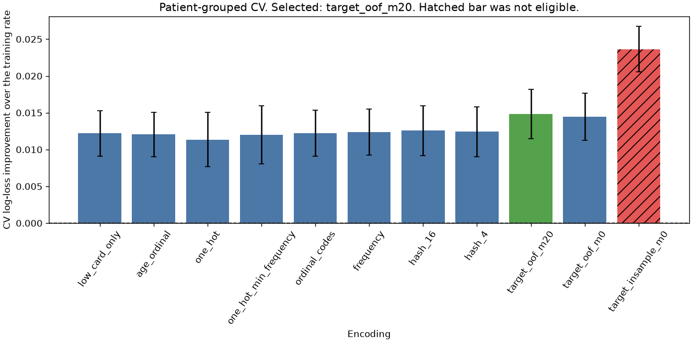
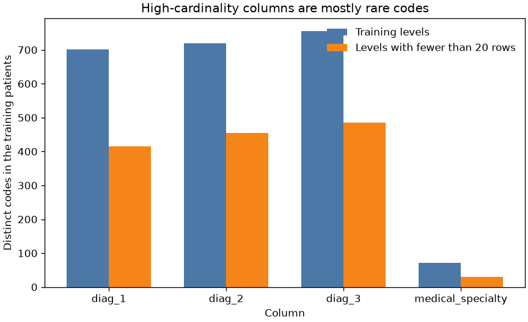
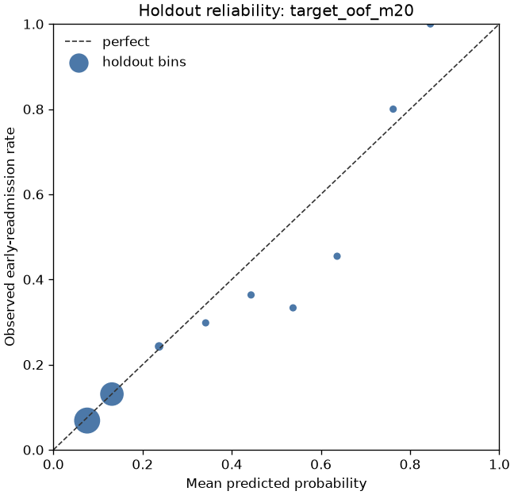

# Categorical encodings for 30-day diabetic readmission

A discharge list has a few small fields and three diagnosis columns with hundreds of codes. This project asks which encoding a linear model can actually use, and which score is only good because the encoding saw the label.

This is a teaching model on a public research extract. It is not a clinical tool and it is not a recommendation about any patient.

## Problem

A hospital quality team wants an early flag for diabetic encounters that return within 30 days of discharge. The flag has to be a probability, because a later project will turn it into a cost decision. The columns people reach for first are the diagnosis codes. Those codes are numerous, sparse, and not an ordered scale. One-hot encoding is the default in a lot of training code. It is the wrong default once a column has hundreds of levels and the model is linear with a fixed penalty.

The same table has a discharge-disposition code. Some of those codes have an early-readmission rate of exactly `0.0`. That is a separate leakage problem. The column is dropped here, before any fit, so the encoding comparison is not a contest about who memorized a zero-rate code.

## Concepts taught

One-hot encoding, ordinal codes, frequency encoding, feature hashing, and target encoding with a patient-grouped out-of-fold mean. Also the in-sample target encoding that must not be used to pick a model, the accuracy trap on a rare positive class, and why a patient with two encounters cannot sit on both sides of the split.

## Theory in brief

A binary logistic regression models `log(p / (1 - p))` as a linear score. The training loss used here is log loss, with L2 penalty and `C` fixed at `1.0`. A wider encoding has more coefficients. The same `C` spends its penalty budget across more weights, so one-hot is not on equal footing with a four-column encoding. That is a property of the comparison, not a reason to retune `C` after seeing the scores. `C` was not tuned.

One-hot encoding makes one 0/1 column per training level. An unseen test level becomes a row of zeros (`handle_unknown="ignore"`). The columns of one feature are linearly dependent. L2 identifies the fit. `min_frequency` of `20` collapses training levels below that count into one bucket. It does not send an unseen test level into that bucket.

Ordinal encoding replaces a level with an integer. That integer is a position in a sorted list of names, then standardized. The model treats a one-step difference as the same everywhere on that line. Age brackets are ordered, so a bin index is a meaningful scale, though the risk need not be linear in the index. An ICD code is a name. Alphabetical order is not a dose.

Frequency encoding replaces a level with its training-row share. An unseen level gets `0.0`. The number is not a probability of readmission. It only says how common the code was.

Feature hashing maps each code to a small signed vector. This script uses scikit-learn's `FeatureHasher`, `16` or `4` bins per high-cardinality column, with the column index in the token so the same code in two diagnosis fields is not forced to share a bin. Collisions remain inside the column. Each hit is stored as a sign, plus or minus one, not as the original code. The model cannot recover that code from the bin.

Target encoding replaces a level with a smoothed mean of the training labels:

`encoded = (n * mean + m * global_mean) / (n + m)`

`n` is the training count of that level, `mean` is its label mean, `global_mean` is the training positive rate, and `m` is `20.0` in the selected encoder. An unseen level gets `global_mean`. With no smoothing, a code that appears once is encoded as that row's own label. That is the leak if the same rows are then scored.

The out-of-fold version holds out the patient, not only the row. Inside each outer training fold, a `GroupKFold` on `patient_nbr` builds the means. The classifier trains on those held-out means. The test rows are encoded with means from the full training fold, which is the deployment map. `fit` then `transform` on the same rows is the in-sample map. It is recorded below and it is not eligible.

The reported model is the eligible experiment with the lowest group-CV log loss. Ties would break toward fewer columns, then the name. The holdout is scored after that choice. `selection_uses_test_scores` is false.

## Data

Diabetes 130-US Hospitals for Years 1999-2008, UCI dataset `296`, DOI `10.24432/C5230J`. The script downloads `https://archive.ics.uci.edu/static/public/296/data.csv` into `data/`, which is gitignored. The repository page is https://archive.ics.uci.edu/dataset/296/diabetes+130-us+hospitals+for+years+1999-2008. The API record has no license field. The donation policy says datasets approved for the repository are licensed CC BY 4.0: https://archive.ics.uci.edu/contribute/donation.

The file has `101766` rows and `50` columns. There are `71518` patients. The positive class is `readmitted == "<30"`, which is `11357` rows, rate `0.11159915885462728`. The other labels, `>30` and `NO`, are the negative class. Encounter ids are unique.

Columns the model is allowed to use:

- Numerics, standardized inside each training fold: time in hospital, lab procedures, procedures, medications, outpatient visits, emergency visits, inpatient visits, and number of diagnoses. The dataset description places the visit counts in the year before the encounter. Length of stay, procedure counts, medication counts, and diagnoses are known by discharge. This is a discharge-time score, not an admission-time score.
- Low-cardinality fields, one-hot, with a missing token: age bracket, admission type, admission source, payer code, max glucose serum, A1C result, the medication fields that are not constant, medication change, and diabetes medication. Missing A1C is `84748` rows. Missing glucose serum is `96420`. Missing payer is `40256`. Those are levels, not values to impute. "Not measured" is a real state.
- High-cardinality fields, encoded by the experiment: `diag_1`, `diag_2`, `diag_3`, and `medical_specialty`. Missing counts are `21`, `358`, `1423`, and `49949`.

Dropped before any fit:

- `encounter_id` and `patient_nbr`. The patient id is the split group only.
- `race` and `gender`. This project is an encoding comparison, not a fairness audit. Race is missing on `2273` rows. Gender is `Unknown/Invalid` on `3` rows. Putting either field in a readmission score is a separate decision, handled in the responsible-AI section later.
- `weight`, missing on `98569` of `101766` rows.
- `examide` and `citoglipton`, each constant.
- `discharge_disposition_id`. Seven ids have an early rate of `0.0` and cover `1688` rows. Id `11` alone has `1642` rows and rate `0.0`. The public CSV does not include the disposition names. A zero-rate code with that many rows is a label shortcut, so the column is out of this comparison.

On the training patients, the high-cardinality columns are mostly rare codes. `diag_1` has `701` levels, of which `415` have fewer than `20` rows (`2346` rows, `86` singletons). `diag_2` has `720` levels, `455` below the cutoff, `123` singletons. `diag_3` has `755` levels, `485` below the cutoff, `116` singletons. `medical_specialty` has `72` levels, `30` below the cutoff, `9` singletons.

## Approach

The split is a `GroupShuffleSplit` on `patient_nbr`, test size `0.2`, seed `42`. It put `57214` patients and `81613` rows in train, and `14304` patients and `20153` rows in test. Patients in both: `0`. The training early rate is `0.11280065675811451`. The test early rate is `0.10673348881059892`.

Evaluation inside the training patients is `GroupKFold` with `5` splits. The fold is a group of patients, not a random set of rows. The logistic regression is `liblinear`, `C` `1.0`, max iterations `200`, no class weight, seed `42`. Predicted probabilities are clipped to `[1e-06, 1 - 1e-06]` before log loss. The clip value in `results/metrics.json` is `1e-06`.

The baseline predicts the training positive rate for every row. It has no ROC-AUC, because the score does not vary. Its accuracy at a threshold of `0.5` is the test majority accuracy, `0.893266511189401`.

Every other experiment uses the same numerics and the same low-cardinality one-hot. The exception is `age_ordinal`, which replaces the age one-hot with a scaled bracket index and still omits the high-cardinality columns. That is the check on ordinal encoding where the order is real. `ordinal_codes` is the check where the order is alphabetical.

`target_insample_m0` fits raw category means on all training rows, including the rows in the validation fold, and then runs the grouped CV on that already-encoded matrix. It is ineligible. Its holdout encodings are built from the training patients only, so the holdout number is not a leaked test score. The leaked number is the CV score.

A random row split of the same test size, seed `42`, is scored after selection for the reported encoding only. It is not used to choose the encoding.

## Experiments

Positive CV gap means the training-rate CV log loss minus the model CV log loss. The selected row is `target_oof_m20`.

| Encoding | Eligible | Columns | CV log loss | CV std | Holdout log loss | Holdout ROC-AUC | Holdout accuracy |
| --- | --- | --- | --- | --- | --- | --- | --- |
| training_rate | yes | `0` | `0.35233528500556127` | `0.002863876091090141` | `0.33981780404157347` | undefined | `0.893266511189401` |
| low_card_only | yes | `138` | `0.3401262811690669` | `0.003088865650789538` | `0.32884073846712025` | `0.6300913359954685` | `0.8929687887659405` |
| age_ordinal | yes | `129` | `0.3402847865987998` | `0.003023095283782573` | `0.32869587046769005` | `0.6303838289366164` | `0.8929191683620304` |
| one_hot | yes | `2386` | `0.34098559183670357` | `0.0036911077458639217` | `0.3293205155373249` | `0.6335682728779916` | `0.8930680295737607` |
| one_hot_min_frequency | yes | `1005` | `0.34031288896136297` | `0.003954102138529765` | `0.3288641949259116` | `0.6349876616323069` | `0.893167270381581` |
| ordinal_codes | yes | `142` | `0.34011909677903046` | `0.003125008961234655` | `0.3288628968254419` | `0.6302841706053529` | `0.8929687887659405` |
| frequency | yes | `142` | `0.3399855019500131` | `0.0031330710461086636` | `0.3285157699210788` | `0.6331122049510384` | `0.8930184091698506` |
| hash_16 | yes | `202` | `0.33975792737184163` | `0.0033964043061342365` | `0.3278808534313931` | `0.6363275613107919` | `0.8928199275542102` |
| hash_4 | yes | `154` | `0.3399066164337213` | `0.0033926866225903276` | `0.3288499432303877` | `0.6293786459286435` | `0.8929191683620304` |
| target_oof_m20 | yes | `142` | `0.3375162458643353` | `0.0033619000429187997` | `0.32616331460860226` | `0.6466875084027803` | `0.8929687887659405` |
| target_oof_m0 | yes | `142` | `0.3378694380857429` | `0.0032103954023362316` | `0.3267887328282574` | `0.6443231861576825` | `0.8927703071503003` |
| target_insample_m0 | no | `142` | `0.3286853192732899` | `0.0030821040190029407` | `0.3298690972300174` | `0.6387988245120344` | `0.8913809358408178` |

The training-rate CV log loss minus the selected CV log loss is `0.014819039141225954`. The low-card CV log loss minus the selected CV log loss is `0.002610035304731584`. That second gap is smaller than the selected fold standard deviation, `0.0033619000429187997`. A single fold would not reliably show it. The selection rule still picks `target_oof_m20`, because the rule is the mean, not a significance test.

The patient bootstrap of the holdout, `1000` resamples, seed `7`, is a different statement. Reference log loss minus selected log loss:

- Training rate minus selected: mean `0.013587191522162069`, interval `0.011177548148230973` to `0.01609335592251771`, fraction positive `1.0`.
- Low-card minus selected: mean `0.0026668100217476717`, interval `0.0017290684714509786` to `0.0037805280961788227`, fraction positive `1.0`.
- Unsmoothed out-of-fold means minus selected: mean `0.0006248415668689806`, interval `0.0002783505804818995` to `0.0009593186841273401`, fraction positive `0.999`.

The holdout intervals exclude zero. The smoothing gap is small. Smoothing won the pre-registered rule; it is not a large effect.

What failed:

- Full one-hot was the expensive miss. `2386` columns, CV log loss `0.34098559183670357`, worse than leaving the diagnosis codes out (`0.3401262811690669` on `138` columns). Collapsing rare levels to `1005` columns did not reverse that. Part of this is the fixed `C`: more coefficients, same penalty. That is still the comparison a team makes if it one-hots first and does not retune.
- Alphabetical ordinal codes did not help. CV log loss `0.34011909677903046` against the low-card `0.3401262811690669`. The integer line is not a clinical order.
- Age as a bin index was slightly worse than age one-hot (`0.3402847865987998` against `0.3401262811690669`). The brackets are ordered. The risk is not a straight line in the index, and the gap sits inside the fold noise.
- Hashing beat the low-card model by a little and lost to target encoding. With `16` bins per column, all `64` occupied bins contain at least two training levels. With `4` bins, all `16` occupied bins collide. The narrow hash was a bit worse (`0.3399066164337213` against `0.33975792737184163`). Collisions are the product, not a bug in the run.
- In-sample raw target encoding posted CV log loss `0.3286853192732899` and CV ROC-AUC `0.6846182227873063`. Both look better than the selected model's CV log loss `0.3375162458643353` and CV ROC-AUC `0.6486342391657721`. It was ineligible. Its holdout log loss is `0.3298690972300174`, worse than the selected holdout `0.32616331460860226`, and its holdout ROC-AUC is `0.6387988245120344`, worse than `0.6466875084027803`. The CV-minus-test log-loss gap for the leaky run is only `-0.001183777956727472`. The ranking reversal is the evidence, not a huge gap between the leaky CV and the leaky holdout. Selecting on the leaked CV would have kept the worse holdout model.

Accuracy at `0.5` goes the other way. The selected holdout accuracy is `0.8929687887659405`. The majority classifier, which predicts no early readmission, scores `0.893266511189401`. The model is less accurate at that threshold because almost every probability stays below one half.

A random row split put `7001` patients on both sides. The same selected encoding, refit on that split, had test log loss `0.3332611027253835`. That is worse than the group holdout, not better. The two test sets are different draws, so this is not a clean measurement of how much the overlap inflates a score. The overlap is still the defect. The number was not used to select the encoding.

## Plots



The vertical axis is the training-rate CV log loss minus the model CV log loss. Higher is better. The error bars are the fold standard deviation. The hatched bar is the ineligible in-sample encoding. Its advantage is visible. The gap from the low-card bar to the selected bar is smaller than those error bars, which matches the CV gap reported above.



Most diagnosis levels in the training patients fall under the `20`-row cutoff. That is why a full one-hot matrix is wide, and why an unsmoothed mean is noisy.



The two large bins are close to the diagonal. The `0.0` to `0.1` bin has `10465` rows, mean predicted probability `0.07563929000032121`, observed rate `0.06860965121834688`. The `0.1` to `0.2` bin has `8469` rows, predicted `0.13117456485168097`, observed `0.13083008619671743`. Above `0.5` the bins are small and high. The `0.5` to `0.6` bin has `27` rows, predicted `0.5373948405950253`, observed `0.3333333333333333`. The next bins have `11`, `5`, and `1` rows. A threshold of `0.5` is almost the majority classifier. Marker area grows with the bin count, so those tail points should not be read as a calibration success.

## Key takeaways

The model to keep from this protocol is the smoothed, patient-held-out target encoding. Holdout log loss is `0.32616331460860226`, against `0.33981780404157347` for the training rate. The holdout gap against the low-card model excludes zero in the patient bootstrap, and it is still a small gap.

One-hot of the diagnosis codes lost to a model that did not expand them. Hashing survived the collisions better than one-hot survived the width, and still lost to the target mean under this penalty.

An in-sample target encoding would have won the CV table and lost the holdout comparison. That score is not eligible, and it should not be quoted as the result.

Accuracy at `0.5` is the wrong headline. The selected model is slightly less accurate than predicting no early readmission.

## Common mistakes

- One-hot encoding a diagnosis, a zip code, or a user id, then being surprised that a linear model with a fixed penalty gets worse.
- Treating `min_frequency` as a fix for unseen levels. It only groups rare training levels.
- Ordinal-encoding a nominal code because the encoder accepts it. The integer is an accident of sorting.
- Fitting a target encoder on the training frame, transforming that same frame, and cross-validating the result. The validation labels are already in the means.
- Splitting encounters at random when the decision is about a patient. This file put `7001` patients on both sides of a random split.
- Reporting accuracy on an `0.11159915885462728` positive rate. The majority accuracy is already `0.893266511189401`.
- Leaving a discharge code in the model because it is "known at discharge." A code with `1642` rows and an early rate of `0.0` can stand in for the label.
- Using race or gender as just another categorical in an encoding bake-off. They were not needed for this comparison, and a readmission score that uses them is a different product decision.

## Interview questions

**Why is one-hot a poor default for a diagnosis code?**
A linear model then gets one coefficient per code. Here that was `2386` columns against `138`, and the CV log loss got worse under the same `C`. Rare codes are estimated from a handful of rows. Hashing, frequency, and a smoothed target mean keep the width fixed.

**How do you target-encode without leaking the label?**
Build the category mean on rows that are not the row you are scoring, and not another row from the same group if the split is grouped. Score the classifier on those held-out encodings. Fit the deployment map on the full training fold only when you encode new rows. `fit` then `transform` on the same matrix is the leaky map. scikit-learn's `TargetEncoder.fit_transform` is the out-of-fold path; `fit` then `transform` is not the same call.

**The in-sample model had a better CV ROC-AUC. Why not ship it?**
Its CV ROC-AUC was `0.6846182227873063` because validation labels had entered the means. The holdout, encoded from training patients only, had ROC-AUC `0.6387988245120344` and a worse log loss than the held-out-mean model. A selection rule that cannot see the holdout would have picked the leak if that run had been eligible.

**Why did accuracy fall while log loss improved?**
The positive rate is about one in nine. At `0.5`, both the majority rule and the selected model predict the negative class for almost every row. Accuracy cannot see a better ranking below that threshold. Log loss and ROC-AUC can. The operating threshold is a cost decision, not a default of one half.

**What do you give up with the hashing trick?**
Identity. Codes that share a bin are the same feature, including codes with opposite effects. Here every occupied bin collided. You also give up a stable name for the coefficient. You gain a fixed width and a transform that does not need a category map at scoring time.

**Why split on the patient instead of the encounter?**
The decision travels with the patient. A random split put `7001` of the patients on both sides. Grouped CV and the out-of-fold target means use the same group, so another encounter from the same patient does not teach the mean that encodes this one.

**Why drop discharge disposition instead of encoding it?**
Id `11` has `1642` rows and an early rate of `0.0`. A one-hot model can put a large negative weight on that level and look accurate for a reason that is not "this diagnosis is risky." The names are not in the public CSV. Dropping the column is the conservative choice for an encoding study. Measuring the inflated score is the leakage project, not this one.

**When is ordinal encoding the right tool?**
When the levels are ordered and a one-step difference is meaningful: a survey scale, or an age bracket if you are willing to treat the brackets as evenly spaced. It is the wrong tool for an ICD code, a city, or a specialty. On this file, even the age index did not beat one-hot age.

**Does a lower `C` or a higher `C` change the one-hot result?**
It can. This comparison held `C` at `1.0` so the encoding was the only change. Tuning `C` inside the same grouped CV would be a fairer test of one-hot, and it was not done. Do not claim one-hot cannot work. Claim it did not work at the penalty that was fixed before the scores.

**Why are race and gender absent?**
They are not required to compare encodings, and a readmission flag that uses them needs a fairness review this project does not do. Leaving them out is not a measurement of bias. It is a scope line.

## How this shows up at work

A quality lead will ask for accuracy. The number to put next to it is the majority accuracy, `0.893266511189401`, and the positive rate, `0.11159915885462728`. If those two are close to the model's accuracy, you have not shown a useful threshold. You have shown a rare event.

Someone will add the discharge disposition because it is on the discharge form and it improves a demo. Ask which codes have a zero event rate before that column is praised. Someone else will one-hot the diagnosis table because the feature store already can. Ask how many levels have fewer than `20` rows, and whether the penalty was retuned after the width changed.

The target mean has an operational cost. The training job must build it out of fold, or the offline AUC will not match the first week of scoring. The map has to be refit when the code set drifts, and an unseen code must fall back to the training rate, not to zero and not to an error, unless you have decided that an unknown code is a reject.

Stakeholders will ask whether to page a nurse at `0.5`. On this holdout, `27` rows landed in the `0.5` to `0.6` bin. That is not an operating point. The next conversation is a cost matrix, which this project does not fit.

Do not put this model in a clinical workflow. The labels are a research extract, the threshold is uncosted, and race and gender were excluded rather than audited.

## Run it

From this directory, with the root dependencies installed:

```bash
python main.py
pytest tests/test_smoke.py
```

`requirements.txt` includes the root pins. It does not add a package. The raw CSV is downloaded by the script and is not committed. `python main.py` writes `results/metrics.json` and the three plots. On this machine the run took about five minutes. That elapsed time is not a result to quote; it changes when the script is rerun.

## Further reading

- UCI dataset record and variable table: https://archive.ics.uci.edu/dataset/296/diabetes+130-us+hospitals+for+years+1999-2008
- Dataset DOI: https://doi.org/10.24432/C5230J
- UCI donation policy, which states the CC BY 4.0 license for datasets approved into the repository: https://archive.ics.uci.edu/contribute/donation
- Creative Commons Attribution 4.0 license deed: https://creativecommons.org/licenses/by/4.0/
- Strack and coauthors, the introductory paper named by the UCI API. I did not use its measured rates. DOI `10.1155/2014/781670`: https://doi.org/10.1155/2014/781670
- Micci-Barreca, "A Preprocessing Scheme for High-Cardinality Categorical Attributes in Classification and Prediction Problems," SIGKDD Explorations 3(1): 27-32, 2001. The journal, volume, pages, and year are from the SIGMOD DiSC record I opened: https://sigmod.org/publications/discs/2002/out/a_daniele_micci-barreca.htm
- Weinberger, Dasgupta, Attenberg, Langford, and Smola, "Feature Hashing for Large Scale Multitask Learning," arXiv:0902.2206. Authors and title from the arXiv API: https://arxiv.org/abs/0902.2206
- scikit-learn `TargetEncoder`, including the difference between `fit_transform` and `fit` then `transform`: https://scikit-learn.org/stable/modules/generated/sklearn.preprocessing.TargetEncoder.html
- scikit-learn `FeatureHasher`: https://scikit-learn.org/stable/modules/generated/sklearn.feature_extraction.FeatureHasher.html
