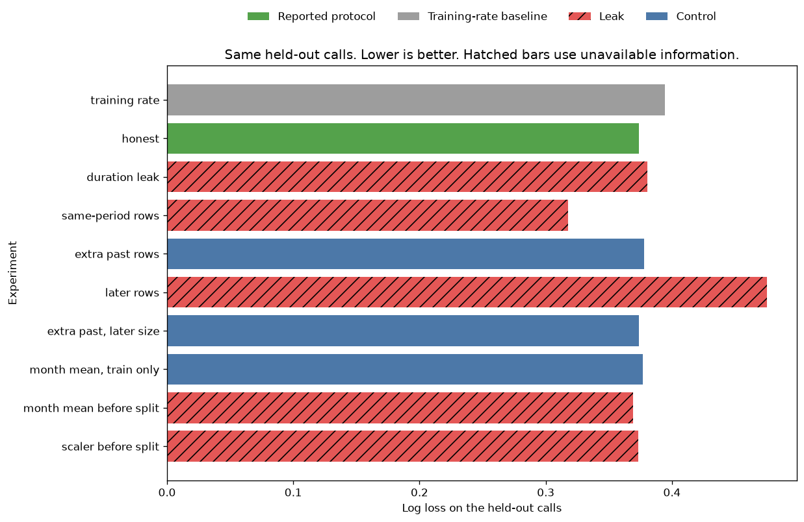
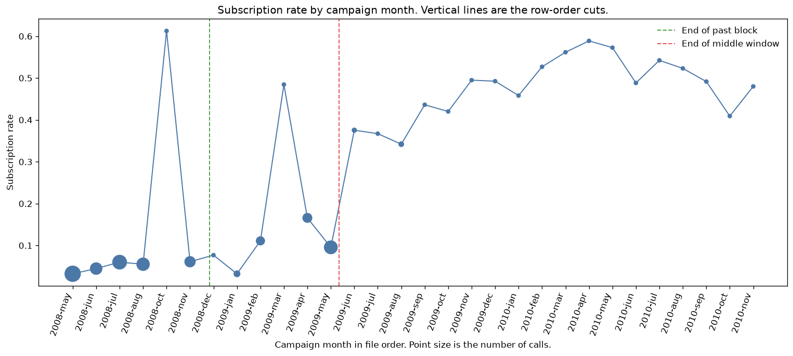
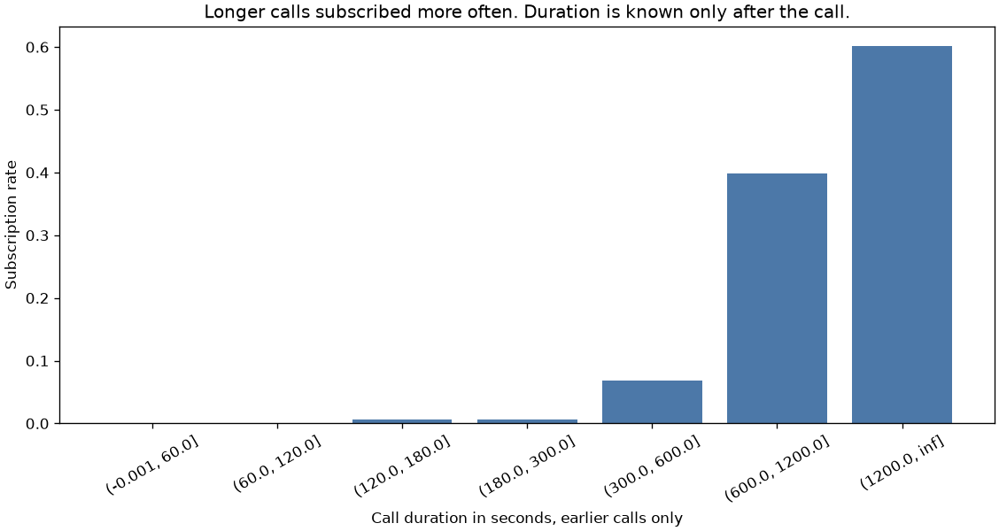
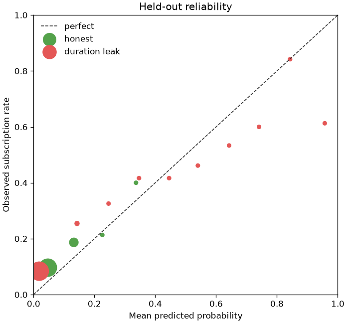

# Leakage on bank telemarketing calls

A Portuguese bank called clients to sell a term deposit. The file is ordered by date. Three common shortcuts make a model look better, or worse, than the call list it would actually face. This project scores all three on the same held-out calls.

The reported model was named before any fit. Leaky fits are recorded and are not eligible. This is a teaching model on a public research extract. It is not a dialer, and it is not a recommendation to call anyone.

## Problem

A campaign team wants a probability that a client will subscribe before the agent dials. The score has to be available at queue time. Call duration is on the extract, and it moves with the label, but the agent does not know the duration until the call is over. Other calls from the same week are also on the extract. Their outcomes are not known when this call is queued. A scaler or a category mean fit on the whole file is the quieter version of the same mistake: the held-out rows help build the features that then score those rows.

The business cost is a bad list. A notebook that trains on the same week will overstate how well the bank can rank next week's clients. A notebook that trains on a later campaign can do the opposite, because the later campaign subscribed more often. Accuracy at one half hides both errors.

## Concepts taught

Target leakage, temporal leakage, and preprocessing fit before the split. Also a sample-size control, why a shuffled split of a dated file is not comparable, why a ranking gain is not a probability gain, and a date-cluster bootstrap for the gap.

## Theory in brief

The decision is whether to place the call. A feature is legitimate only if it would be known at that moment. Call duration fails that test. The previous campaign's outcome does not: it already happened. The names file says `poutcome` is the outcome of the previous marketing campaign, and `campaign` counts contacts in this campaign, including the current one, once the call is queued.

Binary log loss for a clipped probability `p` is the mean of `-(y log p + (1 - y) log(1 - p))`. Predicted probabilities are clipped to `1e-06` before that mean, so a probability of 0 or 1 cannot make the score infinite. Lower is better. The training-rate baseline predicts one number, the past positive rate, for every held-out row. It has no ROC-AUC, because the score does not vary.

A logistic regression models `log(p / (1 - p))` as a linear score, with L2 penalty and `C` fixed at `1.0`. The solver is `liblinear`, the iteration cap is `500`, there is no class weight, and the seed is `42`. `C` was not tuned. A wider one-hot matrix is not on equal footing with a narrower one under that fixed penalty. That is accepted. The penalty was not changed after the scores.

Duration leakage adds one column that is known only after the call. The ranking metric can rise because longer calls in the past subscribed more often. Log loss can still fail to improve, because a feature that separates classes is not the same thing as a well-calibrated probability on a later period. The duration experiment is ineligible even if every metric improves. The column is not available at the decision.

Same-period leakage appends the other half of the middle window to the training rows, with their labels. Those rows are not the held-out calls. They are other calls from the same stretch of the file. They share months, contact channels, and the higher subscription rate of that window. A size control appends the same number of rows drawn with replacement from the past. If only the same-period fit improves, the gain is the period, not the row count.

Later-row leakage appends the tail after the held-out window. That is training on calls that had not happened yet. It is not guaranteed to inflate the score. If the tail has a different subscription rate, the model can import that rate and score the earlier window badly. The matching size control again adds past rows, with replacement, of the same count.

The month target encoder replaces `month` with a smoothed mean of the labels on the rows it is fit on:

`encoded = (n * mean + m * global_mean) / (n + m)`

`n` is the count of that month, `mean` is its label mean, `global_mean` is the mean of the fit rows, and `m` is `20.0`. A month absent from the fit gets `global_mean`. Fitting that map on the past only is a legal transform, and it is still ineligible here, because the honest model already one-hots month and the encoder was not part of the reported protocol. Fitting the map on the past and the held-out calls copies held-out labels into the feature that then scores those calls. Months that never appear in the past are the sharp case: their encoding is built only from the rows being scored.

A scaler and a one-hot encoder fit on the past plus the held-out calls change the feature map before the classifier sees a training row. Extra levels that exist only in the held-out calls become columns of zeros in training. The numeric mean and scale also move. The leak is real. On a file where the past and the held-out half have similar numeric spreads, the score movement can be tiny. Tiny is not the same as zero, and it is not a reason to ship the fit.

The comparison uses a cluster bootstrap. The cluster is the contact date inside the held-out half, because calls on the same day are not independent draws. There are `71` such dates, `1000` resamples, seed `7`. The gap is reference log loss minus candidate log loss. Positive means the candidate has lower log loss. An interval that contains zero is not a win. The held-out calls are not used to add, drop, or replace a feature. `selection_uses_test_scores` is false. The reported name is hardcoded to `honest`.

## Data

Bank Marketing, UCI dataset `222`, DOI `10.24432/C5K306`. The script downloads `https://archive.ics.uci.edu/ml/machine-learning-databases/00222/bank.zip` and reads `bank-full.csv`, semicolon-separated. The repository page is https://archive.ics.uci.edu/dataset/222/bank+marketing. Raw files land in `data/`, which is gitignored.

The names file says the examples are ordered by date from May 2008 to November 2010, and "This dataset is public available for research." It asks for this citation: S. Moro, R. Laureano and P. Cortez, Proceedings of the European Simulation and Modelling Conference, ESM 2011, pp. 117-121, http://hdl.handle.net/1822/14838. The UCI API record has no license field. The donation policy says datasets approved for the repository are licensed CC BY 4.0: https://archive.ics.uci.edu/contribute/donation. The names file does not say CC BY. This README does not pretend that it does.

The file has `45211` rows and `17` columns. The positive class is `y == yes`, `5289` rows, rate `0.11698480458295547`. The names file says there are no missing attribute values. `unknown` is a recorded level in job, education, contact, and poutcome. This script keeps that token. It does not impute it.

The API export was checked against `bank-full.csv`. After `unknown` is filled back in, the shared columns match. The API names the day column `day_of_week` and describes it as the last contact day of the week. The file column is `day`. Its minimum is `1`, its maximum is `31`, and it has `31` distinct values. That is the day of the month, which is what the names file says. The API description does not match the values. The model uses the file column.

Columns in the honest model:

- Client fields: `age`, `job`, `marital`, `education`, `default`, `balance`, `housing`, `loan`.
- Contact fields known when the call is queued: `contact`, `day`, `month`. `day` is one-hot, not scaled. `month` is one-hot.
- History: `campaign`, `pdays`, `previous`, `poutcome`, and `never_contacted`. The names file says `pdays` of -1 means the client was not previously contacted. `never_contacted` is that indicator. `poutcome` is the previous campaign, so it stays. `campaign` includes the current contact and stays. The protocol field `campaign_use` is false because no extra experiment selects or groups on that count. The column is still in the honest list.

Excluded from the reported model: `duration`, last contact duration in seconds. The API warning, stored in `results/metrics.json`, says the attribute strongly affects the target, that duration is not known before the call, and that it should be discarded for a realistic model. The names file does not add a year column. Year labels below are a forward walk from May 2008. A lower month index starts a new year. The walk starts at May 2008 and ends at November 2010, which matches the names-file sentence. September 2008 is absent: the file goes from August to October.

## Approach

The past is the first `27126` rows, fraction `0.6`. The cut index is `27126`. That cut falls inside the November 2008 run, start index `24118`, end index `27716`. The past subscription rate is `0.05039445550394456`, with `1367` subscriptions. Past months are aug, jul, jun, may, nov, and oct.

The next cut is fraction `0.8`, index `36168`. That cut falls inside the May 2009 run, start index `34177`, end index `39752`. The window has `9042` rows and rate `0.11789427117894272`. The later tail has `9043` rows and rate `0.31582439455932765`. The integer cuts are `int(n * fraction)`, so the tail is one row longer than the window.

Seed `42` splits the window into two halves of `4521` rows. The eval half is the only scored set. Its rate is `0.11678832116788321`, with `528` subscriptions. The other half is the same-period contamination. Its rate is `0.11900022119000221`, with `538` subscriptions. The two halves are close. A gain from using one half in training is not a gain from drawing an easier label rate.

`3253` of the `4521` eval rows have a month that does not appear in the past. `1268` have a month the past has seen. That count was the reason to register a month-mean experiment before fitting: a month encoding fit only on the past has to fall back for most of the eval rows.

Every comparable score uses those same eval rows. The logistic regression is not retuned. The experiment list is a constant in `main.py`. The script raises if that list drifts. Block rates are a property of the file order and can be read before any fit. They were not used to add or drop an experiment after the scores existed.

Eligible fits: the training-rate baseline, and the honest model. Ineligible: duration, same-period rows, later rows, the month mean fit on the past and the eval rows, and the scaler fit on the past and the eval rows. The size controls and the train-only month mean are also ineligible. They are checks, not candidates.

A shuffled `0.2` split, seed `42`, is fit with the honest columns after the registered list has run. It is not comparable, and it is not used for selection.

## Experiments

All rows below are scored on the same `4521` eval calls, except the shuffled split, which has its own test rows. ROC-AUC is undefined for the training rate.

| Experiment | Eligible | Features | Log loss | ROC-AUC | Average precision | Accuracy at 0.5 | Mean predicted |
| --- | --- | --- | --- | --- | --- | --- | --- |
| training_rate | yes | `0` | `0.3946184390200872` | undefined | `0.11678832116788321` | `0.8832116788321168` | `0.050394455503944564` |
| honest | yes | `75` | `0.3736699669516322` | `0.6316546380408139` | `0.18177263494071705` | `0.8832116788321168` | `0.06745584322841017` |
| duration_leak | no | `76` | `0.3804182462375427` | `0.7605625184982812` | `0.3402522287488494` | `0.8882990488829905` | `0.05518589038735068` |
| same_period_rows | no | `80` | `0.31782332466998575` | `0.7429943689335123` | `0.3145081658629403` | `0.8834328688343287` | `0.1148013135248593` |
| same_period_size_control | no | `75` | `0.3781489250576405` | `0.635490422633548` | `0.17853169322900186` | `0.8829904888299049` | `0.0681614719517092` |
| future_rows | no | `81` | `0.4751495490177361` | `0.6623423377273867` | `0.22672119795743417` | `0.8261446582614466` | `0.3216821159430636` |
| future_size_control | no | `75` | `0.3739694257081081` | `0.6343876404920733` | `0.18478957680564756` | `0.8832116788321168` | `0.067695704321103` |
| target_train_only | no | `76` | `0.37665817831880094` | `0.6304252138211568` | `0.18062802369748035` | `0.8832116788321168` | `0.06378994500706694` |
| target_before_split | no | `76` | `0.3694002039672068` | `0.6455340406317115` | `0.19603856339801076` | `0.8832116788321168` | `0.06830929276656468` |
| scaler_before_split | no | `80` | `0.3731274947552427` | `0.6312609566741797` | `0.1829888563408238` | `0.8832116788321168` | `0.06769758842854862` |

The training-rate mean prediction is `0.050394455503944564`. The past block rate is `0.05039445550394456`. They differ at the last stored digit. The baseline is the prediction written in the experiment block, not a hand-rounded copy of the block rate.

Date-cluster bootstrap, reference log loss minus candidate log loss:

- Training rate minus honest: mean `0.021412587008794195`, interval `-0.006928186348399703` to `0.05860034538502945`, fraction positive `0.935`. The interval includes zero. The point estimate favors the honest model. That is not a significant win under this bootstrap.
- Honest minus duration: mean `-0.009067037386903825`, interval `-0.04767886792910907` to `0.019812784736288568`, fraction positive `0.327`. The interval includes zero. Duration did not significantly worsen log loss, and it did not improve it either.
- Honest minus same-period rows: mean `0.05733274511435743`, interval `0.0317171816225812` to `0.09300062866648791`, fraction positive `1.0`.
- Size control minus same-period rows: mean `0.06188976083461128`, interval `0.03594346926702735` to `0.09704935271264704`, fraction positive `1.0`. The extra past rows do not explain the gain.
- Honest minus later rows: mean `-0.09897843768593294`, interval `-0.16856849040025754` to `-0.020661378673435263`, fraction positive `0.011`. The interval is entirely negative. Later rows hurt.
- Size control minus later rows: mean `-0.09870521056760007`, interval `-0.1683724761235346` to `-0.021015468442885918`, fraction positive `0.01`. The damage is not the added row count.
- Train-only month mean minus the leaky month mean: mean `0.007426172712738683`, interval `0.004114202531437218` to `0.011824082372746975`, fraction positive `1.0`.
- Honest minus the scaler fit before the split: mean `0.0005575199274784605`, interval `0.0002866570045780267` to `0.0008774105817465183`, fraction positive `1.0`. The interval excludes zero. The gap is a few ten-thousandths of log loss. That is a detectable leak, not a meaningful win.
- Honest minus the train-only month mean: mean `-0.0030843597764767003`, interval `-0.005376383376875629` to `-0.0013373030152299514`, fraction positive `0.0`. Adding the legal month mean hurt. The leaky encoder looks better than that legal encoder. It is not a reason to add the feature, and it was not compared with the honest model in a registered bootstrap. Its point estimate, `0.3694002039672068`, is lower than the honest log loss. That comparison was not the registered test.

What failed, or what must not be quoted as the result:

- Duration is the famous leak, and it is the wrong headline. Past subscriptions lasted `840.3321141185077` seconds on average, against `221.74894211731822` for non-subscriptions. On the eval half the gap shrinks: `493.5473484848485` versus `224.07212622088656`. ROC-AUC still rose from `0.6316546380408139` to `0.7605625184982812`, and average precision rose from `0.18177263494071705` to `0.3402522287488494`. Brier improved from `0.10321664042982152` to `0.09669472005048066`. Log loss did not improve. The column is known only after the call, so the better ranking is not a deployable result. The API's duration-zero rule is true here and irrelevant: `3` rows have duration zero, and `0` of them subscribed.
- Later rows are the leak that makes the score worse. Mean predicted probability `0.3216821159430636` sits next to the later-tail rate `0.31582439455932765`, not next to the eval rate `0.11678832116788321`. Accuracy falls to `0.8261446582614466`. A leak is not a free improvement when the unavailable rows come from a different campaign.
- The train-only month mean lost to the honest model, which already one-hots month. Most eval rows have a month the past never saw, so the encoder falls back to the past rate for `3253` rows. The leaked encoder beats that fallback. It still is not eligible.
- The scaler leak is real and small. Five extra columns appear (`80` against `75`) because the encoder saw levels that are not in the past. Do not describe that gap as a modeling win.
- Same-period contamination is the leak that would fool a leaderboard. Log loss `0.31782332466998575`, mean predicted `0.1148013135248593`, close to the eval rate. Accuracy at one half only moves from `0.8832116788321168` to `0.8834328688343287`. A team watching accuracy would miss it. A team watching log loss would celebrate a result it cannot ship.
- The shuffled split is not a comparison with the honest score. Its own test log loss is `0.4342363977188078` and its ROC-AUC is `0.5012763335282087`. Of its `9043` test rows, `5442` come from the past, `1803` from the window, and `1798` from the later tail. The training side contains `7245` later-tail rows. It did not look better. Do not subtract it from `0.3736699669516322`.

Accuracy at one half is the other trap. The honest model and the training-rate baseline both score `0.8832116788321168`. That is the accuracy of predicting no subscription on this eval half. The honest reliability table has no bin at or above one half. The largest honest bin, from `0.0` to `0.1`, has `3547` rows.

## Plots



Lower is better. The green bar is the reported protocol. Hatched bars use information that would not be available for the next call. The same-period bar is the one that looks like a success. The later-row bar is the one that shows a leak can lose. The scaler bar is almost the honest bar. The picture matches the table: the dramatic leak is not the one a tutorial usually draws.



Point size is the number of calls. The vertical lines are the row-order cuts, and both cuts fall inside a month, so a month label is not a block boundary. October 2008 is the thin spike at `0.6125`. It has `80` rows and `49` subscriptions. March 2009 is the next spike, `258` rows, rate `0.4844961240310077`. May 2008 is the bulk of the early file: `7957` rows, rate `0.032424280507729046`. The later months sit much higher. That rise is why a shuffled split mixes two campaigns, and why training on the tail imports the wrong rate.



The bins are the past only. Calls of at most 60 seconds almost never subscribe: the first bin has `2886` rows, `2` subscriptions, rate `0.000693000693000693`. Calls longer than 1200 seconds have rate `0.6022408963585434` on `357` rows. The chart is the mechanism. It is also the reason the feature cannot be used for the decision the bank actually has.



Marker area grows with the bin count. The honest model stays at low probabilities. Its `0.0` to `0.1` bin has `3547` rows, mean predicted `0.0470990088344188`, observed rate `0.09641950944460106`. The past rate is `0.05039445550394456`, and the eval rate is `0.11678832116788321`, so the model is low relative to the period it is scoring. The duration model spreads out. Its top bin has `31` rows, mean predicted `0.9572219834453355`, observed rate `0.6129032258064516`. That overconfident tail is a reason log loss can fail to follow the ROC-AUC. The low duration bin has `4000` rows, mean predicted `0.018675504737390124`, observed rate `0.08375`.

## Key takeaways

The model this protocol reports is the honest logistic regression. Holdout log loss is `0.3736699669516322`, against `0.3946184390200872` for the training rate. The date-cluster interval for that gap includes zero.

Training on other calls from the same window cut log loss to `0.31782332466998575`, and that gap excludes zero. The same number of extra past rows did not. The score is not eligible.

Training on later calls raised log loss to `0.4751495490177361`. A leak does not always inflate the metric. Duration raised ROC-AUC to `0.7605625184982812` and did not improve log loss. Leave it out anyway.

Accuracy at one half did not show any of this. The honest model matched the rule that predicts nobody subscribes.

## Common mistakes

- Keeping duration because the variable note says it highly affects the target. That sentence is the warning, not the feature recommendation.
- Treating `poutcome` as leakage because the name contains "outcome." It is the previous campaign. The current label is `y`.
- Splitting a date-ordered file at random, then comparing that score with a chronological score. This shuffled run was near chance, and the two test sets are different objects.
- Calling a random half of the next month a clean holdout while the other half of that month is in training.
- Fitting a target encoder on the frame you are about to score. Here the leaked month mean beat the train-only month mean, and the train-only month mean lost to one-hot month.
- Treating a scaler fit on the full extract as harmless because the leaderboard moved only in the fourth decimal. The movement was detectable. The right description is "small," not "free."
- Assuming every leak makes the number better. The later tail made it worse, because the later campaign subscribed more often.
- Reporting accuracy on a positive rate of `0.11678832116788321`. The majority accuracy is already `0.8832116788321168`.
- Reading October 2008 as a large high-rate month. It has `80` rows.

## Interview questions

**What is the difference between a feature leak and a split leak?**
A feature leak uses a column that would not exist at decision time. Duration is that column. A split leak puts rows, or statistics of rows, from the scored period into the fit. Same-period labels, a scaler fit on the eval rows, and a month mean fit on the eval labels are split leaks. The duration model still used a legal row split. It was ineligible for a different reason.

**Why did duration raise ROC-AUC and not log loss?**
ROC-AUC only asks whether subscribers scored higher than non-subscribers. Log loss asks whether the probabilities were right. Past subscribers averaged `840.3321141185077` seconds and eval subscribers averaged `493.5473484848485`, so the duration effect shifted. The top reliability bin predicted `0.9572219834453355` where the observed rate was `0.6129032258064516`. The log-loss interval against the honest model included zero. Either way, the column is unknown before the call.

**The same-period model has the best log loss. Why not ship it?**
Its training rows include the other half of the window being scored. Those labels are not available when the next call is queued. The size control, which added `4521` past rows with replacement, scored `0.3781489250576405` and did not reproduce the gain. A leaderboard that cannot tell those two fits apart will keep the leak.

**Why did training on the future hurt?**
The later tail rate is `0.31582439455932765`. The leaked model predicted `0.3216821159430636` on a window whose rate is `0.11678832116788321`. The bootstrap interval against the honest model was entirely negative. Leakage is a bias, not a gift. The direction depends on what the unavailable rows look like.

**Why is a shuffled split not a sanity check here?**
The authors ordered the file by date. The shuffled test contains `1798` later-tail rows, and the shuffled training set contains `7245`. Its ROC-AUC was `0.5012763335282087`. That number is about the mixed file. It is not a second measurement of the honest protocol.

**The honest model did not significantly beat the training rate. What do you report?**
The pre-registered model, both numbers, and the interval. Point estimate `0.3736699669516322` against `0.3946184390200872`, interval `-0.006928186348399703` to `0.05860034538502945`. Dropping the model because the interval includes zero would be a decision made after seeing the holdout. Shipping it as a proven lift would ignore the interval. This project does neither. It reports the fit that was named first.

**Why cluster the bootstrap by date?**
Calls on the same day share a campaign state. A row bootstrap treats them as independent and makes the interval too narrow. There are `71` dates in the eval half and `1000` resamples. The cluster is still an approximation. It does not model a client who appears on two days.

**When is fitting a scaler before the split a serious bug?**
When the held-out rows have a different location or scale, or when the encoder learns levels that then stand in for the label. Here the log-loss gap was `0.0005575199274784605` on average and the interval excluded zero. Quote it as a small, real leak. The same-period fit is the one that would change a decision.

**Why did the legal month encoding lose?**
The honest model already one-hots month, using only past levels. The encoder's smoothing was `20.0`, and `3253` eval rows needed the fallback. The registered comparison says the train-only mean was worse than honest, interval entirely negative. A leaked mean can look like a recovery from that loss. Recovery with the eval labels is still leakage. Out-of-fold target encoding, without future months, is the subject of `02-feature-engineering/02-categorical-encoding`.

**What would you tell a stakeholder who asks for accuracy?**
Put the majority accuracy beside it. Both the honest model and the all-negative rule score `0.8832116788321168` on the eval half. The same-period leak, which changed log loss by a gap the bootstrap put between `0.0317171816225812` and `0.09300062866648791`, changed accuracy from `0.8832116788321168` to `0.8834328688343287`. Accuracy was the wrong screen.

## How this shows up at work

A campaign lead will ask to include call duration because a demo's ROC-AUC went from `0.6316546380408139` to `0.7605625184982812`. The answer is that the agent does not know the duration when the list is built, and that the probability score did not improve. If someone needs an after-call analysis of which conversations converted, that is a different model, with a different decision, and it should be labeled as such.

Someone will shuffle the extract because the training template does. Ask whether the file is ordered, and whether both sides of the split contain the later campaign. Here they did. Someone else will hold out a random week and leave the rest of that week in training. Ask for the size control: the same number of older rows. If the gain disappears, the model learned the week, not the client.

A platform team will fit the scaler in a notebook on the full extract, then copy the mean into the training job. On this file the top of that interval is `0.0008774105817465183`. The review comment is still "fit the transform on the training fold." The small number is how you stop the team from dismissing the comment. It is not how you dismiss the comment yourself. The pipeline that does this by construction is `02-feature-engineering/10-sklearn-pipelines`, which is not built yet.

Stakeholders will ask for accuracy. Give them the positive rate and the majority accuracy before the model accuracy. If those match, you have not chosen a threshold. You have predicted the common class. The cost of a wasted call is a later project.

Do not put this score in a dialer. The honest lift over the training rate includes zero, the threshold is uncosted, and the labels are a research extract from campaigns that ended in 2010.

## Run it

From this directory, with the root dependencies installed:

```bash
python main.py
pytest tests/test_smoke.py
```

`requirements.txt` includes the root pins. It does not add a package. `make run` calls `python main.py` if you have GNU make. The script downloads the zip, checks it against the UCI API export, and writes `results/metrics.json` plus the four plots. It runs on a laptop CPU. The elapsed time in `results/metrics.json` is not a result. It changes when the script is rerun, and it is not quoted here.

## Further reading

- UCI dataset record: https://archive.ics.uci.edu/dataset/222/bank+marketing
- Dataset DOI: https://doi.org/10.24432/C5K306
- Names-file citation, Moro, Laureano, and Cortez, ESM 2011, pp. 117-121: http://hdl.handle.net/1822/14838
- Introductory paper named by the UCI API: Moro, Cortez, and Rita, Decision Support Systems, DOI `10.1016/j.dss.2014.03.001`. I did not use its measured rates. https://doi.org/10.1016/j.dss.2014.03.001
- UCI donation policy, which states the CC BY 4.0 license for datasets approved into the repository: https://archive.ics.uci.edu/contribute/donation
- Creative Commons Attribution 4.0 license deed: https://creativecommons.org/licenses/by/4.0/
- scikit-learn common pitfalls, section 12.2, including data leakage and preprocessing fit before the split: https://scikit-learn.org/stable/common_pitfalls.html
- Kapoor and Narayanan, "Leakage and the Reproducibility Crisis in ML-based Science," arXiv:2207.07048. Authors, title, and the leakage taxonomy are from the arXiv HTML I opened. I did not reproduce their survey. https://arxiv.org/abs/2207.07048
