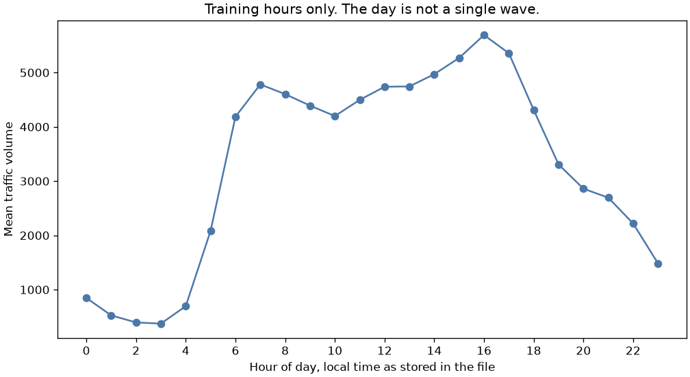
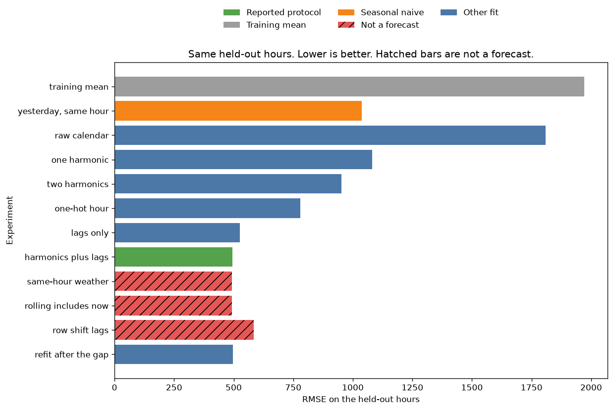
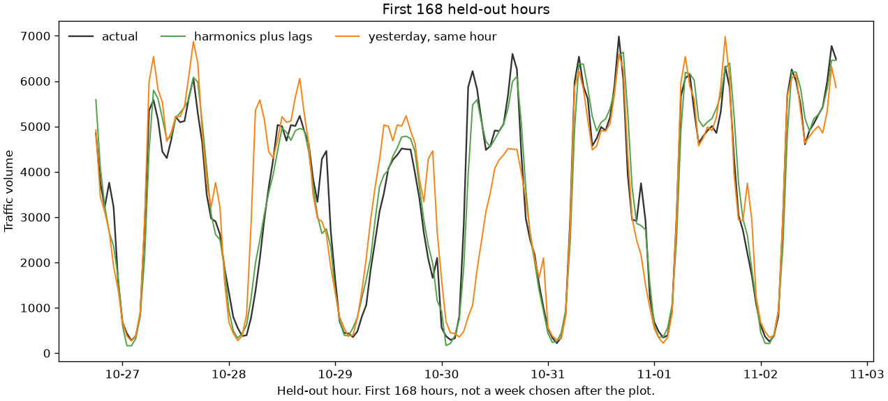
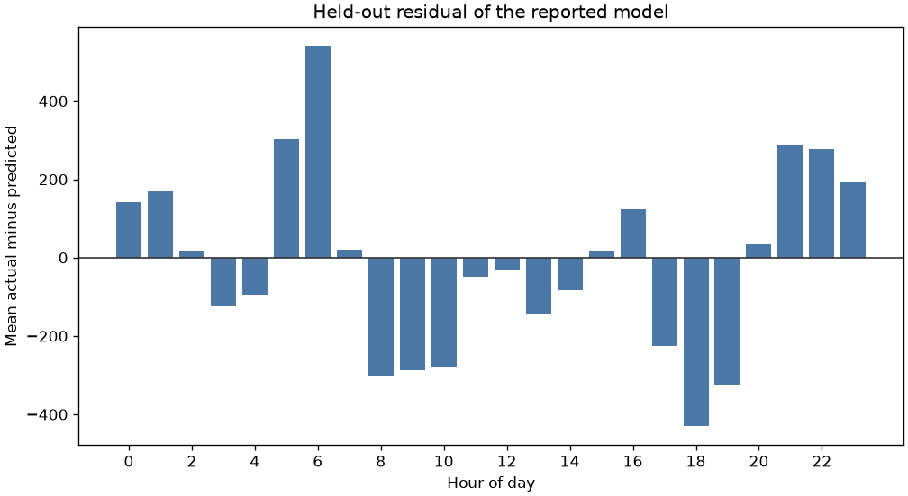

# Datetime features for hourly traffic volume

A road sensor reports westbound volume at the end of each hour. The forecast has to be made at the start of that hour, from the clock and from hours that have already closed. Encoding the clock as ordinary numbers, or filling a missing hour with the previous stored row, changes the forecast you would actually have.

The reported model is the eligible fit with the lowest training-period time-series CV RMSE. That rule was fixed before any holdout score. Leaky fits are scored on the same later hours and are not eligible. This is a teaching model on a public sensor extract. It is not a traffic operations tool.

## Problem

A traffic desk wants the next hour's volume before that hour has happened. The count for the hour is the target, so it cannot be a feature. Rain that "occurred in the hour" is the same kind of problem: the column describes the hour being forecast, not the hour that just ended. A missing sensor hour is a third problem. The previous row in the file may be two hours ago, or ten months ago. Calling that row "lag 1" trains the model on a lag it will not have in production, and it hides the outage.

The cost is a bad staffing or incident plan. A notebook that shifts the observed rows will look orderly until the first gap. A notebook that adds the current hour to a rolling mean will look slightly more accurate, because it has used the answer. Neither number is a forecast.

## Concepts taught

Cyclical encoding, one-hot hour versus Fourier terms, time-based lags, a past rolling window on a clock index, holiday flags that do not use the target, and the difference between a missing hour and the previous stored row. Also a seasonal naive baseline, time-series cross-validation, and a date-cluster bootstrap for a pre-registered gap.

## Theory in brief

The decision is the start of hour `t`. A feature is legitimate only if it would be known then. Volume at `t` fails that test. Volume at `t - 1`, `t - 24`, and `t - 168` passes, if those clock hours exist. Weather at `t - 1` passes. Weather aggregated over hour `t` does not, because the file describes that hour's rain as rain that occurred in the hour, and the temperature as an average for the hour.

Hour is a cycle of length 24. A linear column treats hour 23 as far from hour 0. One harmonic puts the hour on a circle:

`angle = 2 * pi * hour / 24`

`hour_sin = sin(angle)`, `hour_cos = cos(angle)`

Hour 23 and hour 0 are neighbors on that circle. Hour 11 is not. One pair has one peak and one trough per day. The training profile does not look like that: it is low in the middle of the night, rises through the morning, dips in the late morning, and peaks in the afternoon. A second harmonic adds `sin(4 * pi * hour / 24)` and `cos(4 * pi * hour / 24)`, which can place a second peak. It still cannot give each hour its own level. One-hot hour can. Weekday uses the same idea with period 7, and pandas numbers Monday as 0. Month uses `(month % 12) / 12`, so December and January are adjacent. A raw month number puts December next to November and far from January.

A time lag does not use row order. `lag_h(t)` is the volume at timestamp `t - h` if that timestamp is in the file, and missing otherwise. A row shift is `shift(h)` on the collapsed observed series. After a gap, those two numbers are not the same object. The past 24-hour mean is the mean of the previous 24 clock hours, excluding `t`, on a complete hourly index. Missing hours stay missing. A count column records how many of those hours were observed. The leaky rolling mean uses the same index but includes volume at `t`. That is the target, inside the feature.

The holiday flag does not use volume. If any hour on a local date has a holiday name, every hour of that date is flagged. The file itself stamps only hour 0. The flag is a calendar expansion, not a claim that the file labeled the afternoon. State Fair is flagged only on the stamped date. The file does not say how long the fair lasts, so this project does not extend it.

Ridge minimizes squared error plus `alpha * ||w||^2`, with `alpha` fixed at `1.0` and the solver fixed at `cholesky`. It was not tuned. A wider one-hot matrix is not on equal footing with a narrower harmonic matrix under that fixed penalty. That is accepted. The penalty was not changed after the scores. Missing numeric values are filled with the median of the fit rows, and a missing indicator stays in the design. The scaler is fit on those same rows. The holdout does not enter either fit.

RMSE is the square root of the mean squared error. Lower is better. R² is `1 - MSE / mean((y - mean(y))^2)` on the scored hours. The denominator uses the holdout mean, not the training mean, so a constant training-mean forecast can have a slightly negative R².

The comparison uses a cluster bootstrap. The cluster is the local date inside the holdout, because hours on the same day are not independent draws. There are `340` such dates, `1000` resamples, seed `7`. The gap is reference RMSE minus candidate RMSE. Positive means the candidate has lower RMSE. An interval that contains zero is not a win. The pairs were named before the scores. The holdout is not used to add, drop, or replace a feature. `selection_uses_test_scores` is false.

## Data

Metro Interstate Traffic Volume, UCI dataset `492`, DOI `10.24432/C5X60B`. The script downloads `https://archive.ics.uci.edu/static/public/492/metro+interstate+traffic+volume.zip` and reads `Metro_Interstate_Traffic_Volume.csv.gz`. The repository page is https://archive.ics.uci.edu/dataset/492/metro+interstate+traffic+volume. It licenses the dataset CC BY 4.0. The UCI API record has no license field and no introductory paper. This README does not invent one.

Citation, as given on the dataset page: Hogue, J. (2019). Metro Interstate Traffic Volume [Dataset]. UCI Machine Learning Repository. https://doi.org/10.24432/C5X60B.

The page says the series is hourly Interstate 94 westbound traffic at MN DoT ATR station 301, between Minneapolis and St Paul. `date_time` is "Hour of the data collected in local CST time." This script does not convert that clock. `traffic_volume` is "Hourly I-94 ATR 301 reported westbound traffic volume." Temperature is an average in kelvin. `rain_1h` and `snow_1h` are millimeters that occurred in the hour. `clouds_all` is percent cloud cover. `holiday` is "US National holidays plus regional holiday, Minnesota State Fair." Raw files land in `data/`, which is gitignored.

The official zip has `48204` rows and `40575` unique timestamps, so `7629` rows are extra weather observations on a timestamp that already exists. The maximum is `6` rows in one hour, and `6` weather descriptions in one hour. Volume never disagrees within a timestamp. Temperature disagrees on `78` hours, with a maximum spread of `20.432999999999993` kelvin. Rain disagrees on `9` hours, with a maximum spread of `0.7599999999999998` mm. Snow does not disagree. Clouds disagree on `32` hours, with a maximum spread of `75.0` percentage points. The model uses the mean of the numeric weather columns after the screens below. `weather_main` and `weather_description` are dropped before any fit, because one hour can carry several descriptions, not because a model rejected them.

The API says the file has no missing values. The official holiday token for an ordinary hour is the unquoted string `None`. A default pandas read turns that token into a null. This script reads with `keep_default_na=False` and treats `None` and a blank as not a holiday. There are `48143` such tokens and `61` named holiday rows. Every named stamp is at hour 0. The names are Labor Day, Thanksgiving Day, Christmas Day, New Years Day, Martin Luther King Jr Day, Columbus Day, Veterans Day, Washingtons Birthday, Memorial Day, Independence Day, and State Fair. The API export matches the zip on every non-holiday column, and it matches holiday after the same token rule.

Two physical screens were fixed before any score. Temperature below `200.0` kelvin is set to missing: `10` rows, on `10` hours, and those `10` hours are still missing after the hourly mean. Rain above `100.0` mm is set to missing: `1` row, on `1` hour. The page's "no missing values" sentence is about the file as donated. It is not a claim that 0 kelvin is a plausible air temperature.

The collapsed series runs from `2012-10-02 09:00:00` to `2018-09-30 23:00:00`. A complete hourly index over that span has `52551` hours. `11976` are absent. `2588` gaps are longer than one hour. `16` are at least 24 hours. The longest is `7387.0` hours, from `2014-08-08 01:00:00` to `2015-06-11 20:00:00`. There are `2192` gaps of exactly two hours, `324` of them in March and `343` in November. They are scattered across the day. A spring-forward can omit one hour, but these timestamps do not support reading the two-hour gaps as daylight-saving transitions. They are missing observations.

On the unique hours, volume ranges from `0.0` to `7280.0`. The mean is `3290.650474430068` and the median is `3427.0`. Two hours have volume `0`.

## Approach

The cut is `0.8` of the unique hours, in time order. There is no random split. Seed `42` is stored and is not used for the cut. The training block is the first `32460` hours, from `2012-10-02 09:00:00` through `2017-10-26 17:00:00`. The holdout is the later `8115` hours, from `2017-10-26 18:00:00` through `2018-09-30 23:00:00`. That start is after the end of the maximum gap. The holdout was not used to choose the cut, the features, or the model.

Eligible, in this order: training mean, seasonal naive at lag 24, raw calendar numbers, one harmonic, two harmonics, one-hot hour, lags only, and two harmonics plus lags and lagged weather. Ineligible: same-hour weather, a rolling mean that includes the current volume, row-shift lags, and a refit of the reported feature set on hours at or after the end of the maximum gap. The refit is a sample-size control, not a leak. It is still not eligible, because the reported training window was named first.

The seasonal naive predicts the volume from 24 clock hours earlier. If that hour is missing, it uses the mean of the fit rows. The raw calendar model uses hour, weekday, month, and the holiday-date flag as numbers. One harmonic replaces the three cycles with sine and cosine, and keeps the holiday flag. Two harmonics add the second hour pair. One-hot encodes hour, weekday, and month, and keeps the holiday flag as a number. Lags only uses clock lags at 1, 24, and 168 hours, missing indicators, and the past 24-hour mean and count. The reported feature set adds the two-harmonic calendar and lagged temperature, rain, snow, and clouds. It does not add same-hour weather.

On the training hours, `2570` rows have a missing clock lag of 1 hour while the row shift still has a value. On the holdout, that count is `18`. Where both values exist, they disagree on `0` training hours and `0` holdout hours. The bug is not a noisy sensor. It is a gap being treated as one hour. The holdout is also missing clock lag 24 on `24` hours and clock lag 168 on `26` hours.

Selection uses 4-fold `TimeSeriesSplit` on the training hours only. The score is the mean of the four fold RMSEs. Ties would go to fewer features, then to the name. There was no tie. Ineligible models are not cross-validated. They are fit once on their training rows and scored on the holdout.

## Experiments

Every row below is scored on the same `8115` holdout hours. CV RMSE is blank for a model that was not eligible. The reported row is `two_harmonic_plus_lags`.

| Experiment | Eligible | Features | CV RMSE | Holdout RMSE | MAE | R² |
| --- | --- | --- | --- | --- | --- | --- |
| training mean | yes | `0` | `1979.7677176465356` | `1970.206195090623` | `1723.976898534582` | `-0.00014398968995377182` |
| seasonal naive, lag 24 | yes | `1` | `1112.692031110913` | `1038.3391488036405` | `577.8888564227492` | `0.7222093486508524` |
| raw calendar | yes | `4` | `1822.2127723349242` | `1809.6937854893324` | `1596.6431766409994` | `0.1561808857651984` |
| one harmonic | yes | `7` | `1099.0391403931799` | `1080.273658825046` | `839.1610298987108` | `0.6993184767469566` |
| two harmonics | yes | `9` | `973.7037857906903` | `952.9010949865828` | `728.6460043433963` | `0.7660436588645566` |
| one-hot hour | yes | `44` | `794.3918087189775` | `779.8361903799677` | `573.2544654338018` | `0.8433083186833837` |
| lags only | yes | `9` | `646.5985111075213` | `525.0892793922851` | `351.73826012396546` | `0.9289595879501934` |
| harmonics plus lags | yes | `26` | `610.5874463587255` | `493.8430276959893` | `341.2099706044335` | `0.937162771479746` |
| same-hour weather | no | `34` | not run | `492.43178253741263` | `340.53426017290514` | `0.9375213956653876` |
| rolling includes now | no | `26` | not run | `492.7845532696366` | `341.84039245155213` | `0.9374318461335867` |
| row-shift lags | no | `26` | not run | `584.1216131515511` | `432.61280706088087` | `0.9120884938681303` |
| refit after the gap | no | `26` | not run | `496.9486643320604` | `335.8593999182505` | `0.9363699559175229` |

The training mean is the baseline. Its holdout R² is slightly negative because the forecast is the training mean, `3285.9224892174975`, and the holdout mean is `3309.5624152803452`. The reported forecast averages `3319.5420627713092` on those same hours.

The seasonal naive is the serious baseline. It cuts RMSE from `1970.206195090623` to `1038.3391488036405`. A calendar model has to beat that before it is interesting, and most of them do not. Raw hour, weekday, and month score `1809.6937854893324`. One harmonic scores `1080.273658825046`. Two harmonics score `952.9010949865828`. One-hot hour scores `779.8361903799677`. Lags alone score `525.0892793922851`. The reported model scores `493.8430276959893`.

The training profile explains the harmonic failure. Mean volume at hour 3 is `373.22955738934735`. Hour 7 is `4781.520599250936`. Hour 10 falls back to `4198.6683748169835`. Hour 16 peaks at `5691.2556610664715`. Hour 23 is `1483.9707142857144`, closer to hour 0 at `848.0476878612717` than to the afternoon peak. One wave cannot draw the morning rise and the afternoon peak. Two waves move in the right direction and still lose to a separate level for each hour. One-hot has `44` columns against `9` for two harmonics, under the same `alpha` of `1.0`. The wider matrix is the one the penalty treats more harshly, and it still wins the calendar comparison. It does not win the model selection. It has no yesterday.

The reported CV mean is `610.5874463587255`, against `646.5985111075213` for lags only and `794.3918087189775` for one-hot hour. The four reported fold RMSEs are `624.3017595393486`, `809.6590447214699`, `533.8221088117792`, and `474.56687236230437`. The second validation block is the one that contains index `13898`, the first hour after the maximum gap. The CV standard deviation is `126.70053004992371`. Selection uses the mean. The reported feature set adds both the second-harmonic calendar and lagged weather to the lags. This project did not fit the two blocks separately, so the CV win is not a clean credit to either block.

The pre-registered bootstrap gaps, reference RMSE minus candidate RMSE:

| Comparison | Gap mean | 2.5% | 97.5% |
| --- | --- | --- | --- |
| training mean minus reported | `1475.3483262920538` | `1435.1611212731905` | `1511.4893109366974` |
| seasonal naive minus reported | `545.1076724277345` | `480.3332311133934` | `606.872589263708` |
| one harmonic minus two harmonics | `127.2028222141298` | `107.4263408126917` | `146.98529701259048` |
| raw calendar minus one-hot hour | `1028.8823534464736` | `966.5737139377176` | `1092.964575447484` |
| reported minus rolling-includes-now | `1.0436976413902184` | `-1.4239968724479937` | `3.769615748380066` |
| reported minus same-hour weather | `1.435088829837119` | `0.6498407344376943` | `2.2349349070969495` |
| reported minus row shift | `-89.75283822008484` | `-113.98731343208286` | `-63.90920728663577` |
| reported minus post-gap refit | `-3.1240959163008895` | `-9.977103003175662` | `3.3228062757261965` |

The training mean and the seasonal naive both lose to the reported model, and those intervals exclude zero. Two harmonics beat one harmonic. One-hot hour beats the raw calendar numbers. Those four comparisons were eligible or were encoding checks inside the eligible set.

The leak does not earn a win. Including the current volume in the rolling mean scores `492.7845532696366`, a hair under the reported `493.8430276959893`. The date-cluster interval includes zero. The feature is still ineligible, because the current volume is the target. Same-hour weather scores `492.43178253741263`. Its interval excludes zero, and the gain is small next to the reported RMSE. It remains ineligible. At the start of the hour, that hour's rainfall has not finished occurring.

Row shift is the failure that costs something. It scores `584.1216131515511`. The interval is entirely negative, which means the row-shift fit has higher RMSE. The coefficients were trained on `2570` hours whose "lag 1" is the previous stored row, including the row on the other side of the `7387.0` hour hole. The holdout itself has only `18` such hours. The damage is mostly a corrupted training fit, not eighteen bad holdout rows.

Refitting after the gap, on `18562` training hours instead of `32460`, scores `496.9486643320604`. The interval includes zero. Dropping the older block does not clearly help or hurt this holdout. It was not eligible, because the training window was named before the score.

Weekday means on the training hours, with Monday as 0, run from `3660.491918332624` on Friday to `2421.3845158507656` on Sunday. That is why a weekday cycle is in the calendar models. It is not why the lag model wins. Yesterday already carries the weekday.

## Plots

Training hours only. The afternoon peak is not a second copy of the morning.



Same held-out hours. Lower is better. Hatched bars use information that is not a forecast at the start of the hour. The green bar is the reported protocol, not the lowest bar.



The first `168` held-out hours, from `2017-10-26 18:00:00` to `2017-11-02 17:00:00`. This window is the start of the holdout. It was not chosen after looking at the week.



Held-out residual of the reported model, actual minus predicted. Hour 6 averages `540.3418979729187`: the morning is underpredicted, actual `4119.1863905325445` against predicted `3578.844492559626`, over `338` hours. Hour 18 averages `-429.31603783934696`: the evening is overpredicted, actual `4293.982352941176` against predicted `4723.298390780524`, over `340` hours.



## Key takeaways

The forecast that was named by training-period CV has holdout RMSE `493.8430276959893`, against `1970.206195090623` for the training mean and `1038.3391488036405` for yesterday at the same hour. Lags do more than a calendar. One harmonic is the wrong shape for this commute, and one-hot hour beats two harmonics without becoming the selected model.

A rolling mean that includes the current hour scores `492.7845532696366` and is not a forecast. The date-cluster interval includes zero. A row shift that ignores gaps is worse, and the harm shows up in the training fit, not only in the missing holdout hours.

## Common mistakes

- Calling `shift(1)` a one-hour lag on a file with gaps. Here the two agree whenever both exist, and they disagree in definition on `2570` training hours.
- Putting the current hour into a rolling mean because the leaderboard moved in the first unit of RMSE. The interval included zero, and the column is the target.
- Using one sine and cosine pair for a day that has two peaks. Hour 3 and hour 16 are not opposite sides of one wave in this file.
- Leaving hour as a raw number. Hour 23 is near hour 0 on the clock and far from it on the number line. The raw calendar model scored `1809.6937854893324`.
- Encoding month as 1 through 12 and then being surprised that December is far from January.
- Treating same-hour rain as known at the start of the hour because the timestamp is on the row. The column is rain that occurred in the hour.
- Extending State Fair across a week the file does not label. The stamp is one date.
- Reading every two-hour gap as daylight saving time. This file has `2192` of them, spread through the day.
- Filling a missing hour with the previous observation and then reporting a model that "handled missing data." The previous observation may be the other side of a `7387.0` hour hole.
- Tuning `alpha` after seeing the holdout, or declaring one-hot the winner because its holdout RMSE is lower than two harmonics. Selection was the training CV, and one-hot lost that comparison to the lag model.
- Splitting these hours at random. The later year is the question the desk would ask. A random split answers a different question.

## Interview questions

**Why is one sin/cos pair not enough for hour of day?**
It can represent one peak and one trough. This series has a night minimum, a morning rise, a late-morning dip, and an afternoon peak. Training-hour means are `373.22955738934735` at hour 3, `4198.6683748169835` at hour 10, and `5691.2556610664715` at hour 16. Two harmonics beat one harmonic on the holdout, interval `107.4263408126917` to `146.98529701259048`. One-hot hour beat both, because the shape is still not two perfect waves.

**One-hot hour has the best calendar score. Why is it not the reported model?**
The reported model is the eligible fit with the lowest training CV RMSE. One-hot hour's CV RMSE is `794.3918087189775`. Harmonics plus lags is `610.5874463587255`. A calendar model cannot see yesterday. Also, one-hot has `44` columns and two harmonics have `9`, under the same untuned `alpha` of `1.0`. The comparison is informative. It is not a license to retune the penalty on the holdout.

**What is wrong with `shift(1)` when the series has gaps?**
It treats the previous stored row as one hour earlier. After the hole from `2014-08-08 01:00:00` to `2015-06-11 20:00:00`, that row is `7387.0` hours earlier. A clock lookup is missing instead, and the missing indicator says so. The two features never disagree when both are present. The row-shift model still scores `584.1216131515511` against the reported `493.8430276959893`, because `2570` training hours taught it the wrong lag.

**The leaky rolling mean has a lower holdout RMSE. Why not ship it?**
It includes volume at the hour being forecast. The point estimate is `492.7845532696366` against `493.8430276959893`. The date-cluster interval is `-1.4239968724479937` to `3.769615748380066`, which includes zero. Even a clear win would be ineligible. The person asking for the forecast does not know the hour's volume yet.

**Same-hour weather improved the score and the interval excluded zero. Why leave it out?**
The gain is real and small: interval `0.6498407344376943` to `2.2349349070969495`, holdout RMSE `492.43178253741263`. `rain_1h` is rain that occurred in the hour, and temperature is an average for the hour. Lagged weather is already in the reported model. The same-hour block is a nowcast. Label it as a nowcast if someone needs it. Do not mix it into the forecast.

**Why time-series CV instead of random k-fold?**
A random fold trains on hours from both sides of the validation block. The lag features then see the future of the block they are scoring. `TimeSeriesSplit` keeps the validation block later than its training rows. The second validation block contains the restart after the long gap, and its RMSE is `809.6590447214699`. That is a property of this file, not a reason to shuffle.

**Why is the training-mean R² negative?**
R² compares the forecast with the mean of the scored hours, not with the training mean. The training mean is `3285.9224892174975`. The holdout mean is `3309.5624152803452`. A constant that is not the holdout mean can have R² `-0.00014398968995377182`. The RMSE, `1970.206195090623`, is the number to quote. The sign of R² is a reminder about the denominator.

**How should December sit next to January?**
Use `(month % 12) / 12` before the sine and cosine, or one-hot the month. A raw month number makes December 12 and January 1. The holiday flag is separate. It is a date-level calendar bit, built from the stamped holiday name, not from volume.

**The residual plot still misses the morning. Is the model done?**
No. Hour 6 is underpredicted by `540.3418979729187` on average, and hour 18 is overpredicted by `429.31603783934696`. The lag model got the broad day right and still has a systematic clock error. The next experiment would be a later project. It is not a reason to add the current hour.

**What do you tell an operations lead who wants one number?**
The protocol forecast, the seasonal naive beside it, and the fact that the current hour was not used. Holdout RMSE `493.8430276959893` against `1038.3391488036405` for yesterday and `1970.206195090623` for the training mean. Then say what the model still misses: the morning ramp. Do not quote the leaky `492.7845532696366` as the accuracy they will get at the start of the hour.

## How this shows up at work

An operations lead will ask to include "current conditions" because a demo moved from `493.8430276959893` to `492.43178253741263`. Ask which conditions exist when the forecast is requested. Rain for the hour being forecast does not. Yesterday's rain does. If the desk wants a nowcast at minute 50, that is a different decision, with a different feature timestamp, and it should be labeled as such.

A pipeline will build lags with `shift(1)` because the frame looks hourly. Ask for the gap table before the feature table. This file has `11976` missing hours and one hole of `7387.0` hours. The row-shift fit scored `584.1216131515511`. The review comment is to join on the clock, keep a missing indicator, and fit the imputer on the training fold only.

Someone will propose one sine and cosine pair as the standard encoding. Show the training hour profile before agreeing. If the day has two peaks, one pair is the wrong function, not a neutral default. One-hot hour is a fair check. It is also a wider matrix, and a fixed L2 penalty does not treat it as the same model. Say that when you quote `779.8361903799677` against `952.9010949865828`.

The residual chart is the stakeholder chart. Hour 6 is still short by `540.3418979729187` vehicles on average. A lead who only hears RMSE `493.8430276959893` will think the morning is solved. It is not. The first `168` holdout hours are in the week plot so the daily miss is visible without picking a flattering week.

Do not put this score in a dispatch tool. The threshold for action is uncosted, the sensor gaps are large, and the labels are a research extract from one westbound station through `2018-09-30 23:00:00`.

## Run it

From this directory, with the root dependencies installed:

```bash
python main.py
pytest tests/test_smoke.py
```

`requirements.txt` includes the root pins. It does not add a package. `make run` calls `python main.py` if you have GNU make. The script downloads the official zip, checks it against the UCI API export, and writes `results/metrics.json` plus the four plots. It runs on a laptop CPU. The elapsed time in `results/metrics.json` is not a result. It changes when the script is rerun, and it is not quoted here.

## Further reading

- UCI dataset record: https://archive.ics.uci.edu/dataset/492/metro+interstate+traffic+volume
- Dataset DOI: https://doi.org/10.24432/C5X60B
- Creative Commons Attribution 4.0 license: https://creativecommons.org/licenses/by/4.0/legalcode
- Hyndman and Athanasopoulos, Forecasting: Principles and Practice, 3rd edition, OTexts. Seasonal naive and the other simple benchmarks: https://otexts.com/fpp3/simple-methods.html
- The same book, dynamic harmonic regression, for Fourier terms as seasonal predictors: https://otexts.com/fpp3/dhr.html
- scikit-learn `TimeSeriesSplit`: https://scikit-learn.org/stable/modules/generated/sklearn.model_selection.TimeSeriesSplit.html
- scikit-learn common pitfalls, including preprocessing fit before the split: https://scikit-learn.org/stable/common_pitfalls.html
