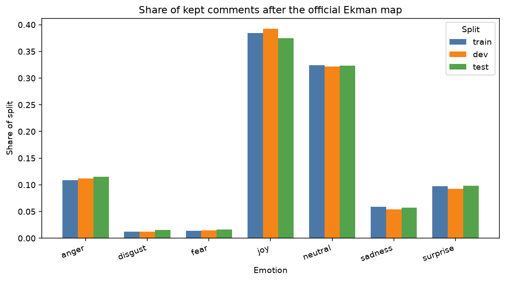
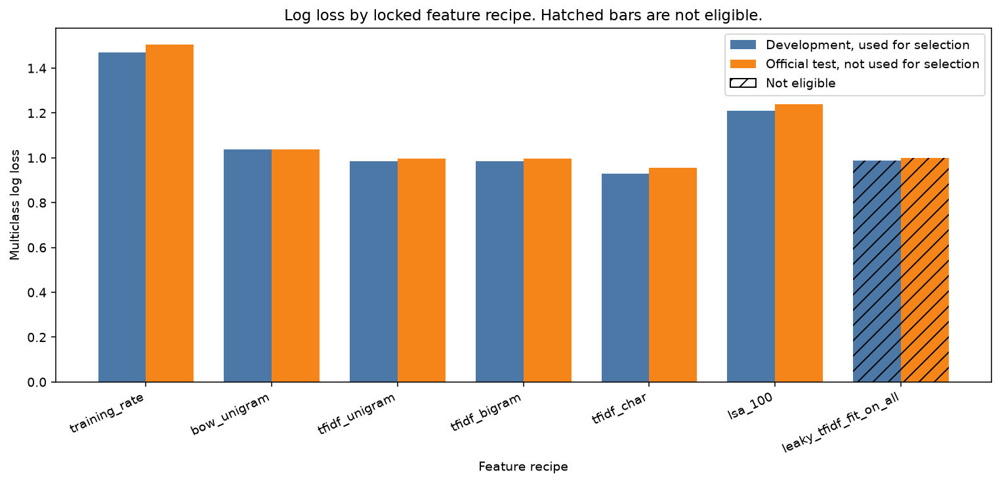
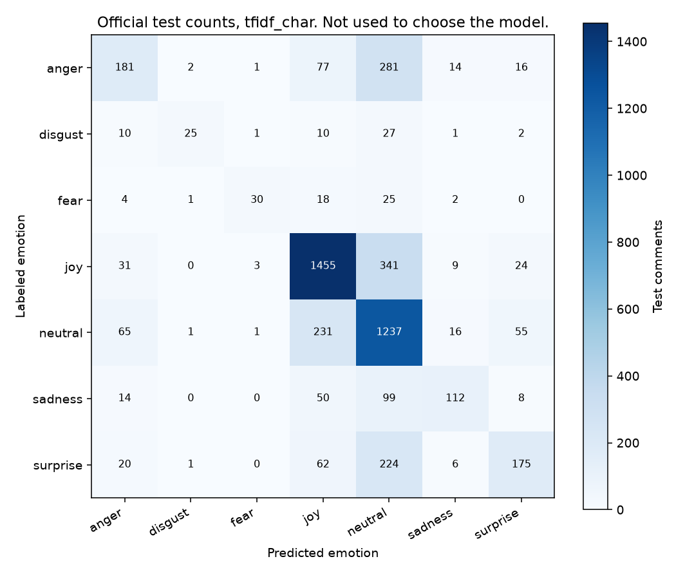
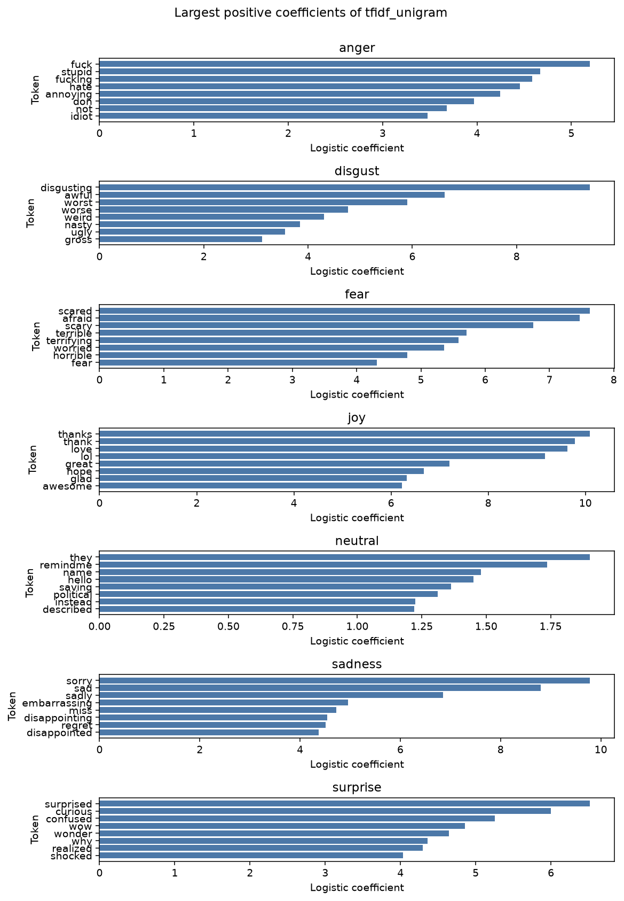
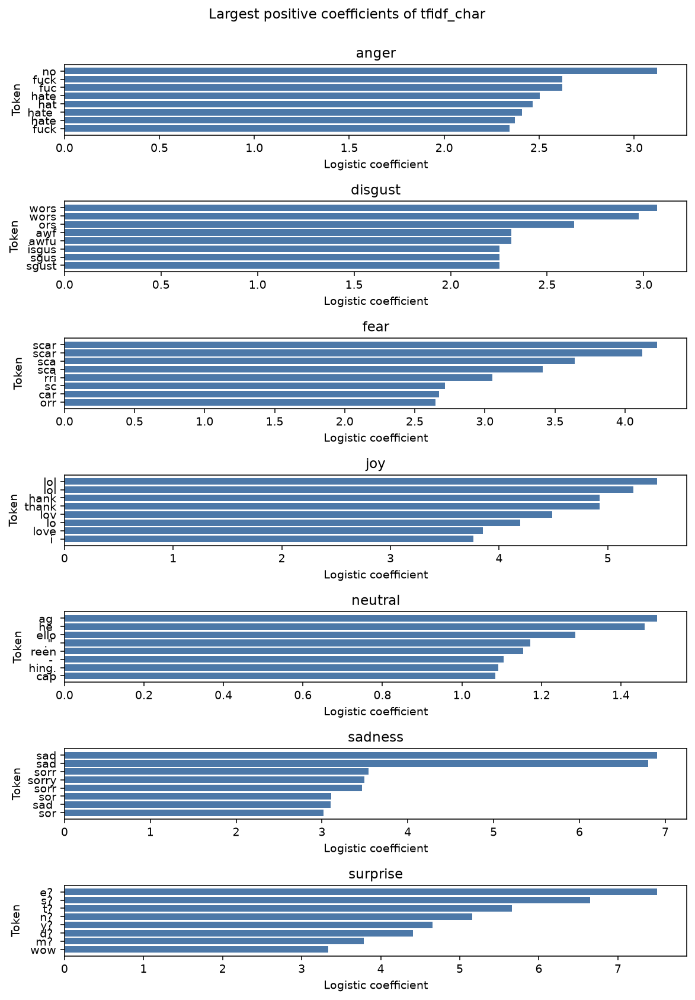

# Text features for short comments

A moderator, or a support desk, has a comment and a coarse emotion label. The text has to become columns before a linear model can use it. Counting words, weighting them, adding pairs, chopping them into characters, and compressing them are not the same representation. Fitting the vocabulary on the comments you are about to score is not a representation choice. It is a leak, even when the score does not move.

The reported model is the eligible recipe with the lowest development log loss. That rule was fixed before any test score. The leaky vectorizer is scored on the same official test comments and is not eligible. This is a teaching model on public comments. It is not a moderation tool, and it is not the paper's evaluation.

## Problem

Someone has to read a short comment and decide whether it is angry, sad, joyful, or none of those. A person can do that one comment at a time. A queue cannot. The useful object is a probability, not a bag of tokens, because the next system will threshold it, sample it, or hand it to a reviewer.

The label in the file is not one emotion. A comment can carry several fine labels, and those labels can sit in different families. If the model is forced to emit one class, the training rows have to be rows that actually have one class. Dropping the mixed comments changes the population. Keeping them and then scoring a single-label metric answers a question the labels do not ask.

The other failure is quieter. A notebook that builds the word list on every split, including the week being scored, has already used the test text. The classifier may never have seen a test label. The number can still be honest-looking, or even worse. It is not a holdout.

## Concepts taught

Bag-of-words counts, TF-IDF, word n-grams under a feature cap, character n-grams inside word boundaries, and a 100-component latent semantic embedding. Also an official split, a training-rate baseline, multiclass log loss against accuracy and macro F1, a row bootstrap for a pre-registered gap, and a vectorizer fit that sees the test text.

## Theory in brief

The decision is one kept comment. The label is one coarse emotion. A feature is a function of the text only. It is fit on the training comments unless the experiment is the named leak.

A word token is a run of at least two word characters, lowercased. The pattern is the one in `main.py`. Single letters and punctuation do not become tokens. Order inside the comment is discarded. A count vector stores how often each vocabulary token appears. That is bag of words.

TF-IDF starts from those counts and downweights a token that appears in many training comments. This script does not set the weighting arguments, so they stay at the installed scikit-learn defaults: raw term count, smoothed inverse document frequency, and an L2-normalized row. With `n` training documents and document frequency `df(t)`:

`idf(t) = log((1 + n) / (1 + df(t))) + 1`

The row is then divided by its L2 norm. A token in nearly every comment gets a small weight. A token in a few comments gets a large one. The leaky fit changes this formula, because `n` and `df(t)` are counted on train, development, and test text. The classifier is still fit on training labels only. The leak is the vocabulary and the weights, not a stolen label.

Word bigrams are adjacent token pairs, kept together with unigrams. The vocabulary cap is `10000` features, and tokens that appear in fewer than `2` training documents are dropped before that cap. The cap keeps the most frequent remaining items. A frequent pair can displace a rarer unigram. The bigram model is not the unigram model plus extra columns. It is a different set of `10000` columns.

Character n-grams of length 3 to 5 are cut inside word boundaries. The analyzer pads a word with spaces, so a fragment can include a boundary. `lol` and a leading-space fragment of the same letters are different columns. These features do not have to be words. On a short comment, a stem, a typo, or a fragment can be the whole signal.

Latent semantic analysis takes the training TF-IDF matrix and keeps `100` components from a randomized truncated SVD. The components are fit on training rows only, then applied to the other splits. The sum of explained variance ratios is the share of TF-IDF variance those components keep. It is a linear compression. It is not a trained word embedding, and it is not a transformer.

The classifier is multinomial logistic regression. For a feature vector `x` and class `k`:

`P(y = k | x) = exp(w_k · x + b_k) / sum_j exp(w_j · x + b_j)`

The penalty is the default L2 penalty. `C` is `1.0`. The solver is `saga`, because `liblinear` does not fit this multiclass problem in the installed scikit-learn. `max_iter` is `200` and `tol` is `0.001`. `class_weight` is null. None of those were tuned after a score.

Log loss is the mean of `-log P(y_true | x)`. Lower is better. The training-rate model predicts the training class frequencies for every comment. Its hard prediction is the largest training class. Accuracy is the share of hard predictions that match. Macro F1 averages the per-class F1, so a rare class counts as much as joy. A high accuracy with a low macro F1 means the large classes are carrying the headline.

The feature matrix is float32. Scoring it as float64 can make a probability row fail a sum-to-one check by a rounding margin. The script divides each row by its sum before log loss. The numbers below include that step. It does not change which recipe is eligible.

The comparison uses a row bootstrap on the official test comments. There are `1000` resamples, seed `7`. The gap is reference log loss minus candidate log loss. Positive means the candidate has lower log loss. An interval that contains zero is not a win. An interval that excludes zero can also be a loss: the sign says which way. The pairs were named before the scores. The test split is not used to add, drop, or replace a feature. `selection_uses_test_scores` is false.

The bootstrap treats comments as independent draws. These files do not include an author or subreddit column, so this project does not cluster on either. That is a limit of the interval, not a hidden cluster test.

## Data

GoEmotions, agreement-filtered splits released with Demszky et al., ACL 2020, DOI `10.18653/v1/2020.acl-main.372`. The script downloads `train.tsv`, `dev.tsv`, `test.tsv`, `emotions.txt`, and `ekman_mapping.json` from `google-research/google-research` `goemotions/data`, and checks each file against a SHA-256 pin in `main.py`. The paper is https://aclanthology.org/2020.acl-main.372/. The data README is https://github.com/google-research/google-research/tree/master/goemotions.

The Hugging Face dataset card tags the dataset `apache-2.0`. The card is https://huggingface.co/datasets/google-research-datasets/go_emotions. The google-research repository is also Apache-2.0. This download has no separate data-license file. The license recorded in `results/metrics.json` is that pair of sources, not a file this script invented.

Citation: Dorottya Demszky, Dana Movshovitz-Attias, Jeongwoo Ko, Alan Cowen, Gaurav Nemade, and Sujith Ravi. 2020. GoEmotions: A Dataset of Fine-Grained Emotions. In Proceedings of the 58th Annual Meeting of the Association for Computational Linguistics, pages 4040–4054, Online. Association for Computational Linguistics.

The paper describes 58k English Reddit comments labeled for 27 emotion categories or neutral. The data README says the files used here are the version filtered to rater agreement, not the raw rater file. Each row is one comment: text, a comma-separated list of emotion ids, and a comment id. There is no header. The ids follow `emotions.txt`. Names in the released text are masked, as that README describes. Raw files land in `data/`, which is gitignored.

This script does not rerun the paper. The paper's task is multi-label classification over the fine labels. The target here was locked before the fit: the official Ekman map, with neutral left as neutral. A comment is kept only when every fine label maps to the same coarse emotion. Anger includes anger, annoyance, and disapproval. Disgust is disgust alone. Fear includes fear and nervousness. Joy includes joy, amusement, approval, excitement, gratitude, love, optimism, relief, pride, admiration, desire, and caring. Sadness includes sadness, disappointment, embarrassment, grief, and remorse. Surprise includes surprise, realization, confusion, and curiosity. A comment whose fine labels fall in two of those groups is dropped. The map is checked against `ekman_mapping.json` before any fit.

The official files have `43410` training rows, `5426` development rows, and `5427` test rows. After the cross-group drop, the kept rows are `39555`, `4946`, and `4968`. The dropped counts are `3855`, `480`, and `459`. Comment ids do not overlap across the three files: the three overlap counts are `0`. Exact text does overlap. The raw files share `41` texts between train and development, `32` between train and test, and `10` between development and test. `41` kept test rows have text that also appears in the raw train or development file. Those rows are a sensitivity check. They are not a reason to pick a different recipe.

On the kept training comments, joy has `15216` rows and neutral has `12823`. Disgust has `498`. Fear has `541`. The test support is `1863` joy, `1606` neutral, `572` anger, `488` surprise, `283` sadness, `80` fear, and `76` disgust. A model that always leans toward joy and neutral will look accurate.

## Approach

The split is the official three files. Seed `42` is stored and is not used to cut the data. It is used for the logistic regression and the SVD. The development file chooses the recipe. The test file does not.

Eligible, in this order: training rate, bag-of-words unigrams, TF-IDF unigrams, TF-IDF word unigrams and bigrams, TF-IDF character n-grams, and LSA with `100` components on the unigram TF-IDF matrix. Ineligible: the same unigram TF-IDF vectorizer, fit on the kept text of all three splits. That fit sees `49469` documents. The honest vectorizers see `39555`.

The training-rate model is a prior dummy. It has no text features. Every other recipe uses the same logistic regression. Selection is the lowest development log loss. A tie would keep the earlier name in the locked list. There was no tie. Ineligible models are scored and cannot win.

After the reported model is chosen, the `41` test rows whose exact text appears in train or development are dropped, and the same probabilities are scored again. That check does not refit and does not reselect.

## Experiments

Every row below is scored on the same `4968` kept test comments. Development log loss is the selection score for eligible rows. The reported row is `tfidf_char`.

| Experiment | Eligible | Features | Fit documents | Dev log loss | Test log loss | Test accuracy | Test macro F1 |
| --- | --- | --- | --- | --- | --- | --- | --- |
| training rate | yes | `0` | `0` | `1.4715089304108815` | `1.5041699927045604` | `0.375` | `0.07792207792207792` |
| bag of words | yes | `10000` | `39555` | `1.0380036280853535` | `1.037624297000595` | `0.6340579710144928` | `0.5388993437690537` |
| TF-IDF unigrams | yes | `10000` | `39555` | `0.985144412812997` | `0.9966623100047696` | `0.6326489533011272` | `0.4910740419526144` |
| TF-IDF word bigrams | yes | `10000` | `39555` | `0.9844359284642624` | `0.9972933018782066` | `0.6358695652173914` | `0.4676557719616882` |
| TF-IDF character n-grams | yes | `10000` | `39555` | `0.9296188540434075` | `0.9546742014250085` | `0.6471417069243156` | `0.5386933448170452` |
| LSA, 100 components | yes | `100` | `39555` | `1.2100016438737202` | `1.2397548456659995` | `0.533816425120773` | `0.2701533776078608` |
| TF-IDF fit on all splits | no | `10000` | `49469` | `0.9875119942828606` | `0.998050295566316` | `0.6334541062801933` | `0.4881495418019691` |

The training rate is the baseline. Its test log loss is `1.5041699927045604`, its accuracy is `0.375`, and its macro F1 is `0.07792207792207792`. The hard prediction is the largest training class. Joy has `15216` of `39555` kept training comments. Accuracy near the joy share is what that baseline should do. It is not a text model.

Bag of words cuts test log loss to `1.037624297000595`. TF-IDF unigrams cut it further, to `0.9966623100047696`. The development scores agree: `1.0380036280853535` for counts and `0.985144412812997` for TF-IDF. The cap binds on both. Each has `10000` features and `59` training rows with no active feature. Those rows have no token evidence. The classifier then has only the intercept.

Word bigrams are the experiment that does not pay. Development log loss is `0.9844359284642624`, a hair under the unigram `0.985144412812997`. Test log loss is `0.9972933018782066`, a hair over the unigram `0.9966623100047696`. Test macro F1 falls from `0.4910740419526144` to `0.4676557719616882`. The vocabulary is still capped at `10000`, and `113` training rows are all zeros, against `59` for unigrams. Adding pairs under that cap removes unigrams. It does not add a free lunch.

Character n-grams win the locked comparison. Development log loss is `0.9296188540434075`. Test log loss is `0.9546742014250085`. Test accuracy is `0.6471417069243156` and test macro F1 is `0.5386933448170452`. The cap still binds. Only `4` training rows are all zeros. The test ranking agrees with the development ranking for this winner. That agreement is a report, not the selection rule. The test file was not used to choose it.

LSA is the clear miss. The `100` components keep an explained-variance sum of `0.2529340088367462`. Development log loss rises to `1.2100016438737202`. Test log loss is `1.2397548456659995`, and test macro F1 is `0.2701533776078608`. Compressing the unigram matrix this hard throws away the rare tokens that separate the small classes. A linear embedding of this size is not a substitute for the sparse vector it was built from.

The leak does not inflate the score. The vectorizer fit on all three splits has test log loss `0.998050295566316`, against `0.9966623100047696` for the honest unigram fit. It is still ineligible. The test comments helped build the vocabulary and the inverse document frequency. A leak that fails is still a leak.

No eligible fit emitted a convergence warning. The warning count is `0` for every row. The reported fit's largest iteration count is `17`, under the cap of `200`. The count model used `73`. LSA used `14`. The tolerance was not loosened after the scores.

The pre-registered bootstrap gaps, reference log loss minus candidate log loss:

| Comparison | Gap mean | 2.5% | 97.5% |
| --- | --- | --- | --- |
| training rate minus character n-grams | `0.549495791279552` | `0.5241133465169708` | `0.5737837077828932` |
| bag of words minus TF-IDF unigrams | `0.04096198699582554` | `0.025004449853685825` | `0.05524045451960766` |
| TF-IDF unigrams minus word bigrams | `-0.0006309918734370701` | `-0.008763585988184778` | `0.00725066400579212` |
| TF-IDF unigrams minus character n-grams | `0.041988108579761096` | `0.029965660869821293` | `0.054239501843184316` |
| TF-IDF unigrams minus LSA | `-0.2430925356612299` | `-0.2612399786668943` | `-0.22680331494996456` |
| TF-IDF unigrams minus the leaky fit | `-0.001387985561546401` | `-0.003894780048155236` | `0.001097227477266687` |

The training rate loses to the reported model, and that interval excludes zero. TF-IDF beats counts, and that interval excludes zero. Character n-grams beat TF-IDF unigrams, and that interval excludes zero. Those three are wins for the candidate.

Word bigrams do not beat unigrams. The interval includes zero, and the point gap is negative. LSA loses to unigrams. Its interval excludes zero in the wrong direction. The leaky fit does not beat the honest unigram fit. Its interval includes zero. None of those three is a reason to change the reported recipe. The leaky fit would not have been eligible even if the interval had excluded zero.

Per-class test metrics for the reported model, not used to choose it:

| Emotion | Support | Precision | Recall | F1 |
| --- | --- | --- | --- | --- |
| anger | `572` | `0.556923076923077` | `0.31643356643356646` | `0.4035674470457079` |
| disgust | `76` | `0.8333333333333334` | `0.32894736842105265` | `0.4716981132075471` |
| fear | `80` | `0.8333333333333334` | `0.375` | `0.5172413793103448` |
| joy | `1863` | `0.7645822385706779` | `0.7809983896940419` | `0.7727031332979288` |
| neutral | `1606` | `0.553715308863026` | `0.7702366127023661` | `0.6442708333333333` |
| sadness | `283` | `0.7` | `0.3957597173144876` | `0.5056433408577878` |
| surprise | `488` | `0.625` | `0.35860655737704916` | `0.45572916666666663` |

Joy recall is `0.7809983896940419`. Anger recall is `0.31643356643356646`. Disgust precision is `0.8333333333333334` and disgust recall is `0.32894736842105265`. The model is willing to call disgust when it is sure, and it often is not sure. `class_weight` was left null. Reweighting after this table would be a new experiment. It was not run, because the test file had already been scored.

Dropping the `41` overlapping test rows, without refitting, moves the reported log loss from `0.9546742014250085` to `0.9599048999764226`. Accuracy moves to `0.6452202151410594` and macro F1 to `0.5369057085170554`, on `4927` rows. The check does not reselect. Exact text overlap is a limit of this file. It is not the source of the character-n-gram win.

## Plots

Share of kept comments inside each split. Joy and neutral dominate all three. The plot is a share, not a claim that the splits were rebalanced.



Development and official-test log loss for the locked list. Lower is better. The hatched bars fit the vectorizer on text that includes the test comments. The development bars are the selection scores. The test bars were not used to choose the recipe.



Official test counts for `tfidf_char`. This figure was not an input to selection. The rare rows often land in joy or neutral. The recall table is the numeric version of that picture. Cell counts are drawn here and are not copied into the prose, because they are not stored in `results/metrics.json`.



Largest positive coefficients of the TF-IDF unigram model. This plot is always that model, including when another recipe is selected. Joy's largest coefficient is `thanks`, at `10.089580535888672`. Fear's largest is `scared`, at `7.626424789428711`. Disgust's largest is `disgusting`, at `9.403564453125`. Some anger coefficients are profanity from the comments. They stay in the plot. They are not repeated here.



Largest positive coefficients of the reported character model. These are fragments, not a word list. Joy's largest is `lol`, at `5.455506324768066`. The same plot is why a character model can win on short, informal text: the column does not have to be a dictionary word.



## Key takeaways

The recipe named by development log loss has official-test log loss `0.9546742014250085`, against `1.5041699927045604` for the training rate and `0.9966623100047696` for TF-IDF unigrams. Character n-grams beat the word recipes on this short-comment set. The test file did not make that choice.

Word bigrams under a `10000` feature cap do not beat unigrams. The test interval includes zero, and macro F1 gets worse. LSA at `100` components keeps `0.2529340088367462` of the TF-IDF variance and loses clearly. A vectorizer fit on the test text scores `0.998050295566316` and is not eligible. The leak did not buy a better number.

Accuracy of `0.6471417069243156` hides the rare classes. Disgust recall is `0.32894736842105265`. This is not a moderation score.

## Common mistakes

- Fitting the vectorizer on all splits because the classifier only sees training labels. The leaky fit used `49469` documents. Its test log loss was `0.998050295566316`, and it was still invalid.
- Treating a leak that failed to inflate the score as proof that leakage does not matter. The interval included zero. The test text had still entered the vocabulary.
- Picking the n-gram range on the test log loss. Bigrams were slightly better on development log loss and slightly worse on test log loss. Selection used development. Character n-grams won that comparison.
- Adding word pairs without noticing the cap. Both vocabularies have `10000` features. The bigram model is not a superset of the unigram model.
- Calling a 100-component SVD a sentence embedding. It kept `0.2529340088367462` of the unigram variance and raised test log loss to `1.2397548456659995`.
- Quoting accuracy on a label set whose largest class has `15216` of `39555` training rows. The training-rate accuracy is `0.375`. Macro F1 is the check.
- Scoring a single-label metric on comments whose fine labels cross Ekman groups. This project drops those rows, `3855` of them in training, and says so. Keeping them would be a different task.
- Comparing this log loss with the paper's fine-grained multi-label result. The targets are not the same, and this script does not train the paper's model.
- Reading a character fragment as a word. `lol` is a token in the reported model. Many of its neighbors are not words.
- Turning on `class_weight` after seeing disgust recall of `0.32894736842105265`. That would be a new experiment, chosen on the test file.
- Ignoring exact text overlap because comment ids do not overlap. The id overlaps are `0`. `41` kept test rows still repeat text from train or development.

## Interview questions

**Why use TF-IDF instead of raw counts?**
A token in almost every comment has little class evidence, and a raw count still gives it a large column. Smoothed IDF downweights that token, then L2 normalization stops long comments from dominating by length. On this split, TF-IDF unigrams have test log loss `0.9966623100047696` against `1.037624297000595` for counts. The bootstrap gap is `0.04096198699582554`, and the interval excludes zero. That is a measured gain, not a reason to skip the count baseline.

**Word bigrams should help. Why did they not?**
The cap is `10000` features for both models. Frequent pairs displace unigrams. Development log loss was `0.9844359284642624` against `0.985144412812997`, so the development file barely preferred bigrams. Test log loss was `0.9972933018782066` against `0.9966623100047696`, and the interval included zero. Test macro F1 fell to `0.4676557719616882`. These comments are also short. A pair is often a one-off.

**What did the character model capture that words did not?**
Character n-grams of length 3 to 5 fire inside words, including fragments and informal tokens. The reported joy coefficient on `lol` is `5.455506324768066`. The unigram model can represent `thanks`, at `10.089580535888672`, but it misses a fragment that never became a full token. Test log loss is `0.9546742014250085` against `0.9966623100047696`. The interval excludes zero. The features are harder to read. That is the trade.

**Is LSA an embedding, and when does it mislead?**
It is a linear compression of the training TF-IDF matrix. It is not word2vec and not a transformer. Here `100` components explain `0.2529340088367462` of the variance. Test log loss rises to `1.2397548456659995`, and the gap against unigrams is entirely negative. The plot can look cleaner while the rare classes disappear. Use it when you need a dense vector and you have checked the loss. Do not use it because the picture is easier to draw.

**The classifier never saw a test label. Why is the all-split vectorizer a leak?**
IDF uses the document count and the document frequency. Fitting it on `49469` documents instead of `39555` lets the test text decide which tokens exist and how surprising they are. A token that appears only in the test file can enter the vocabulary. A token that is common in the test file gets a different weight. The labels stayed in the training fold. The features did not.

**The leaky score was worse. Why not shrug?**
Test log loss is `0.998050295566316` against `0.9966623100047696`. The interval includes zero. A leak is defined by what information entered the fit, not by whether the leaderboard moved. Shipping it would make the next test, the one that was not in the vocabulary fit, a different problem. The failed inflation is a useful warning. It is not a waiver.

**Accuracy is 0.647. Is that good enough to route comments?**
No. The training-rate accuracy is already `0.375`, because joy is common. Reported macro F1 is `0.5386933448170452`. Anger recall is `0.31643356643356646` and disgust recall is `0.32894736842105265`. A router that files the rare emotions under joy or neutral will post a tolerable accuracy and miss the queue that needed a person.

**Why drop comments with two Ekman groups?**
The model emits one class. A comment labeled both anger and joy does not have one class under this map. The drop is `3855` training rows, `480` development rows, and `459` test rows. It was locked before the fit. It makes the problem easier than the paper's multi-label task. Say that when you quote the log loss. Do not quote it as the paper's number.

**Why not report the paper's BERT score next to this one?**
The paper evaluates fine-grained multi-label classification. This project evaluates one coarse label on the comments that survive the Ekman collapse, with a linear model and a fixed `C`. Putting the two scores in one cell pretends they are the same experiment. They are not.

**What do you tell a reviewer who wants one number?**
The protocol number, the baseline beside it, and the class the headline hides. Official-test log loss `0.9546742014250085` against `1.5041699927045604` for the training rate. Then disgust recall `0.32894736842105265`, and the fact that the test text was not in the vectorizer fit. Do not quote the leaky `0.998050295566316` as a second holdout.

## How this shows up at work

A support lead will ask for accuracy. The reported accuracy is `0.6471417069243156`. The training-rate accuracy is `0.375`. The number that changes a staffing plan is the recall on the emotions a person must see. Anger recall is `0.31643356643356646`. Disgust recall is `0.32894736842105265`. Bring the confusion plot and the macro F1, `0.5386933448170452`. Leave the single accuracy in the appendix.

A platform team will fit the vectorizer in a training job that already joined the evaluation week, because the join was convenient. Ask for the fit count. This leaky fit saw `49469` documents. The honest fit saw `39555`. The test log loss did not improve. The review comment is still to fit the vocabulary on the training fold only, and to persist that vocabulary with the model.

Someone will add word bigrams because a blog said n-grams help. Ask whether the feature cap moved. Here it did not. Both models have `10000` columns, and the bigram interval included zero. If the product text is short, say that before spending the column budget on pairs.

Someone will replace the sparse vector with a 100-dimensional SVD because the online store wants a dense feature. The explained-variance sum is `0.2529340088367462`, and the test log loss is `1.2397548456659995`. Density was not free. A later project can try a real trained embedding. This file does not support calling LSA that embedding.

Do not put this score in a moderation tool. The official data release includes a model card for the uses and limits of models built on these comments. This repository did not train that model. The labels are a research annotation of Reddit comments, the mixed-emotion rows were dropped, and no action threshold was costed.

## Run it

From this directory, with the root dependencies installed:

```bash
python main.py
pytest tests/test_smoke.py
```

`requirements.txt` includes the root pins. It does not add a package. `make run` calls `python main.py` if you have GNU make. The script downloads the five pinned files, fits the locked recipes, and writes `results/metrics.json` plus the five plots. The smoke test does not download and does not fit. It runs on a laptop CPU.

## Further reading

- Demszky et al., ACL 2020, anthology page: https://aclanthology.org/2020.acl-main.372/
- Paper DOI: https://doi.org/10.18653/v1/2020.acl-main.372
- Preprint linked from the data README: https://arxiv.org/abs/2005.00547
- GoEmotions data and model-card pointer: https://github.com/google-research/google-research/tree/master/goemotions
- Hugging Face dataset card, including the Apache-2.0 tag: https://huggingface.co/datasets/google-research-datasets/go_emotions
- Apache License 2.0: https://www.apache.org/licenses/LICENSE-2.0
- scikit-learn text feature extraction, including TF-IDF and `char_wb`: https://scikit-learn.org/stable/modules/feature_extraction.html#text-feature-extraction
- scikit-learn common pitfalls, including preprocessing fit before the split: https://scikit-learn.org/stable/common_pitfalls.html
- Manning, Raghavan, and Schütze, Introduction to Information Retrieval, Cambridge University Press, 2008. Term weighting and latent semantic indexing: https://nlp.stanford.edu/IR-book/
- Deerwester, Dumais, Furnas, Landauer, and Harshman, "Indexing by Latent Semantic Analysis," Journal of the American Society for Information Science, 1990.
- Salton and Buckley, "Term-weighting approaches in automatic text retrieval," Information Processing & Management, 1988.
