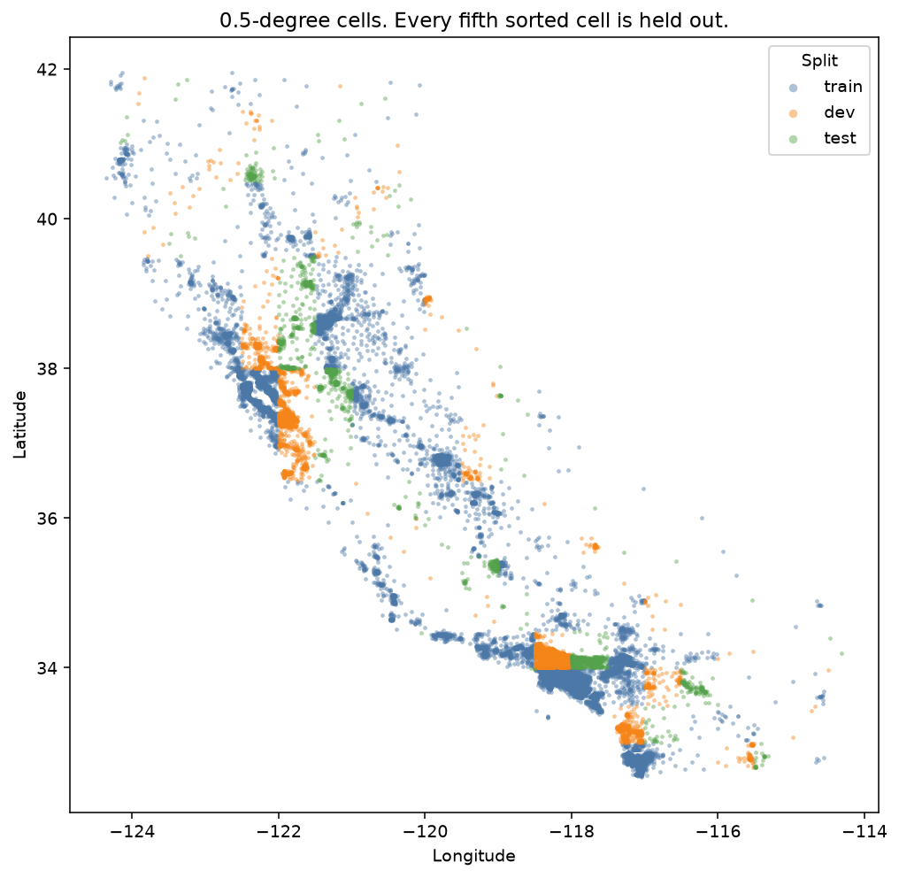
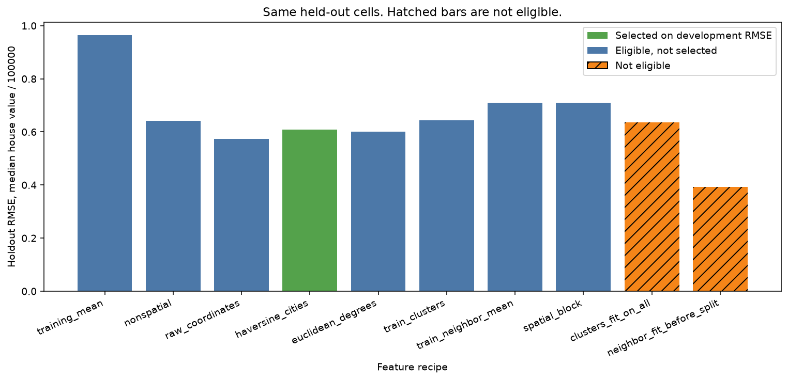
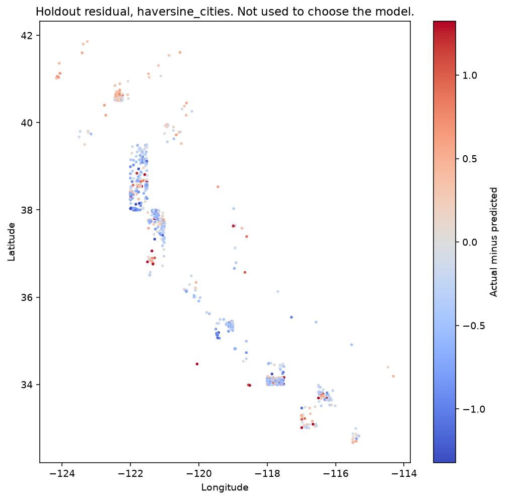
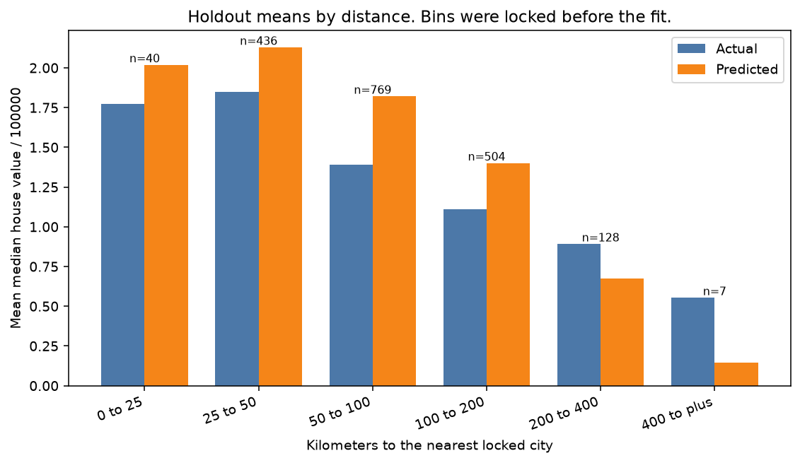

# Geospatial features for California block groups

A pricing desk has a block group and wants a median house value. Income and crowding are already on the row. Location is the extra claim: distance to a city, a cluster of coordinates, or the prices of nearby block groups. Those are not the same feature. A neighbor average that was built before the split has already seen the cells being scored.

The reported model is the eligible recipe with the lowest development RMSE. That rule was fixed before any holdout score. Leaky fits are scored on the same held-out cells and are not eligible. This is a teaching model on a 1990 census extract. It is not an appraisal.

The same file is used in `00-foundations/04-linear-logistic-from-scratch` to check a from-scratch line on a random row split. That is a different question. Do not carry those errors into this one.

## Problem

Someone quoting a block group wants a number before they have the census median. The non-spatial columns are the usual ones: income, age, rooms, bedrooms, population, and people per household. Location is the temptation. A warehouse, a store, or a comp set is "nearby," and nearby is easy to compute badly.

Three mistakes produce a number a stakeholder will like. The first puts the block group being scored into its own neighbor average. The second fits location clusters on the map, including the cells held out for the test. The third draws a random row holdout, then compares that error with a spatial holdout as if they were the same experiment. Random rows from the same cell are not a forecast of a new cell.

The cost is a model that looks accurate until the next neighborhood arrives. A cell the training file never entered does not have fifteen other sales at the same corner. A notebook that averaged those sales has answered a different question.

## Concepts taught

Haversine distance, Euclidean distance in degrees, distance to a frozen city list, k-means on coordinates, and a neighbor mean that excludes the row itself. Also a geographic cell split, a training-mean baseline, a non-spatial baseline, a cluster bootstrap, and two leaks: clusters fit on the whole map, and neighbor features built before the split.

## Theory in brief

The decision is one block group. A feature is legitimate if it would be known without that block group's target, and without the targets of other block groups in a cell you are claiming to hold out. Income on the same row passes. The target of a neighbor in the holdout cell fails.

Haversine distance uses a spherical Earth. Latitudes and longitudes are converted to radians. With radius `R` equal to `6371.0` km:

`a = sin²(Δlat / 2) + cos(lat1) cos(lat2) sin²(Δlon / 2)`

`distance = 2 R arctan2(sqrt(a), sqrt(1 - a))`

The same point has distance zero. The function is symmetric. One degree of latitude is on the order of 111 km. A degree of longitude is shorter as you move away from the equator, so a Euclidean distance in degrees is not a distance in kilometers. This project still fits that Euclidean version, because the comparison was locked before the scores. Both city recipes add the distance to each of the five locked cities and the minimum of those five.

The neighbor feature is the mean target of the `15` nearest other block groups, plus the haversine distance to the nearest of those fifteen. The search uses a ball tree on radian coordinates. On training rows, the row itself is excluded by index, not by distance. Two block groups can share a rounded coordinate. Excluding only the zero-distance rows would drop the wrong ones, or keep the row's own target. Holdout and development rows may use the training pool only. They do not search other holdout rows.

The leaky neighbor feature uses the full file as the pool and excludes only the row itself. A holdout row can then see another holdout target. A training row can see a holdout target. That is the leak, even when the classifier, here a ridge model, is fit on training labels only.

Clusters are k-means with `k = 8`, `n_init = 10`, and seed `42`, in raw latitude and longitude degrees. The honest fit places the centers on training coordinates, then assigns every row. The leaky fit places the centers on every coordinate, including the holdout. The assigned label becomes eight one-hot columns. Degree space treats a degree of longitude as equal to a degree of latitude. That distortion was accepted. It was not "fixed" after the scores.

The cell split does not use seed `42`. Latitude and longitude are floored into `0.5` degree cells. Unique cells are sorted by latitude, then longitude. Index modulo `5` equal to `4` is the holdout. The previous remainder, equal to `3`, is development. The rest is training. A cell cannot appear on two sides. A cell can still share an edge with a training cell. The nearest training block group can sit just across that edge. Blocking the cell is not blocking the neighborhood.

The model is ridge with `alpha` fixed at `1.0` and the solver fixed at `cholesky`. It was not tuned. A wider matrix is not on equal footing with a narrower one under that penalty. Missing numeric values would be filled with the training median. This file has none. The scaler is fit on the training rows. The holdout does not enter the imputer, the scaler, the honest cluster centers, or the honest neighbor pool.

RMSE is the square root of mean squared error. Lower is better. R² is `1 - MSE / mean((y - mean(y))²)` on the scored rows. The denominator uses the scored-set mean, not the training mean, so a constant training-mean forecast can have a negative R² when the holdout is a different price level.

Selection is the lowest development RMSE. Ties would go to fewer features, then to the name. Test scores are not an argument. The comparison uses a cluster bootstrap. The cluster is the holdout cell, because block groups in one cell are not independent draws. There are `35` such cells, `1000` resamples, seed `7`. The gap is reference RMSE minus candidate RMSE. Positive means the candidate has lower RMSE. An interval that contains zero is not a win. The pairs were named before the scores.

## Data

California housing, the StatLib houses extract redistributed by scikit-learn from figshare file `5976036`. The script downloads `https://ndownloader.figshare.com/files/5976036` and checks SHA-256 `aaa5c9a6afe2225cc2aed2723682ae403280c4a3695a2ddda4ffb5d8215ea681`, the checksum in scikit-learn's loader. The original StatLib path cited by that loader is `https://lib.stat.cmu.edu/datasets/houses.zip`. Raw files land in `data/`, which is gitignored.

Citation, as given in the scikit-learn loader: Pace, R. Kelley and Ronald Barry, Sparse Spatial Autoregressions, Statistics and Probability Letters, 33:291-297, 1997. DOI: https://doi.org/10.1016/S0167-7152(96)00140-X

The loader describes 20,640 observations from the 1990 US census, one row per block group. This run has `20640` rows, `8` features, and `0` missing feature values. scikit-learn does not attach a separate dataset license in the loader. The census source is a US government work. This README does not invent a license the loader does not state. The library that redistributes the file is BSD-3-Clause. That is a license for the code, not a claim that the census extract was written by the library authors.

The target is median house value divided by `100000`. The observed maximum is `5.00001`. `992` rows sit at or above `5.0` in the sense used by the audit, which counts `target >= 5`. The sensitivity later uses `target < 5`. Those `992` rows were not dropped. The cap is a property of the file, not a cleaning step chosen after the scores.

| Column | Meaning | Min | Max | Mean |
| --- | --- | --- | --- | --- |
| MedInc | median income in the block group | `0.4999` | `15.0001` | `3.8706710029069766` |
| HouseAge | median house age | `1.0` | `52.0` | `28.639486434108527` |
| AveRooms | average rooms per household | `0.8461538461538461` | `141.9090909090909` | `5.428999742190376` |
| AveBedrms | average bedrooms per household | `0.3333333333333333` | `34.06666666666667` | `1.096675149606208` |
| Population | block-group population | `3.0` | `35682.0` | `1425.4767441860465` |
| AveOccup | average people per household | `0.6923076923076923` | `1243.3333333333333` | `3.0706551594363742` |
| Latitude | block-group latitude | `32.54` | `41.95` | `35.63186143410852` |
| Longitude | block-group longitude | `-124.35` | `-114.31` | `-119.56970445736432` |

AveRooms and AveBedrms are total rooms and bedrooms divided by households. AveOccup is population divided by households. A block group with few households and many empty houses can post a huge rooms number. The maximum average rooms is `141.9090909090909`. Those rows stay. They were not screened after a score.

The five reference cities are frozen from the GeoNames `cities15000` dump read on 2026-10-27, before any fit. The rule was: feature class P, country US, admin1 CA, the five largest by the population in that dump. A later dump does not change this list. The dump readme licenses the extract CC BY 4.0: https://creativecommons.org/licenses/by/4.0/. The ranking is the population in that dump, not a 1990 population. Using it as a 1990 fact would be a mistake. Using it as a frozen, public list of city coordinates is the experiment that was locked.

| City | GeoName id | Latitude | Longitude | Population in the frozen dump |
| --- | --- | --- | --- | --- |
| Los Angeles | `5368361` | `34.05223` | `-118.24368` | `3820914` |
| San Diego | `5391811` | `32.71571` | `-117.16472` | `1404452` |
| San Jose | `5392171` | `37.33939` | `-121.89496` | `997368` |
| San Francisco | `5391959` | `37.77493` | `-122.41942` | `827526` |
| Fresno | `5350937` | `36.74773` | `-119.77237` | `542107` |

## Approach

There are `176` cells. Training has `106` cells and `13700` rows. Development has `35` cells and `5056` rows. The holdout has `35` cells and `1884` rows. Cell overlap is `0` on every pair of splits. The script checks those counts before any ridge fit. Seed `42` is not used for the cut.

`31` holdout cells share an edge with a training cell. `1879` of the `1884` holdout rows sit in such a cell. The nearest training block group, by the honest haversine search, is `0.8692532174615147` km away at the closest holdout row. The median is `10.86302933170466` km. The mean is `14.187662973118774` km. The 90th percentile is `33.39020512527212` km. The farthest is `60.119003299138775` km. Adjacent cells can still leak. The protocol says so, and the audit measures it. That measurement was not used to move a cell from one split to another.

The holdout is also a cheaper set of cells. The training target mean is `2.0439531751824815`. The development mean is `2.387260100870253`. The holdout mean is `1.3921948195329088`. A model selected on the richer development cells is not automatically a model of the cheaper holdout. The censored rows are uneven too: `669` in training, `317` in development, and `6` in the holdout, out of `992`.

Eligible, in this order: training mean, non-spatial columns, raw latitude and longitude, haversine to the five cities, Euclidean degrees to the same cities, training-only clusters, training-only neighbor mean, and the combined spatial block. Ineligible: clusters fit on all coordinates, and neighbor features built before the split. A random row holdout of `1884` rows, seed `42`, using the spatial-block recipe, is scored and is not eligible. It is not on the selection list and it is not on the holdout chart.

## Experiments

Every row below is scored on the same `1884` holdout rows. Development RMSE chose `haversine_cities`. There was no tie. The holdout was not used to replace it, including where a holdout number is better.

| Experiment | Eligible | Features | Dev RMSE | Holdout RMSE | MAE | R² |
| --- | --- | --- | --- | --- | --- | --- |
| training mean | yes | `0` | `1.1833743120720654` | `0.9652129570335812` | `0.8388695121034605` | `-0.8381007913666745` |
| non-spatial | yes | `6` | `0.8870658345485006` | `0.6426447788247575` | `0.5068712830393954` | `0.18517376707246958` |
| raw coordinates | yes | `8` | `0.8625235717906037` | `0.574128064144755` | `0.4315405389616199` | `0.3496598181858296` |
| haversine cities | yes | `12` | `0.8559907342651001` | `0.6079330366056027` | `0.490233294316185` | `0.27082037509820944` |
| Euclidean degrees | yes | `12` | `0.8564837689600097` | `0.6015413636895895` | `0.48388643073188475` | `0.2860726371579474` |
| training clusters | yes | `14` | `0.8689581110237132` | `0.6436078181788429` | `0.47910285597732366` | `0.18272981134214028` |
| training neighbor mean | yes | `8` | `1.0688391867964555` | `0.7088736339167692` | `0.5385832551783992` | `0.00857313659083958` |
| spatial block | yes | `22` | `1.05629607410349` | `0.7102093164549146` | `0.5424185661915107` | `0.004833459825451691` |
| clusters fit on all | no | `14` | `0.8728270646985484` | `0.6355684114268049` | `0.4797539351463601` | `0.20301959509055512` |
| neighbor fit before split | no | `8` | `0.5242987591662753` | `0.39365233020049006` | `0.252443266647348` | `0.6942625150616837` |

The training mean is the baseline. Its holdout R² is `-0.8381007913666745` because the forecast is the training mean, `2.0439531751824815`, and the holdout mean is `1.3921948195329088`. The non-spatial model is the serious baseline. It cuts holdout RMSE from `0.9652129570335812` to `0.6426447788247575`. A location feature has to beat that before it is interesting.

Development RMSE selected haversine cities, at `0.8559907342651001`, against `0.8625235717906037` for raw coordinates and `0.8564837689600097` for Euclidean degrees. On the holdout, raw coordinates score `0.574128064144755` and Euclidean degrees score `0.6015413636895895`. Both are lower than the reported `0.6079330366056027`. That is not a reason to switch. The holdout did not get a vote. The cell-cluster intervals for those two gaps include zero.

The neighbor mean is the eligible failure. Development RMSE is `1.0688391867964555`, worse than the non-spatial `0.8870658345485006`. Holdout RMSE is `0.7088736339167692`. A mean of fifteen training block groups does not travel into a cell the training file does not contain. The nearest training neighbor can be under a kilometer, and the feature still lost the development comparison. Stacking that feature into the spatial block makes development RMSE `1.05629607410349` with `22` columns under the same `alpha` of `1.0`. The wider matrix is the one the penalty treats more harshly, and this project did not separate the penalty from the bad neighbor column. The block was not selected. It should not be described as the full spatial model that won.

Training-only clusters score development RMSE `0.8689581110237132` and holdout RMSE `0.6436078181788429`. They do not beat the non-spatial model in any way this protocol treats as a win. Fitting the centers on the whole map scores holdout RMSE `0.6355684114268049`. That leak is small, and it is still a leak.

The pre-registered bootstrap gaps, reference RMSE minus candidate RMSE:

| Comparison | Gap | 2.5% | 97.5% | Excludes zero |
| --- | --- | --- | --- | --- |
| training mean minus reported | `0.3572799204279785` | `0.2402118659369264` | `0.5912444065659797` | yes |
| non-spatial minus reported | `0.03471174221915474` | `-0.02313809654462898` | `0.10538242363720655` | no |
| raw coordinates minus haversine | `-0.03380497246084768` | `-0.08081121203175537` | `0.07005925370162415` | no |
| Euclidean degrees minus haversine | `-0.006391672916013169` | `-0.02805772544874165` | `0.011447543335394543` | no |
| non-spatial minus neighbor mean | `-0.06622885509201171` | `-0.26966185817055444` | `0.26939867703107684` | no |
| non-spatial minus clusters | `-0.000963039354085482` | `-0.14149646831915327` | `0.13652264654782814` | no |
| haversine minus spatial block | `-0.10227627984931187` | `-0.29889735115466476` | `0.18438156638817677` | no |
| training clusters minus all-coordinate clusters | `0.00803940675203807` | `-0.0364251768704696` | `0.03515665213656744` | no |
| training neighbors minus before-split neighbors | `0.3152213037162791` | `0.07809950433073233` | `0.47624245404623766` | yes |

The reported model beats the training mean, and that interval excludes zero. It does not clearly beat the non-spatial model on the holdout. The point gap is `0.03471174221915474`, and the interval includes zero. City distances won the development file. They did not earn a holdout claim against income and crowding.

Haversine does not clearly beat raw coordinates or Euclidean degrees on the holdout. Both point gaps are negative, which means haversine has the higher RMSE, and both intervals include zero. At the scale of this state, the sphere correction did not separate itself from degrees. The development file preferred haversine by a very small margin. That is why it is the reported recipe. It is not a reason to tell a stakeholder that kilometers beat a latitude column.

The neighbor and cluster gaps against the non-spatial model include zero on the holdout. The development file is the place the neighbor feature failed cleanly. The holdout interval is wide because there are `35` cells, not `1884` independent rows. Do not read a wide interval as proof that the feature is harmless. Read it as a comparison this sample cannot separate.

The cluster leak does not earn a win. The gap is `0.00803940675203807`, and the interval includes zero. A leak that fails to inflate the score is still a leak. The centers still saw the holdout coordinates.

The neighbor leak does earn a fake win. The before-split mean scores `0.39365233020049006`. The honest mean scores `0.7088736339167692`. The gap is `0.3152213037162791`, and the interval excludes zero. Development RMSE for the leak is `0.5242987591662753`. That number was not allowed to select the model. It is the picture of a comp set that includes the sales you are pretending to forecast.

The random-row comparison uses the spatial-block recipe, seed `42`, and `1884` rows. Its RMSE is `0.4567734647829089`. `1883` of those `1884` rows share a cell with the fit set. That is not a better spatial model. It is almost the leak, drawn by chance. It is not plotted next to the spatial holdout. The spatial block on the spatial holdout scores `0.7102093164549146`. Quoting the random number beside it would hide the cell overlap.

After selection, the reported model was scored again on holdout rows with target below the cap. `6` rows were excluded. `1878` remained. RMSE moved from `0.6079330366056027` to `0.5956327547939062`. MAE moved to `0.4857451559414558`. R² moved to `0.2398928892648179`. This pass does not reselect. The cap is mostly a development and training problem: `317` and `669` rows, against `6` in the holdout. Dropping the cap before selection would have been a different protocol.

Distance to the nearest locked city, on the holdout, using bins that were named before the fit:

| Kilometers | Rows | Actual mean | Predicted mean |
| --- | --- | --- | --- |
| `0.0` to `25.0` | `40` | `1.7734499999999997` | `2.0183585330260505` |
| `25.0` to `50.0` | `436` | `1.8474886009174312` | `2.1284302957501056` |
| `50.0` to `100.0` | `769` | `1.3913901170351106` | `1.8204719216122505` |
| `100.0` to `200.0` | `504` | `1.1081984325396825` | `1.400468118579035` |
| `200.0` to `400.0` | `128` | `0.8911640625` | `0.6752114643816318` |
| `400.0` and beyond | `7` | `0.5531428571428572` | `0.14575773002624956` |

The actual means fall as the locked cities get farther away, with a small step up from the first bin to the second. The reported model follows that direction and misses the level. It is high inside `200.0` km and low beyond it. The last bin has `7` rows. It is not a region to hang a conclusion on. The bins were not used to add or drop a city.

## Plots

The holdout cells are scattered through the state. The rule was every fifth sorted cell, not a cut that removes one metro. Green points still sit next to blue points. That is the edge leakage the audit counts.



Holdout RMSE for the locked list. Lower is better. The green bar was selected on development RMSE. It is not the shortest eligible bar. The hatched bars are not eligible. The shortest bar is the neighbor mean built before the split. The random-row RMSE is not on this chart.



Holdout residual of the reported model, actual minus predicted. Blue is overprediction. The errors clump. They are not a salt-and-pepper residual around zero. This map was not an input to selection. The color scale is clipped so a few large errors do not wash out the rest.



Holdout means by distance to the nearest locked city. The bins were locked before the fit. The model is high on the nearer bins and low on the farther ones. Counts are in the table above.



## Key takeaways

Development RMSE selected haversine distances to five frozen cities. On the held-out cells that choice has RMSE `0.6079330366056027`, against `0.9652129570335812` for the training mean and `0.6426447788247575` for a model with no location. The holdout gap against the non-spatial model includes zero. Raw coordinates scored `0.574128064144755` on the same cells and were not swapped in.

The eligible neighbor mean failed. Development RMSE was `1.0688391867964555`. The same mean, built before the split, scored `0.39365233020049006` and was not eligible. That interval excluded zero. A random split of the same size scored `0.4567734647829089` because `1883` of `1884` rows still shared a cell with the fit set.

`31` of `35` holdout cells share an edge with a training cell. Blocking the cell is not blocking the neighborhood. The holdout mean is `1.3921948195329088` against a training mean of `2.0439531751824815`, so a constant forecast looks worse here than it would on a random slice of the same file.

## Common mistakes

- Building the neighbor mean on the full file, then fitting the model on training labels only. The before-split score is `0.39365233020049006`. The honest score is `0.7088736339167692`. The labels of the scored cells had entered the feature.
- Treating a leak that failed to move the score as proof that leakage does not matter. All-coordinate clusters scored `0.6355684114268049` against `0.6436078181788429`. The interval included zero. The centers had still seen the holdout map.
- Selecting on the holdout because raw coordinates scored `0.574128064144755` and the reported model scored `0.6079330366056027`. Development RMSE had already chosen. The interval included zero. Switching would spend the test set.
- Comparing a random-row RMSE of `0.4567734647829089` with the spatial-block holdout of `0.7102093164549146`. `1883` of the random rows share a cell with the fit set. The lower number is the overlap, not a better recipe.
- Calling a Euclidean degree distance a kilometer. Both city recipes were fit. The holdout gap included zero. That is a result about this map, not a license to skip the unit.
- Fitting k-means on latitude and longitude and reading the clusters as markets. The metric is degrees, `k` was locked at `8`, and the honest clusters did not beat the non-spatial model.
- Forgetting to exclude the row itself from its neighbor mean. A zero distance is not enough when several block groups share a rounded coordinate. The exclusion is by index.
- Dropping the `992` capped targets after seeing a score. The holdout contains `6` of them. The sensitivity does not reselect.
- Reading a latitude weight, or a city distance, as the effect of moving a house. These are 1990 cross-section associations. The city list is a later GeoNames ranking.
- Quoting this RMSE next to the random-split error in `00-foundations/04-linear-logistic-from-scratch`. Same file, different split, different question.

## Interview questions

**Why is a random row split the wrong test for a location feature?**
Rows in the same cell share a market. A random holdout of `1884` rows left `1883` of them in a cell the model was also fit on. The spatial-block RMSE on that draw was `0.4567734647829089`. The same recipe on held-out cells scored `0.7102093164549146`. The random number answers "how well do I predict a held-out row when its neighbors stayed in training?" The cell split answers "how well do I predict a cell I did not train on?"

**The cells do not overlap. Where is the remaining leak?**
`31` of `35` holdout cells share an edge with a training cell, and `1879` holdout rows sit in those cells. The closest training neighbor is `0.8692532174615147` km away. A feature that uses that neighbor is allowed in the honest recipe, and it must be described as interpolation from the next cell, not as a pure blocked-cell experiment. A feature that uses a holdout target is not allowed.

**Why did the honest neighbor mean lose and the leaky one win?**
The honest mean can only see training targets. Development RMSE was `1.0688391867964555`, worse than the non-spatial `0.8870658345485006`. The leaky mean can see other rows in the cell being scored. Holdout RMSE fell to `0.39365233020049006`. The gap was `0.3152213037162791`, and the interval excluded zero. The win is the answer sitting in the feature.

**Haversine won development RMSE. Did kilometers beat raw coordinates?**
Not on the holdout. Raw coordinates scored `0.574128064144755`. Haversine scored `0.6079330366056027`. The interval included zero, and the point gap was negative. Euclidean degrees were in between, at `0.6015413636895895`, and that interval also included zero. The reported model stays the development choice. A stakeholder who wants the holdout winner is asking to spend the test set.

**Why is the training-mean R² so negative?**
R² uses the holdout mean in the denominator. The training mean is `2.0439531751824815`. The holdout mean is `1.3921948195329088`. A constant forecast of the training mean is far from this cheaper slice, so R² is `-0.8381007913666745`. RMSE against that constant is still the right baseline. The negative R² is the shift, not a broken metric.

**Why not tune alpha, or drop the neighbor column, after the spatial block lost?**
`alpha` was locked at `1.0`. The spatial block has `22` columns against `12` for the reported model. Retuning the penalty, or deleting the neighbor column because development RMSE was `1.05629607410349`, would be a new experiment. The protocol named the block before the score and kept the loss.

**What do you tell someone who quotes the leaky neighbor score?**
It is `0.39365233020049006`, and it is not a holdout. The honest version of the same feature is `0.7088736339167692`. The interval excludes zero. If the rows about to be scored helped build the average, the number is a description of the cell, not a forecast of a new one.

**The city list is newer than the census. Does that invalidate the feature?**
It invalidates a claim that these were the five largest California cities in 1990. It does not invalidate a locked coordinate list. The populations in the frozen dump run from `542107` to `3820914`. They were not used as weights. They were the rule that chose the five points, and that rule was not rerun after the fit.

## How this shows up at work

A pricing or logistics lead will ask for the error on a random sample of past orders. Bring the cell overlap with that number. Here a random draw of `1884` rows left `1883` in a cell the model had already fit, and the RMSE was `0.4567734647829089`. The spatial holdout of the reported model was `0.6079330366056027`. Those are not two estimates of the same thing. The random number is what you get when the next order is next door to an order you trained on. The cell number is closer to a new tile of the map.

Someone will add "average of the fifteen nearest sales" because comps are how appraisers talk. Ask whether the subject sale is in the fifteen, and whether the sales being scored are in the pool. The before-split version scored `0.39365233020049006`. The training-only version lost to a model with no location. A comp set that includes the label is not a feature. A comp set from the next cell is a feature, and it may still not help.

The same conversation shows up as a store-radius feature or a distance-to-warehouse column. Freeze the reference points before the fit. This list was frozen from a GeoNames dump, and it is not a 1990 population ranking. If the business wants today's warehouses, say that the coordinates are today's coordinates. Do not let a later dump silently change the five points and then compare the errors.

A stakeholder will also ask why the model is high on the cheap holdout. The training mean is `2.0439531751824815` and the holdout mean is `1.3921948195329088`. The distance profile is high inside `200.0` km and low beyond it. That is a level shift, not a reason to add the holdout into the city list. Recalibrating on the holdout would spend the test. Say what the next tile will need: a check that its price level still looks like the training cells.

Do not ship this as an appraisal. The target is a 1990 block-group median, censored at `5.00001`, and `992` rows sit on that cap. The model is a ridge line with a fixed penalty. It is a demonstration of which location feature survived a cell split.

## Run it

From this directory, with the root dependencies installed:

```bash
python main.py
pytest tests/test_smoke.py
```

`requirements.txt` includes the root pins. It does not add a package. `make run` calls `python main.py` if you have GNU make. The script downloads the pinned housing archive if the hash does not match, fits the locked recipes, and writes `results/metrics.json` plus the four plots. It does not download GeoNames. The city list is in the script. The smoke test does not download and does not fit. It runs on a laptop CPU.

## Further reading

- Pace and Barry, as cited by the scikit-learn loader: Sparse Spatial Autoregressions, Statistics and Probability Letters, 33:291-297, 1997. DOI: https://doi.org/10.1016/S0167-7152(96)00140-X
- scikit-learn California housing loader: https://scikit-learn.org/stable/modules/generated/sklearn.datasets.fetch_california_housing.html
- scikit-learn user guide for the same file: https://scikit-learn.org/stable/datasets/real_world.html#california-housing-dataset
- Figshare file used by that loader: https://ndownloader.figshare.com/files/5976036
- StatLib houses path cited by the loader: https://lib.stat.cmu.edu/datasets/houses.zip
- GeoNames dump readme, including the CC BY 4.0 grant: https://download.geonames.org/export/dump/readme.txt
- Creative Commons Attribution 4.0: https://creativecommons.org/licenses/by/4.0/
- scikit-learn pairwise haversine metric: https://scikit-learn.org/stable/modules/generated/sklearn.metrics.pairwise.haversine_distances.html
- Tobler, "A Computer Movie Simulating Urban Growth in the Detroit Region," Economic Geography, 1970. The first-law statement is the reason a cell split is not a cure for spatial dependence. It is not a source for the numbers above.
