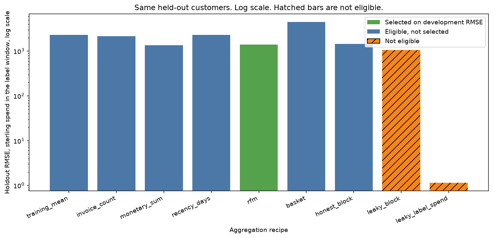
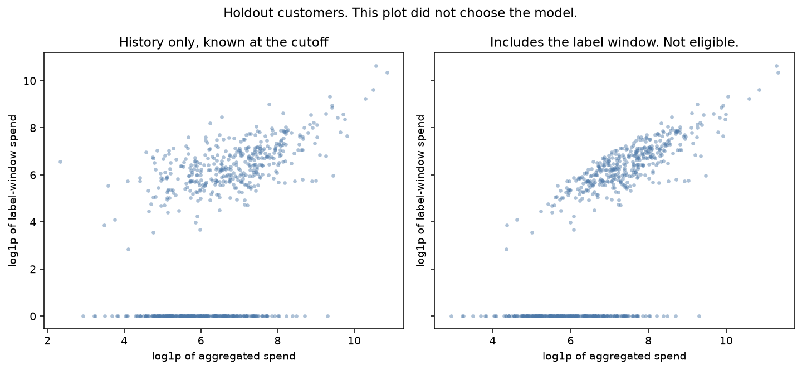
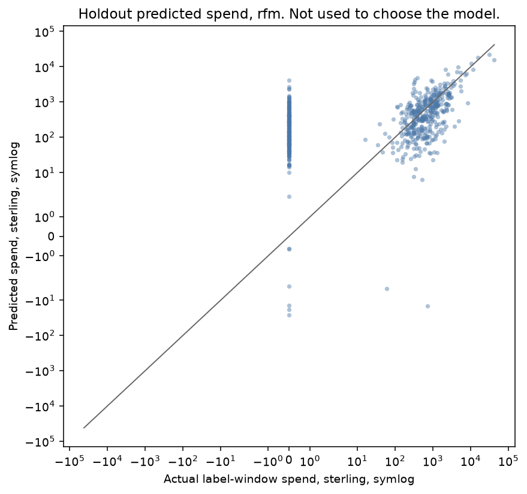

# Aggregation features for a gift retailer's next window of spend

A wholesale account manager has a customer who already buys, and wants a spend number for the next window. The invoice log has many lines per customer. The decision is one customer, at one cutoff. A sum of those lines is a feature only if every line had already happened. A sum that includes the window being forecast is the answer, written into a column.

The reported model is the eligible recipe with the lowest development RMSE. That rule was fixed before any holdout score. Two leaks are scored on the same held-out customers and are not eligible. This is a teaching model on a UK gift retailer's invoice lines. It is not a credit score and it is not a pricing tool.

`01-data-and-eda/04-sql-for-ml` asks whether a date filter was present in a repeat-purchase query. That project uses UCI Online Retail, dataset 352, and a classification loss. This project uses the earlier sheet of Online Retail II, dataset `502`, and a spend regression. Do not carry that log loss into this RMSE.

## Problem

The company sells all-occasion gifts, and the UCI description says many customers are wholesalers. An account team wants to know, on a cutoff morning, how much each known customer will spend in the following window. Inventory and a call list both depend on that number. The log they have is line after line: an invoice, a product, a quantity, a price, a timestamp.

The easy table is one row per customer, with columns that summarize the log. The easy mistake is to summarize the whole file, including the invoices that define the label. That table cannot be built on the cutoff morning. It will still produce a flattering error in a notebook that already has the later invoices.

A second mistake is to summarize the right window and then pick the wrong summary. A mean line value is not a total. A count of distinct products is not a total. The target is a total. Those columns can fit the customers used to estimate the weights and miss the next set.

## Concepts taught

Collapsing invoice lines to one row per customer. A purchase rule. A cutoff taken from the timestamp range, not from a score. Sum, count, recency, and mean as different aggregations. A customer split at one as-of date. A training-mean baseline. A basket recipe that loses. Two ineligible features: the same aggregations computed through the end of the sheet, and the label itself. A customer bootstrap of the holdout RMSE gap.

## Theory in brief

The decision is one customer at the cutoff. A feature is legitimate if it uses only purchase lines timestamped before that cutoff. The label is the spend at or after the cutoff. A customer with no purchase before the cutoff is not in the scored set. Their later invoices are not a history.

A purchase line has a parsed customer id, quantity greater than zero, price greater than zero, and an invoice that does not start with C. Line amount is quantity times price. Cancellations and other nonpositive rows stay out of both the features and the label. They are counted in the audit. They are not a second experiment.

The cutoff rule does not look at a model score. Take the latest timestamp in the sheet, floor it to midnight, and subtract `90` days. This run's sheet ends at `2010-12-09T20:01:00`, so the cutoff is `2010-09-10T00:00:00`. History is strictly before that instant. The label window is that instant through the sheet end. The rule uses the file's time range. A production job would use "this morning" and would not know the next window.

For one customer, the honest monetary sum is the sum of line amounts before the cutoff. The label is the sum of line amounts at or after the cutoff, or zero if there are none. Invoice count is the number of distinct invoices in the history. Recency is the number of days from the last history purchase to the cutoff. The basket columns are the number of distinct stock codes, the mean line amount, and the mean quantity, all on history lines only.

The leaky block computes those same six functions on every purchase line in the sheet. Its recency anchor is the sheet end, not the cutoff. That is a query with no date filter, scored as of the end of the file. The leaky label feature is the label column. The median imputer and the scaler for that feature are still fit on training customers only. The leak is the column, not the scaler.

No purchase invoice has lines on both sides of the cutoff. The count is `0`. Under the purchase rule, the leaky monetary sum minus the honest monetary sum minus the label has maximum absolute difference `7.275957614183426e-12`. That is floating-point residue, not a second definition. `1946` customers have a larger leaky sum than an honest sum, and `1946` eligible customers have a positive label. The future spend is inside the leaky sum.

The estimator is ridge with `alpha` fixed at `1.0` and the solver fixed at cholesky. It was not tuned. The objective is squared error plus that penalty on the coefficients. A six-column recipe is not on equal footing with a one-column recipe under a fixed penalty. A loss by the wider recipe is not a reason to retune after the score. The imputer and the scaler are fit on training customers only. The target is sterling spend, including zeros. It is not logged. The protocol field is `none`.

RMSE is the square root of mean squared error. Lower is better. R² is one minus the residual sum of squares divided by the sum of squares around the scored-set mean. The denominator is not the training mean, so a constant training-mean forecast can have a negative R² when the holdout mean differs. Selection is the lowest development RMSE. A tie would go to fewer features, then to the name. Test scores are not an argument. The failed eligible recipe is the highest development RMSE among eligible recipes that were not selected.

The holdout comparison resamples customers, not invoice lines. There are `1000` resamples and the seed is `7`. The gap is the other recipe's test RMSE minus the reported recipe's test RMSE. Positive means the other recipe is worse. The interval is the percentile interval stored with each comparison. An interval that contains zero is not a separation. The pairs are the locked list against the reported recipe. They were not chosen after looking for a flattering pair.

## Data

Online Retail II, UCI Machine Learning Repository, dataset `502`. The script downloads `https://archive.ics.uci.edu/static/public/502/online+retail+ii.zip` and checks SHA-256 `572e36277c2390fbfde10664750731e0a86f55e33470d91919085f0408e67bfb`. The workbook inside that zip has SHA-256 `bcbe73b35f5b7babf197fb0cb983a11f5d9ff929078d4aa53d171b1f2df2e980`. Raw files land in `data/`, which is gitignored.

Citation, as given by the repository: Chen, D. (2012). Online Retail II [Dataset]. UCI Machine Learning Repository. DOI: https://doi.org/10.24432/C5CG6D. License: Creative Commons Attribution 4.0 International, https://creativecommons.org/licenses/by/4.0/. The repository page is https://archive.ics.uci.edu/dataset/502/online+retail+ii.

The workbook has two sheets. This project reads `Year 2009-2010` only. It does not read `Year 2010-2011`. That second sheet is the year used by the SQL project. Opening it would turn this run into a second pass over a related extract. The sheet that was read has `525461` rows and eight columns. The price column in this file is named Price. The UCI variable note says UnitPrice. The script uses the header that is in the sheet.

| Check | Count |
| --- | --- |
| Rows | `525461` |
| Blank customer id | `107927` |
| Customer values that were not blank and did not parse | `0` |
| Invoice starts with C | `10206` |
| Negative quantity | `12326` |
| Zero quantity | `0` |
| Nonpositive price | `3690` |
| Negative price | `3` |
| Cancellation prefix and positive quantity | `1` |
| Negative quantity without a cancellation prefix | `2121` |
| Purchase rows | `407664` |
| Purchase invoices | `19213` |
| Purchase customers | `4312` |
| Countries | `40` |
| United Kingdom rows | `485852` |
| Blank description | `2928` |

The United Kingdom share of rows is `0.9246204761152588`. That is a share of lines, not a share of customers. Description and country are not model features. `2928` blank descriptions stay in the file and out of the recipe.

History purchase rows, before the cutoff, are `256540`. Label-window purchase rows are `151124`. Eligible customers, those with at least one purchase line before the cutoff, are `3373`. Customers who appear only in the label window are `939`. They are not scored. Eligible customers with a positive label are `1946`.

The customer split sorts ids as integers, then uses seed `42`, a test size of `0.2`, and `0.25` of the remainder as development. The counts are `2023` training, `675` development, and `675` holdout. It is not stratified. It is not a second time split. Every scored customer is being asked the same as-of question.

The training label mean is `746.8483400889768`. The development label mean is `792.6958666666666`. The holdout label mean is `732.3028014814815`. The training label percentile stored in the audit is `8090.253999999989`. `6` holdout customers sit above it. Those six account for `0.6541166813713768` of the reported model's holdout squared error. They were not dropped after that share was computed. The share was not a selection input.

## Approach

The baseline predicts the training label mean for every customer. It uses no aggregation. The eligible aggregations were named before the fit:

- invoice count only
- monetary sum only
- recency only
- recency, invoice count, and monetary sum
- distinct products, mean line amount, and mean quantity
- all six honest columns

The two ineligible recipes were also named before the fit. One rebuilds the six columns through the end of the sheet. One uses the label as the only feature. Neither can be computed on the cutoff morning.

Each recipe is a ridge model with the same penalty. The development customers choose the eligible recipe. The holdout customers are scored after that choice. A lower holdout RMSE is not a reason to replace the reported recipe. A bootstrap interval that includes zero is not a reason either. The failed eligible recipe is the worst development RMSE among the eligible recipes that were not selected.

## Experiments

Development RMSE selected `rfm`. Its development RMSE is `2220.8343863601813`. Its holdout RMSE is `1392.581556339998`. The training-mean holdout RMSE is `2326.8056756196756`. The gap, training mean minus reported, is `934.2241192796776`. The interval is `242.47879234894026` to `1505.7168290119362`. It excludes zero.

`basket` is the failed eligible recipe. Its development RMSE is `4145.939180770899`, worse than the training mean's development RMSE of `3644.216826376693`. On the training customers the basket RMSE is `2527.4697264754427`, which beats the training mean's `2970.8625674243804`. The averages fit the estimation customers and missed the development customers. Development R² is `-0.2945122985409563`. Holdout RMSE is `4495.200039678976` and holdout R² is `-2.7324567916112494`. The holdout gap against the reported recipe is `3102.618483338978`. The interval is `631.913366306379` to `5875.020820272639`. It excludes zero. The basket is worse, not a near miss.

`monetary_sum` lost the development comparison, `2314.237709867898` against `2220.8343863601813`, and then posted a lower holdout RMSE, `1365.7283437256767`. The holdout gap is `-26.853212614321365`. The interval is `-83.76626922277254` to `42.72843679335396`. It includes zero. The recipe was not switched. Holdout R² for monetary sum is `0.6554713135641697`. Holdout R² for the reported recipe is `0.6417897399456682`. The prettier holdout number is in the table. It is not the selection.

`honest_block` has a training RMSE of `1379.1597933832686`, a bit lower than the reported recipe's training RMSE of `1397.51686203652`. Its development RMSE is `2305.1872637775823`, which lost. Holdout RMSE is `1450.9963990501678`. The gap is `58.41484271016975`. The interval is `-22.80954026516105` to `257.78571013437`. It includes zero. Adding the basket columns to the three RFM columns did not win under the fixed penalty.

`leaky_label_spend` has holdout RMSE `1.1496075472434353` and holdout R² `0.9999997558841628`. The gap is `-1391.4319487927546`. The interval is `-2069.731587309567` to `-819.2999612456555`. It excludes zero. Training RMSE for that feature is `1.4678174740246548`. The penalty keeps the error off exact zero. The column is still the label. It was not selected.

`leaky_block` has holdout RMSE `1055.67005539234`. The point gap is `-336.91150094765817`. The interval is `-658.958897182996` to `81.95516545097787`. It includes zero. The point estimate looks better, and the customer bootstrap does not separate it from the reported recipe. It would have been ineligible even if the interval had excluded zero. The future invoices were not known at the cutoff. A leak that fails a noise check is still a leak.

| Recipe | Eligible | Features | Development RMSE | Holdout RMSE | Holdout MAE | Holdout R² |
| --- | --- | --- | --- | --- | --- | --- |
| training_mean | yes | `0` | `3644.216826376693` | `2326.8056756196756` | `833.4720911539519` | `-3.908016222209376e-05` |
| invoice_count | yes | `1` | `2849.8692887508214` | `2145.124190121032` | `792.7675560195933` | `0.15003386272245978` |
| monetary_sum | yes | `1` | `2314.237709867898` | `1365.7283437256767` | `523.5476298296663` | `0.6554713135641697` |
| recency_days | yes | `1` | `3613.009377263986` | `2293.133606808985` | `826.8152751009025` | `0.02869536469901779` |
| rfm | yes | `3` | `2220.8343863601813` | `1392.581556339998` | `542.9107179533374` | `0.6417897399456682` |
| basket | yes | `3` | `4145.939180770899` | `4495.200039678976` | `1029.1651208916662` | `-2.7324567916112494` |
| honest_block | yes | `6` | `2305.1872637775823` | `1450.9963990501678` | `554.7399757003847` | `0.611107639074806` |
| leaky_block | no | `6` | `1751.176095952662` | `1055.67005539234` | `385.59534462398045` | `0.7941489206393045` |
| leaky_label_spend | no | `1` | `1.8005023845748664` | `1.1496075472434353` | `0.41179451143993345` | `0.9999997558841628` |

Holdout gaps against the reported recipe. Positive means the other recipe has higher RMSE.

| Other recipe | Gap | Interval low | Interval high | Excludes zero |
| --- | --- | --- | --- | --- |
| training_mean | `934.2241192796776` | `242.47879234894026` | `1505.7168290119362` | yes |
| invoice_count | `752.5426337810338` | `390.541897898287` | `1075.0244563283372` | yes |
| monetary_sum | `-26.853212614321365` | `-83.76626922277254` | `42.72843679335396` | no |
| recency_days | `900.5520504689869` | `181.78386628397246` | `1454.554086033343` | yes |
| basket | `3102.618483338978` | `631.913366306379` | `5875.020820272639` | yes |
| honest_block | `58.41484271016975` | `-22.80954026516105` | `257.78571013437` | no |
| leaky_block | `-336.91150094765817` | `-658.958897182996` | `81.95516545097787` | no |
| leaky_label_spend | `-1391.4319487927546` | `-2069.731587309567` | `-819.2999612456555` | yes |

Invoice count and recency each lose to the reported recipe on the holdout, and those intervals exclude zero. Their holdout RMSEs are `2145.124190121032` and `2293.133606808985`. A count of orders, or a days-since-last-order number, is not a substitute for the sum of money when the target is a sum of money.

MAE was stored and was not the selection metric. The reported recipe's holdout MAE is `542.9107179533374`. The training mean's holdout MAE is `833.4720911539519`. The selection remains development RMSE.

`8` holdout predictions from the reported recipe are negative. Spend cannot be negative. Those predictions were not clipped. Clipping was not in the locked list, so a clipped score is not this result.

## Plots



The vertical axis is a log scale so the label leak is visible next to the basket failure. The green bar is the development-set choice. It is not the shortest holdout bar. The monetary-sum bar is slightly shorter, and that recipe was not selected. Hatched bars were not eligible.



Both panels are holdout customers. The left panel uses history only. The right panel uses the sum through the sheet end. Zeros in the label window sit on the bottom of each panel. The right panel is tighter for customers who did spend, and it is not a perfect line: the leaky sum still contains the history. The identity check is the maximum absolute difference in the audit, not a visual guess. This plot did not choose the model.



Axes are symlog so a few large accounts do not hide the rest. Customers with no label-window spend form the column at zero. Some predictions on that column are negative. The diagonal is identity, not a fitted curve. This plot did not choose the model.

## Key takeaways

Development RMSE selected recency, invoice count, and past spend. Holdout RMSE is `1392.581556339998`, against a training-mean RMSE of `2326.8056756196756`. The interval excludes zero.

The basket of averages beat the training mean on the estimation customers and lost on the development customers. An average line value is not the total the target asks for.

Past spend alone had a lower holdout RMSE than the reported recipe. The interval included zero. The development rule stood.

Putting the label in the feature column produced a holdout RMSE of `1.1496075472434353`. That query could not have been run at the cutoff. A sum through the end of the file contains that same label, up to `7.275957614183426e-12`, and its interval still included zero. Ineligible either way.

## Common mistakes

Building the customer table on the whole extract, then splitting customers. The label window is already in the columns. The split of customers does not remove it.

Calling a same-window sum "previous spend." Previous means before the cutoff. `1946` customers gained spend when the date filter was removed, and the leaky sum contains that spend.

Switching to `monetary_sum` because its holdout RMSE is `1365.7283437256767`. That number was not the selection. The interval against the reported recipe includes zero.

Treating mean line value and mean quantity as a richer version of total spend. They lost to the training mean on the development customers after beating it on the training customers.

Reading the leaky block's lower point estimate as a ship decision. The interval includes zero, and the recipe was ineligible before that check.

Dropping the `6` holdout customers who sit above `8090.253999999989` because they hold `0.6541166813713768` of the squared error. They are in the file. The share was computed after the fit. It did not change the recipe.

Comparing this RMSE with the log loss in `01-data-and-eda/04-sql-for-ml`. Different extract, different target, different metric.

## Interview questions

1. Why is one row per customer not the same as one row per invoice? The decision is the customer's spend in a future window. An invoice line is an input to that row. Scoring lines as if they were independent customers answers a different question.

2. Why is a holdout RMSE of `1.1496075472434353` not a reason to ship? The feature is the label. The interval against the reported recipe excludes zero, and the recipe was still ineligible. The column could not have been filled on the cutoff morning.

3. Why keep `rfm` when `monetary_sum` has holdout RMSE `1365.7283437256767`? Selection was development RMSE. Monetary sum lost that comparison, `2314.237709867898` against `2220.8343863601813`. The holdout gap includes zero. Replacing the recipe after seeing the holdout would make the holdout part of the search.

4. Why did the basket fail if its training RMSE beat the training mean? Training RMSE `2527.4697264754427` against `2970.8625674243804` only says the averages fit the estimation customers. Development RMSE `4145.939180770899` is worse than the training mean's `3644.216826376693`. The target is a total. Those columns are not a total.

5. Why can a leaky sum that contains the label still have an interval that includes zero? The label is added to a large history sum, then scaled with five other columns, under a fixed penalty. The point estimate is better. With `675` holdout customers and a heavy tail, the customer bootstrap does not separate that gap from zero. The recipe is ineligible because of the window, not because of the interval.

6. What does the maximum absolute difference `7.275957614183426e-12` show? With `0` spanning invoices and the same purchase rule on both sides, the leaky monetary sum is the honest sum plus the label, up to floating-point residue. The leak is an identity, not a metaphor.

7. Why is the customer bootstrap not a fix for the wholesaler tail? `6` holdout customers above `8090.253999999989` account for `0.6541166813713768` of the reported squared error. Resampling customers keeps those accounts in some samples and drops them from others. The intervals get wide. It does not make RMSE a typical-customer metric.

8. How is this different from the SQL project? That project is a repeat-purchase query on UCI 352, scored with log loss. This project is a spend regression on sheet `Year 2009-2010` of dataset `502`. The second sheet was not read. A good date filter there is not a result here.

9. What would a feature store have to enforce? The aggregation query needs an as-of timestamp equal to the cutoff. A nightly job that sums the table as it sits on disk will include invoices from the label window as soon as those invoices land. The honest columns are the ones that could have been written on `2010-09-10T00:00:00`.

## How this shows up at work

A feature platform will have a "customer spend" column. The first question is the as-of time, not the model. If the column is the sum of whatever is in the warehouse table, a backtest that joins it to next-quarter spend will look like the hatched bar at the right of the RMSE chart. The offline number will not survive the next cutoff, because the future invoices will not be in the table yet.

The account team will ask for the customers who will spend a lot. RMSE is dominated by `6` holdout customers. A rank of large accounts and a squared error on all eligible customers are different products. Say which one was requested. This ridge line also emits negative spend: `8` holdout predictions are below zero. A call list that shows a negative forecast is a product bug, and clipping it after the fact is a new experiment.

Finance will ask for net revenue. This recipe drops `2121` negative-quantity rows that are not cancellation prefixes, and `1` cancellation-prefix row with a positive quantity. Returns are not netted. That was locked before the fit. A net-revenue feature is a different project, not a footnote on this RMSE.

Do not ship the line as a credit limit. The UCI description says many customers are wholesalers. The target is gift-invoice spend in one window of a public extract. The penalty was not tuned. The holdout was not used to choose the recipe.

## Run it

From this folder, with the shared environment and the extra reader:

```bash
python -m pip install -r requirements.txt
python main.py
pytest tests/test_smoke.py
```

`python main.py` downloads the zip if it is missing, checks the hash, reads one sheet, and writes `results/metrics.json` plus the three plots. The smoke test does not download the file and does not fit the ridge model. It checks the locked recipe list, the cutoff rule, the purchase rule, and that a future line stays out of the honest sum.

## Further reading

- Chen, D. (2012). Online Retail II [Dataset]. UCI Machine Learning Repository. https://doi.org/10.24432/C5CG6D and https://archive.ics.uci.edu/dataset/502/online+retail+ii
- Creative Commons Attribution 4.0 International: https://creativecommons.org/licenses/by/4.0/
- scikit-learn, Ridge: https://scikit-learn.org/stable/modules/generated/sklearn.linear_model.Ridge.html
- scikit-learn user guide, Data leakage: https://scikit-learn.org/stable/common_pitfalls.html
- pandas groupby user guide: https://pandas.pydata.org/docs/user_guide/groupby.html
